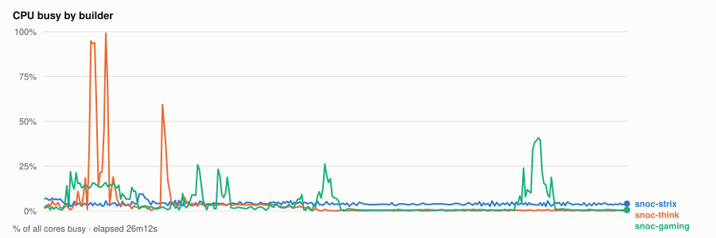
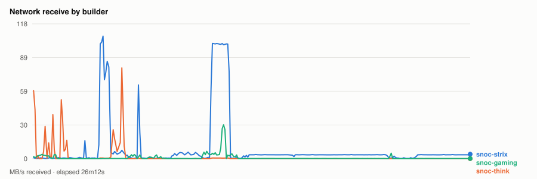
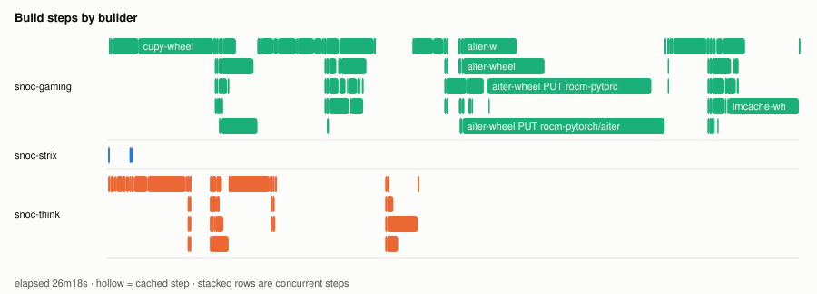
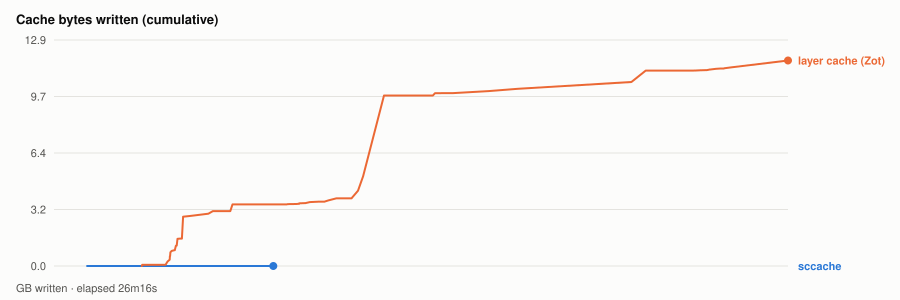

# Cold parallel wheel build — 20261029T230457Z

- **arch** `gfx1201` · **commit** `15e12d7` (dirty)
- **wall clock** 26m16s · **exit** 0
- **sample interval** 5s · **sccache prefix** ``

> Throughput, not isolated per-target cost: the builds ran concurrently and shared the sccache store and registry, both on Strix, which is also a build node. For clean per-wheel numbers use `bench.sh cold`, which serialises on purpose.

## CPU busy by builder



## Network receive by builder



## Build steps by builder



## Interactive chart


## Cache bytes written (cumulative)



## Per-builder totals

| builder | peak CPU | mean CPU | min free mem | net received |
|---|---|---|---|---|
| snoc-gaming | 41% | 6% | 8.9GB | 1.4GB |
| snoc-strix | 10% | 4% | 17.7GB | 13.7GB |
| snoc-think | 99% | 5% | 108.2GB | 2.7GB |

## Per-target build steps

| target | node | start | build | total | prev total | change | cached |
|---|---|---|---|---|---|---|---|
| pytorch-wheel | snoc-strix | 00:00:02 | 0s | 53s | 4m11s | -79% | 13/26 |
| vllm-wheel | snoc-think | 00:00:02 | 3m00s | 4m34s | 24s | +1017% | 4/39 |
| cupy-wheel | snoc-gaming | 00:00:03 | 4m01s | 5m39s | - | - | 2/22 |
| triton-wheel | snoc-think | 00:04:39 | 1m34s | 7m09s | 25m25s | -72% | 8/23 |
| nixl-wheel | snoc-gaming | 00:05:44 | 2m31s | 4m23s | - | - | 2/28 |
| aiter-wheel | snoc-gaming | 00:10:09 | 2m39s | 11m03s | - | - | 6/26 |
| lmcache-wheel | snoc-gaming | 00:21:17 | 1m31s | 5m00s | 10s | +2760% | 2/34 |

*start* is elapsed from the beginning of this run, so it compares across runs. *build* is the span of the target's own steps; *total* is what the builder reported for it. The gap between them is setup plus cache export — which is why `change` is computed on *total*. A `*` marks a target whose previous run predates that measurement, so its comparison is build-vs-build and excludes the export on both sides.
*previous* is `20261029T223053Z`.

*buildkit transfer* is what BuildKit itself moved — context, layer pulls and exports. Downloads made **inside** a RUN step (apt, pip, git) are invisible to it and show up only in the node's network series above, which is why the two disagree.

## Cache writes

| stream | objects | bytes | first | last |
|---|---|---|---|---|
| sccache (compiler) | 6 | 864B | +1m11s | +7m51s |
| Zot blobs (layer cache) | 105 | 11.7GB | +3m08s | +26m16s |

## Published artifacts

```
  pytorch-wheel  362.7 MB  (11 tags)
      published         arch      extra            version   rocm          size       build            wheel
      2026-10-29 14:36  gfx1201   device-gfx1201   2.14.1    10.1.0-full    362.7 MB  -                torch-2.14.1a0+git5c48869-cp314-cp314-linux_x86_64.whl
      … 9 older tag(s); ZOT_TAGS=0 for all
      latest
  triton-wheel  393.0 MB  (18 tags)
      published         arch      extra            version   rocm          size       build            wheel
      2026-10-29 14:36  noarch    -                3.8.0     10.1.0-full    393.0 MB  -                triton-3.8.0+git675c5987-cp314-cp314-linux_x86_64.whl
      … 16 older tag(s); ZOT_TAGS=0 for all
      latest
  aiter-wheel  131.1 MB  (7 tags)
      published         arch      extra            version   rocm          size       build            wheel
      2026-10-29 14:36  gfx1201   device-gfx1201   2.14.1    10.1.0-full    131.1 MB  -                amd_aiter-0.1.27-cp314-cp314-linux_x86_64.whl
      … 5 older tag(s); ZOT_TAGS=0 for all
      latest
  nixl-wheel  12.2 MB  (5 tags)
      published         arch      extra            version   rocm          size       build            wheel
      2026-10-29 14:36  gfx1201   device-gfx1201   v1.5.1    10.1.0-full     12.2 MB  -                nixl-1.5.1-py3-none-any.whl
      … 3 older tag(s); ZOT_TAGS=0 for all
      latest
  cupy-wheel  41.4 MB  (4 tags)
      published         arch      extra            version   rocm          size       build            wheel
      2026-10-29 14:36  gfx1201   device-gfx1201   v14.2.0   10.1.0-full     41.4 MB  -                cupy-14.2.0-cp314-cp314-linux_x86_64.whl
      … 2 older tag(s); ZOT_TAGS=0 for all
      latest
  vllm-wheel  67.4 MB  (6 tags)
      published         arch      extra            version   rocm          size       build            wheel
      2026-10-29 14:36  gfx1201   device-gfx1201   v0.32.0   10.1.0-full     67.4 MB  -                vllm-0.32.0+rocm101-cp314-cp314-linux_x86_64.whl
      … 4 older tag(s); ZOT_TAGS=0 for all
      latest
  lmcache-wheel  8.6 MB  (7 tags)
      published         arch      extra            version   rocm          size       build            wheel
      2026-10-29 14:36  gfx1201   device-gfx1201   v0.5.6    10.1.0-full      8.7 MB  -                lmcache-0.5.6-cp314-cp314-linux_x86_64.whl
      … 5 older tag(s); ZOT_TAGS=0 for all
      latest
```

