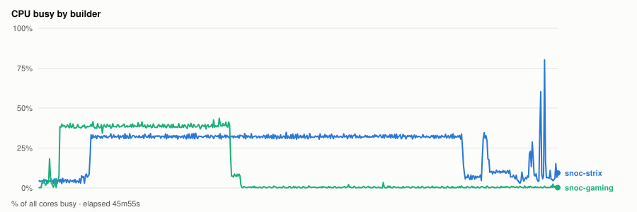
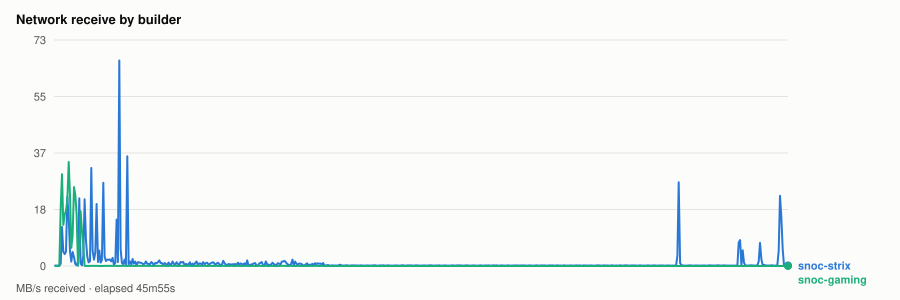
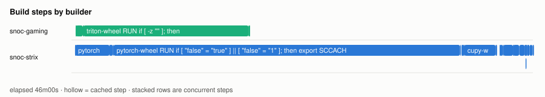
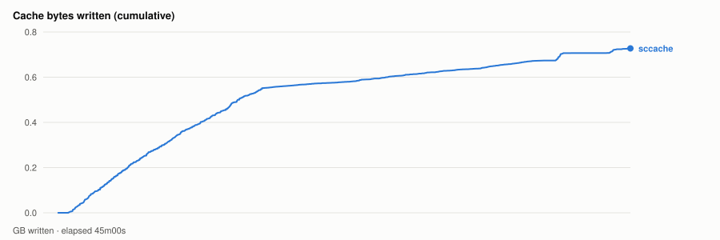

# Cold parallel wheel build — 20261030T111221Z

- **arch** `gfx1201` · **commit** `d5eabf2` (dirty)
- **wall clock** 46m00s · **exit** 0
- **sample interval** 5s · **sccache prefix** `perf-20261030T111221Z`

> Throughput, not isolated per-target cost: the builds ran concurrently and shared the sccache store and registry, both on Strix, which is also a build node. For clean per-wheel numbers use `bench.sh cold`, which serialises on purpose.

## CPU busy by builder



## Network receive by builder



## Build steps by builder



## Interactive chart


## Cache bytes written (cumulative)



## Per-builder totals

| builder | peak CPU | mean CPU | min free mem | net received |
|---|---|---|---|---|
| snoc-gaming | 44% | 13% | 867.1MB | 1.5GB |
| snoc-strix | 80% | 26% | 5.5GB | 3.2GB |

## Per-target build steps

| target | node | start | build | total | prev total | change | cached |
|---|---|---|---|---|---|---|---|
| pytorch-wheel | snoc-strix | 00:00:21 | 38m33s | 38m33s | 1h35m | -59% | 3/25 |
| triton-wheel | snoc-gaming | 00:00:24 | 17m18s | 17m18s | - | - | 3/22 |
| cupy-wheel | snoc-strix | 00:38:55 | 3m24s | 3m24s | 4m33s | -25% | 2/21 |
| nixl-wheel | snoc-strix | 00:42:41 | 2m33s | 2m33s | 3m43s | -31% | 1/27 |
| aiter-wheel | snoc-strix | 00:45:15 | 44s | 44s | 2m05s | -64% | 2/25 |

*start* is elapsed from the beginning of this run, so it compares across runs. *build* is the span of the target's own steps; *total* is what the builder reported for it. The gap between them is setup plus cache export — which is why `change` is computed on *total*. A `*` marks a target whose previous run predates that measurement, so its comparison is build-vs-build and excludes the export on both sides.
*previous* is `20261030T001853Z`.

*buildkit transfer* is what BuildKit itself moved — context, layer pulls and exports. Downloads made **inside** a RUN step (apt, pip, git) are invisible to it and show up only in the node's network series above, which is why the two disagree.

## Cache writes

| stream | objects | bytes | first | last |
|---|---|---|---|---|
| sccache (compiler) | 3687 | 762.2MB | +1m09s | +45m00s |
| Zot blobs (layer cache) | 0 | - | - | - |

## Published artifacts

```
  pytorch-wheel  339.8 MB  (13 tags)
      published         arch      extra            version   rocm          size       build            wheel
      2026-10-29 18:18  gfx950    device-gfx950    2.15.0    10.1.0-full    339.8 MB  -                torch-2.15.0a0+git31a77fc-cp314-cp314-linux_x86_64.whl
      … 11 older tag(s); ZOT_TAGS=0 for all
      latest
  triton-wheel  431.0 MB  (20 tags)
      published         arch      extra            version   rocm          size       build            wheel
      2026-10-29 18:18  noarch    -                3.9.0     10.1.0-full    431.0 MB  -                triton-3.9.0+gitaad2a60d-cp314-cp314-linux_x86_64.whl
      … 18 older tag(s); ZOT_TAGS=0 for all
      latest
  aiter-wheel  131.1 MB  (7 tags)
      published         arch      extra            version   rocm          size       build            wheel
      2026-10-29 14:36  gfx1201   device-gfx1201   2.14.1    10.1.0-full    131.1 MB  -                amd_aiter-0.1.27-cp314-cp314-linux_x86_64.whl
      … 5 older tag(s); ZOT_TAGS=0 for all
      latest
  nixl-wheel  12.2 MB  (7 tags)
      published         arch      extra            version   rocm          size       build            wheel
      2026-10-29 18:18  gfx950    device-gfx950    v1.5.2    10.1.0-full     12.2 MB  -                nixl-1.5.2-py3-none-any.whl
      … 5 older tag(s); ZOT_TAGS=0 for all
      latest
  cupy-wheel  41.4 MB  (4 tags)
      published         arch      extra            version   rocm          size       build            wheel
      2026-10-29 14:36  gfx1201   device-gfx1201   v14.2.0   10.1.0-full     41.4 MB  -                cupy-14.2.0-cp314-cp314-linux_x86_64.whl
      … 2 older tag(s); ZOT_TAGS=0 for all
      latest
  vllm-wheel  67.4 MB  (6 tags)
      published         arch      extra            version   rocm          size       build            wheel
      2026-10-29 14:36  gfx1201   device-gfx1201   v0.32.0   10.1.0-full     67.4 MB  -                vllm-0.32.0+rocm101-cp314-cp314-linux_x86_64.whl
      … 4 older tag(s); ZOT_TAGS=0 for all
      latest
  lmcache-wheel  8.6 MB  (7 tags)
      published         arch      extra            version   rocm          size       build            wheel
      2026-10-29 14:36  gfx1201   device-gfx1201   v0.5.6    10.1.0-full      8.7 MB  -                lmcache-0.5.6-cp314-cp314-linux_x86_64.whl
      … 5 older tag(s); ZOT_TAGS=0 for all
      latest
```

