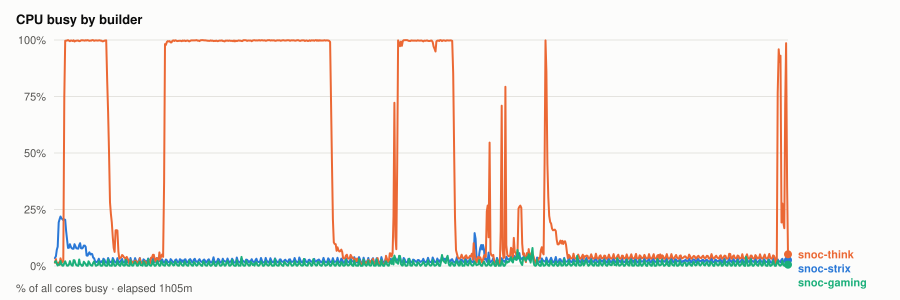
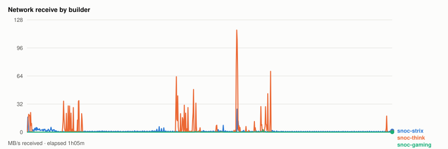
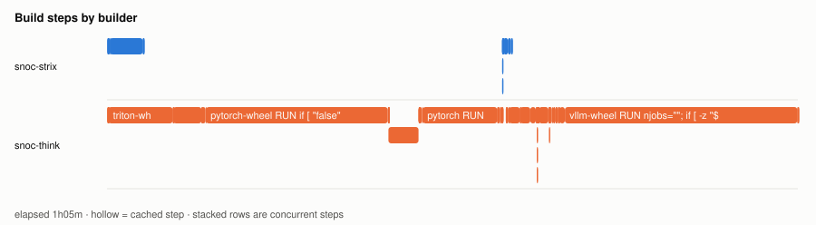
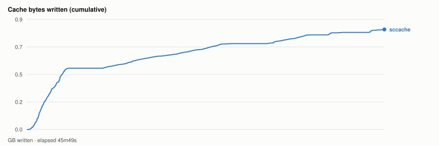

# Cold parallel wheel build — 20261102T161307Z

- **started** Mon 02 Nov 2026 10:13:07 CST
- **arch** `gfx1201` · **commit** `d44b34d` (dirty)
- **wall clock** 1h05m · **exit** 0
- **sample interval** 5s · **sccache prefix** `perf-20261102T161307Z`

> Throughput, not isolated per-target cost: the builds ran concurrently and shared the sccache store and registry, both on Strix, which is also a build node. For clean per-wheel numbers use `bench.sh cold`, which serialises on purpose.

## CPU busy by builder



## Network receive by builder



## Build steps by builder



## Interactive chart


## Cache bytes written (cumulative)



## Per-builder totals

| builder | peak CPU | mean CPU | min free mem | net received |
|---|---|---|---|---|
| snoc-gaming | 8% | 1% | 13.9GB | 88.4MB |
| snoc-strix | 22% | 3% | 11.0GB | 3.2GB |
| snoc-think | 100% | 41% | 72.2GB | 8.1GB |

## Per-target build steps

| target | node | start | build | total | prev total | change | cached |
|---|---|---|---|---|---|---|---|
| cupy-wheel | snoc-strix | 00:00:02 | 3m24s | 3m24s | 3m24s | -0% | 1/21 |
| triton-wheel | snoc-think | 00:00:02 | 6m13s | 6m14s | 6m09s | +1% | 3/22 |
| pytorch-wheel | snoc-think | 00:06:17 | 20m24s | 20m25s | - | - | 3/25 |
| pytorch | snoc-think | 00:26:43 | 10m43s | 10m47s | - | - | 3/32 |
| aiter-wheel | snoc-strix | 00:37:31 | 53s | 53s | - | - | 0/25 |
| nixl-wheel | snoc-think | 00:37:31 | 3m16s | 3m16s | - | - | 1/27 |
| lmcache-wheel | snoc-think | 00:40:48 | 1m08s | 1m08s | - | - | 1/33 |
| vllm-wheel | snoc-think | 00:41:58 | 23m39s | 23m39s | - | - | 4/38 |

*start* is elapsed from the beginning of this run, so it compares across runs. *build* is the span of the target's own steps; *total* is what the builder reported for it. The gap between them is setup plus cache export — which is why `change` is computed on *total*. A `*` marks a target whose previous run predates that measurement, so its comparison is build-vs-build and excludes the export on both sides.
*previous* is `20261030T201713Z`.

*buildkit transfer* is what BuildKit itself moved — context, layer pulls and exports. Downloads made **inside** a RUN step (apt, pip, git) are invisible to it and show up only in the node's network series above, which is why the two disagree.

## Cache writes

| stream | objects | bytes | first | last |
|---|---|---|---|---|
| sccache (compiler) | 4432 | 863.3MB | +9s | +45m49s |
| Zot blobs (layer cache) | 0 | - | - | - |

## Published artifacts

```
  pytorch-wheel  343.3 MB  (18 tags)
      published         arch      extra            version   rocm          size       build            wheel
      2026-10-30 12:22  gfx1250   device-gfx1250   2.15.0    10.1.0-full    343.3 MB  -                torch-2.15.0a0+git31a77fc-cp314-cp314-linux_x86_64.whl
      … 16 older tag(s); ZOT_TAGS=0 for all
      latest
  triton-wheel  431.0 MB  (23 tags)
      published         arch      extra            version   rocm          size       build            wheel
      2026-10-30 12:22  noarch    -                3.9.0     10.1.0-full    431.0 MB  -                triton-3.9.0+gitaad2a60d-cp314-cp314-linux_x86_64.whl
      … 21 older tag(s); ZOT_TAGS=0 for all
      latest
  aiter-wheel  131.1 MB  (11 tags)
      published         arch      extra            version   rocm          size       build            wheel
      2026-10-30 12:22  gfx1250   device-gfx1250   2.15.0    10.1.0-full    131.1 MB  -                amd_aiter-0.1.27-cp314-cp314-linux_x86_64.whl
      … 9 older tag(s); ZOT_TAGS=0 for all
      latest
  nixl-wheel  12.2 MB  (12 tags)
      published         arch      extra            version   rocm          size       build            wheel
      2026-10-30 12:22  gfx1250   device-gfx1250   v1.5.2    10.1.0-full     12.2 MB  -                nixl-1.5.2-py3-none-any.whl
      … 10 older tag(s); ZOT_TAGS=0 for all
      latest
  cupy-wheel  41.4 MB  (8 tags)
      published         arch      extra            version   rocm          size       build            wheel
      2026-10-30 12:22  gfx1250   device-gfx1250   v14.2.0   10.1.0-full     41.4 MB  -                cupy-14.2.0-cp314-cp314-linux_x86_64.whl
      … 6 older tag(s); ZOT_TAGS=0 for all
      latest
  vllm-wheel  55.0 MB  (9 tags)
      published         arch      extra            version   rocm          size       build            wheel
      2026-10-30 12:22  gfx1250   device-gfx1250   v0.32.0   10.1.0-full     55.0 MB  -                vllm-0.32.0+rocm101-cp314-cp314-linux_x86_64.whl
      … 7 older tag(s); ZOT_TAGS=0 for all
      latest
  lmcache-wheel  8.6 MB  (11 tags)
      published         arch      extra            version   rocm          size       build            wheel
      2026-10-30 12:22  gfx1250   device-gfx1250   v0.5.6    10.1.0-full      8.7 MB  -                lmcache-0.5.6-cp314-cp314-linux_x86_64.whl
      … 9 older tag(s); ZOT_TAGS=0 for all
      latest
```

