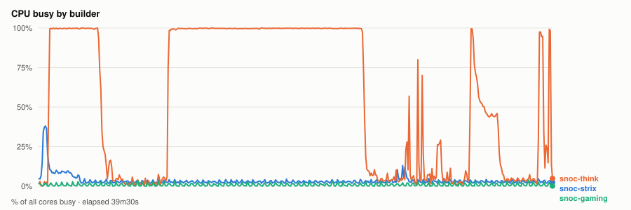
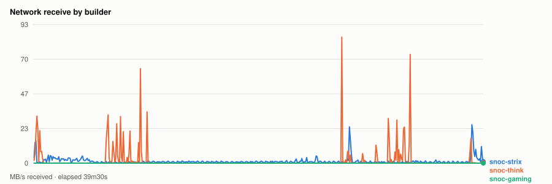
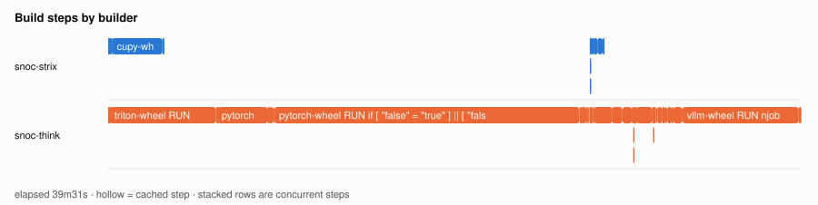
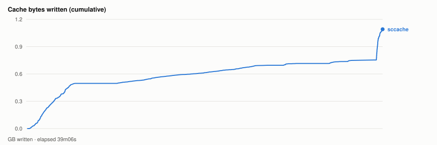

# Cold parallel wheel build — 20261102T195216Z

- **started** Mon 02 Nov 2026 13:52:16 CST
- **arch** `gfx1201` · **commit** `2822a93`
- **wall clock** 39m31s · **exit** 0
- **sample interval** 5s · **sccache prefix** `perf-20261102T195216Z`

> Throughput, not isolated per-target cost: the builds ran concurrently and shared the sccache store and registry, both on Strix, which is also a build node. For clean per-wheel numbers use `bench.sh cold`, which serialises on purpose.

## CPU busy by builder



## Network receive by builder



## Build steps by builder



## Interactive chart


## Cache bytes written (cumulative)



## Per-builder totals

| builder | peak CPU | mean CPU | min free mem | net received |
|---|---|---|---|---|
| snoc-gaming | 4% | 1% | 14.1GB | 19.7MB |
| snoc-strix | 38% | 4% | 19.2GB | 3.0GB |
| snoc-think | 100% | 56% | 65.3GB | 4.4GB |

## Per-target build steps

| target | node | start | build | total | prev total | change | cached |
|---|---|---|---|---|---|---|---|
| cupy-wheel | snoc-strix | 00:00:02 | 3m07s | 3m07s | 5s | +3046% | 1/21 |
| triton-wheel | snoc-think | 00:00:03 | 6m11s | 6m11s | 5s | +6723% | 3/22 |
| pytorch-wheel | snoc-think | 00:06:15 | 20m44s | 20m44s | 5s | +22377% | 3/25 |
| pytorch | snoc-think | 00:27:01 | 25s | 30s | 5s | +450% | 3/23 |
| aiter-wheel | snoc-strix | 00:27:32 | 45s | 46s | 1m18s | -41% | 0/25 |
| nixl-wheel | snoc-think | 00:27:32 | 2m27s | 2m27s | 1m54s | +29% | 2/27 |
| lmcache-wheel | snoc-think | 00:30:00 | 1m07s | 1m07s | 1m36s | -30% | 3/33 |
| vllm-wheel | snoc-think | 00:31:08 | 8m23s | 8m23s | 4m31s | +85% | 4/38 |

*start* is elapsed from the beginning of this run, so it compares across runs. *build* is the span of the target's own steps; *total* is what the builder reported for it. The gap between them is setup plus cache export — which is why `change` is computed on *total*. A `*` marks a target whose previous run predates that measurement, so its comparison is build-vs-build and excludes the export on both sides.
*previous* is `20261102T184648Z`.

*buildkit transfer* is what BuildKit itself moved — context, layer pulls and exports. Downloads made **inside** a RUN step (apt, pip, git) are invisible to it and show up only in the node's network series above, which is why the two disagree.

## Cache writes

| stream | objects | bytes | first | last |
|---|---|---|---|---|
| sccache (compiler) | 5432 | 1.1GB | +9s | +39m06s |
| Zot blobs (layer cache) | 0 | - | - | - |

## Published artifacts

```
  pytorch-wheel  382.9 MB  (21 tags)
      published         arch      extra            version   rocm          size       build            wheel
      2026-11-02 12:45  gfx1201   device-gfx1201   2.15.0    10.1.0-full    382.9 MB  -                torch-2.15.0a0+git31a77fc-cp314-cp314-linux_x86_64.whl
      … 19 older tag(s); ZOT_TAGS=0 for all
      latest
  triton-wheel  431.0 MB  (26 tags)
      published         arch      extra            version   rocm          size       build            wheel
      2026-11-02 12:45  noarch    -                3.9.0     10.1.0-full    431.0 MB  -                triton-3.9.0+gitaad2a60d-cp314-cp314-linux_x86_64.whl
      … 24 older tag(s); ZOT_TAGS=0 for all
      latest
  aiter-wheel  133.5 MB  (14 tags)
      published         arch      extra            version   rocm          size       build            wheel
      2026-11-02 12:45  gfx1201   device-gfx1201   2.15.0    10.1.0-full    133.5 MB  -                amd_aiter-0.1.28-cp314-cp314-linux_x86_64.whl
      … 12 older tag(s); ZOT_TAGS=0 for all
      latest
  nixl-wheel  12.2 MB  (15 tags)
      published         arch      extra            version   rocm          size       build            wheel
      2026-11-02 12:45  gfx1201   device-gfx1201   v1.5.2    10.1.0-full     12.2 MB  -                nixl-1.5.2-py3-none-any.whl
      … 13 older tag(s); ZOT_TAGS=0 for all
      latest
  cupy-wheel  41.5 MB  (11 tags)
      published         arch      extra            version   rocm          size       build            wheel
      2026-11-02 12:45  gfx1201   device-gfx1201   v14.2.0   10.1.0-full     41.5 MB  -                cupy-14.2.0-cp314-cp314-linux_x86_64.whl
      … 9 older tag(s); ZOT_TAGS=0 for all
      latest
  vllm-wheel  67.4 MB  (12 tags)
      published         arch      extra            version   rocm          size       build            wheel
      2026-11-02 12:45  gfx1201   device-gfx1201   v0.32.0   10.1.0-full     67.4 MB  -                vllm-0.32.0+rocm101-cp314-cp314-linux_x86_64.whl
      … 10 older tag(s); ZOT_TAGS=0 for all
      latest
  lmcache-wheel  8.6 MB  (14 tags)
      published         arch      extra            version   rocm          size       build            wheel
      2026-11-02 12:45  gfx1201   device-gfx1201   v0.5.6    10.1.0-full      8.7 MB  -                lmcache-0.5.6-cp314-cp314-linux_x86_64.whl
      … 12 older tag(s); ZOT_TAGS=0 for all
      latest
```

