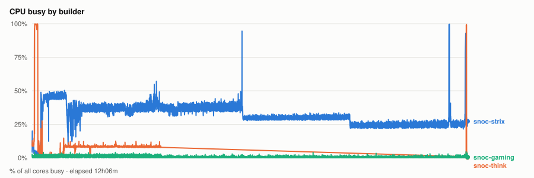
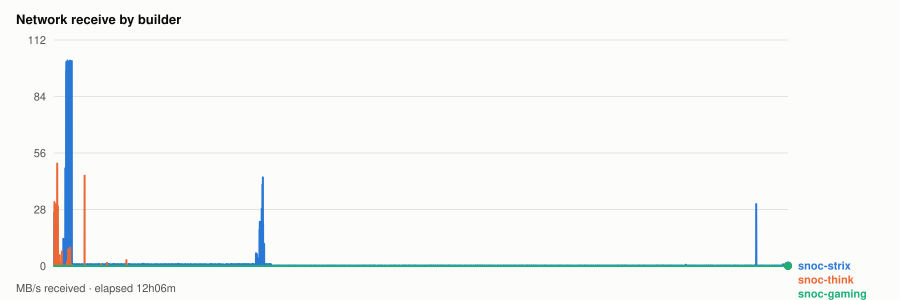
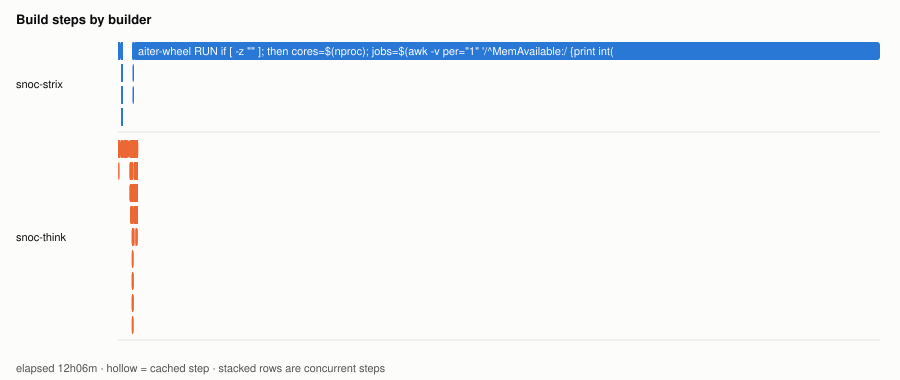

# Cold parallel wheel build — 20261103T011113Z

- **started** Mon 02 Nov 2026 19:11:13 CST
- **arch** `gfx950` · **commit** `3c966f9`
- **wall clock** 12h06m · **exit** 143
- **sample interval** 5s · **sccache prefix** ``

> Throughput, not isolated per-target cost: the builds ran concurrently and shared the sccache store and registry, both on Strix, which is also a build node. For clean per-wheel numbers use `bench.sh cold`, which serialises on purpose.

## CPU busy by builder



## Network receive by builder



## Build steps by builder



## Interactive chart


## Per-builder totals

| builder | peak CPU | mean CPU | min free mem | net received |
|---|---|---|---|---|
| snoc-gaming | 5% | 1% | 14.1GB | 237.9MB |
| snoc-strix | 100% | 32% | 542.1MB | 26.2GB |
| snoc-think | 100% | 10% | 65.5GB | 2.7GB |

## Per-target build steps

| target | node | start | build | total | prev total | change | cached |
|---|---|---|---|---|---|---|---|
| cupy-wheel | snoc-strix | 00:00:02 | 2m50s | 3m03s | 5s | +2982% | 1/22 |
| triton-wheel | snoc-think | 00:00:03 | 0s | 5s | 5s | +3% | 13/23 |
| pytorch-wheel | snoc-think | 00:00:09 | 10m53s | 12m32s | 1m12s | +933% | 3/26 |
| pytorch | snoc-think | 00:12:42 | 22s | 1m07s | 1m07s | +0% | 2/24 |
| aiter-wheel | snoc-strix | 00:13:49 | 11h52m | 11h52m | 17m28s | +3977% | 0/25 |
| nixl-wheel | snoc-think | 00:13:50 | 1m33s | 2m05s | 2m07s | -2% | 1/28 |
| lmcache-wheel | snoc-think | 00:15:56 | 1m09s | 1m44s | 1m42s | +2% | 3/34 |

*start* is elapsed from the beginning of this run, so it compares across runs. *build* is the span of the target's own steps; *total* is what the builder reported for it. The gap between them is setup plus cache export — which is why `change` is computed on *total*. A `*` marks a target whose previous run predates that measurement, so its comparison is build-vs-build and excludes the export on both sides.
*previous* is `20261102T214151Z`.

*buildkit transfer* is what BuildKit itself moved — context, layer pulls and exports. Downloads made **inside** a RUN step (apt, pip, git) are invisible to it and show up only in the node's network series above, which is why the two disagree.

## Cache writes

| stream | objects | bytes | first | last |
|---|---|---|---|---|
| sccache (compiler) | 0 | - | - | - |
| Zot blobs (layer cache) | 0 | - | - | - |

## Published artifacts

```
  pytorch-wheel  340.0 MB  (24 tags)
      published         arch      extra            version   rocm          size       build            wheel
      2026-11-02 18:23  gfx950    device-gfx950    2.15.0    10.1.0-full    340.0 MB  -                torch-2.15.0a0+git31a77fc-cp314-cp314-linux_x86_64.whl
      … 22 older tag(s); ZOT_TAGS=0 for all
      latest
  triton-wheel  431.0 MB  (29 tags)
      published         arch      extra            version   rocm          size       build            wheel
      2026-11-02 18:23  noarch    -                3.9.0     10.1.0-full    431.0 MB  -                triton-3.9.0+gitaad2a60d-cp314-cp314-linux_x86_64.whl
      … 27 older tag(s); ZOT_TAGS=0 for all
      latest
  aiter-wheel  133.6 MB  (16 tags)
      published         arch      extra            version   rocm          size       build            wheel
      2026-11-02 15:41  gfx1250   device-gfx1250   2.15.0    10.1.0-full    133.6 MB  -                amd_aiter-0.1.29.dev0+gf1965cd26.d20261102-cp314-cp314-linux_x86_64.whl
      … 14 older tag(s); ZOT_TAGS=0 for all
      latest
  nixl-wheel  12.2 MB  (18 tags)
      published         arch      extra            version   rocm          size       build            wheel
      2026-11-02 18:23  gfx950    device-gfx950    v1.5.2    10.1.0-full     12.2 MB  -                nixl-1.5.2-py3-none-any.whl
      … 16 older tag(s); ZOT_TAGS=0 for all
      latest
  cupy-wheel  41.2 MB  (15 tags)
      published         arch      extra            version   rocm          size       build            wheel
      2026-11-02 18:23  gfx950    device-gfx950    v14.2.0   10.1.0-full     41.2 MB  -                cupy-14.2.0-cp314-cp314-linux_x86_64.whl
      … 13 older tag(s); ZOT_TAGS=0 for all
      latest
  vllm-wheel  63.0 MB  (16 tags)
      published         arch      extra            version   rocm          size       build            wheel
      2026-11-02 15:41  gfx1250   device-gfx1250   v0.33.0   10.1.0-full     63.0 MB  -                vllm-0.33.0+rocm101-cp314-cp314-linux_x86_64.whl
      … 14 older tag(s); ZOT_TAGS=0 for all
      latest
  lmcache-wheel  8.6 MB  (18 tags)
      published         arch      extra            version   rocm          size       build            wheel
      2026-11-02 18:23  gfx950    device-gfx950    v0.5.6    10.1.0-full      8.6 MB  -                lmcache-0.5.6-cp314-cp314-linux_x86_64.whl
      … 16 older tag(s); ZOT_TAGS=0 for all
      latest
```

