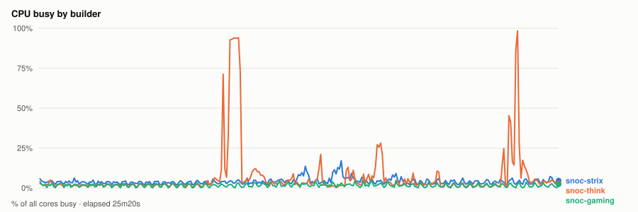
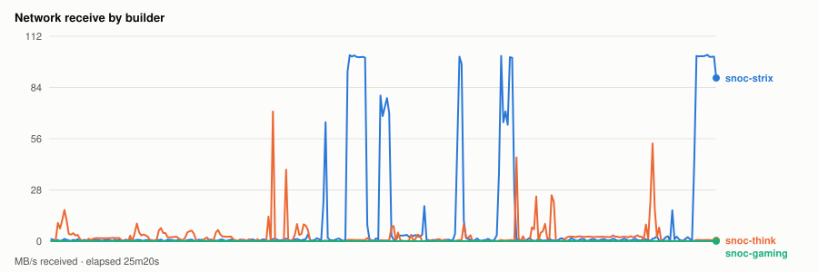
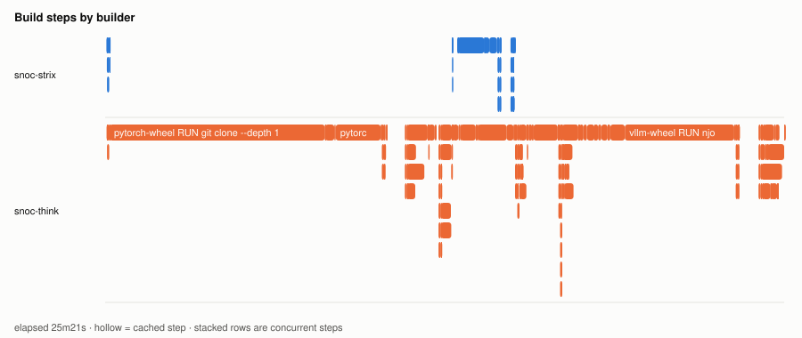
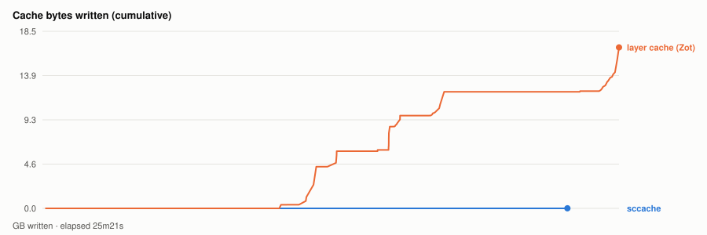

# Cold parallel wheel build — 20261103T165914Z

- **started** Tue 03 Nov 2026 10:59:14 CST
- **arch** `gfx1201` · **commit** `cb57af7`
- **wall clock** 25m21s · **exit** 0
- **sample interval** 5s · **sccache prefix** ``

> Throughput, not isolated per-target cost: the builds ran concurrently and shared the sccache store and registry, both on Strix, which is also a build node. For clean per-wheel numbers use `bench.sh cold`, which serialises on purpose.

## CPU busy by builder



## Network receive by builder



## Build steps by builder



## Interactive chart


## Cache bytes written (cumulative)



## Per-builder totals

| builder | peak CPU | mean CPU | min free mem | net received |
|---|---|---|---|---|
| snoc-gaming | 5% | 2% | 14.1GB | 23.2MB |
| snoc-strix | 17% | 4% | 20.0GB | 17.1GB |
| snoc-think | 98% | 7% | 113.1GB | 4.1GB |

## Per-target build steps

| target | node | start | build | total | prev total | change | cached |
|---|---|---|---|---|---|---|---|
| cupy-wheel | snoc-strix | 00:00:03 | 0s | 6s | 3m08s | -97% | 11/22 |
| triton-wheel | snoc-think | 00:00:03 | 0s | 5s | 8m23s | -99% | 13/23 |
| pytorch-wheel | snoc-think | 00:00:09 | 10m09s | 11m52s | 11m38s | +2% | 3/28 |
| pytorch | snoc-think | 00:12:02 | 19s | 53s | 54s | -2% | 2/22 |
| aiter-wheel | snoc-strix | 00:12:56 | 1m42s | 2m19s | 1m45s | +33% | 0/27 |
| nixl-wheel | snoc-think | 00:12:56 | 2m21s | 2m46s | 2m29s | +11% | 1/28 |
| lmcache-wheel | snoc-think | 00:15:44 | 1m11s | 1m55s | - | - | 3/31 |
| vllm-wheel | snoc-think | 00:17:40 | 5m51s | 7m40s | - | - | 4/36 |

*start* is elapsed from the beginning of this run, so it compares across runs. *build* is the span of the target's own steps; *total* is what the builder reported for it. The gap between them is setup plus cache export — which is why `change` is computed on *total*. A `*` marks a target whose previous run predates that measurement, so its comparison is build-vs-build and excludes the export on both sides.
*previous* is `20261103T160201Z`.

*buildkit transfer* is what BuildKit itself moved — context, layer pulls and exports. Downloads made **inside** a RUN step (apt, pip, git) are invisible to it and show up only in the node's network series above, which is why the two disagree.

## Cache writes

| stream | objects | bytes | first | last |
|---|---|---|---|---|
| sccache (compiler) | 9 | 5.2MB | +8m37s | +23m05s |
| Zot blobs (layer cache) | 121 | 16.9GB | +8s | +25m21s |

## Published artifacts

```
  pytorch-wheel  382.9 MB  (26 tags)
      published         arch      extra            version   rocm          size       build            wheel
      2026-11-03 10:03  gfx1201   device-gfx1201   2.15.0    10.1.0-full    382.9 MB  -                torch-2.15.0a0+git31a77fc-cp314-cp314-linux_x86_64.whl
      … 24 older tag(s); ZOT_TAGS=0 for all
      latest
  triton-wheel  431.0 MB  (34 tags)
      published         arch      extra            version   rocm          size       build            wheel
      2026-11-03 10:03  noarch    -                3.9.0     10.1.0-full    431.0 MB  -                triton-3.9.0+gitaad2a60d-cp314-cp314-linux_x86_64.whl
      … 32 older tag(s); ZOT_TAGS=0 for all
      latest
  aiter-wheel  133.7 MB  (18 tags)
      published         arch      extra            version   rocm          size       build            wheel
      2026-11-03 10:03  gfx1201   device-gfx1201   2.15.0    10.1.0-full    133.7 MB  -                amd_aiter-0.1.29.dev0+gf1965cd26.d20261103-cp314-cp314-linux_x86_64.whl
      … 16 older tag(s); ZOT_TAGS=0 for all
      latest
  nixl-wheel  12.2 MB  (20 tags)
      published         arch      extra            version   rocm          size       build            wheel
      2026-11-03 10:03  gfx1201   device-gfx1201   v1.5.2    10.1.0-full     12.2 MB  -                nixl-1.5.2-py3-none-any.whl
      … 18 older tag(s); ZOT_TAGS=0 for all
      latest
  cupy-wheel  41.5 MB  (19 tags)
      published         arch      extra            version   rocm          size       build            wheel
      2026-11-03 10:03  gfx1201   device-gfx1201   v14.2.0   10.1.0-full     41.5 MB  -                cupy-14.2.0-cp314-cp314-linux_x86_64.whl
      … 17 older tag(s); ZOT_TAGS=0 for all
      latest
  vllm-wheel  74.8 MB  (17 tags)
      published         arch      extra            version   rocm          size       build            wheel
      2026-11-03 10:03  gfx1201   device-gfx1201   v0.33.0   10.1.0-full     74.8 MB  -                vllm-0.33.0+rocm101-cp314-cp314-linux_x86_64.whl
      … 15 older tag(s); ZOT_TAGS=0 for all
      latest
  lmcache-wheel  8.6 MB  (19 tags)
      published         arch      extra            version   rocm          size       build            wheel
      2026-11-03 10:03  gfx1201   device-gfx1201   v0.5.6    10.1.0-full      8.7 MB  -                lmcache-0.5.6-cp314-cp314-linux_x86_64.whl
      … 17 older tag(s); ZOT_TAGS=0 for all
      latest
```

