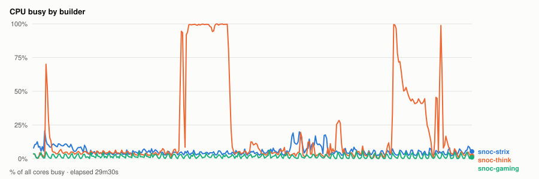
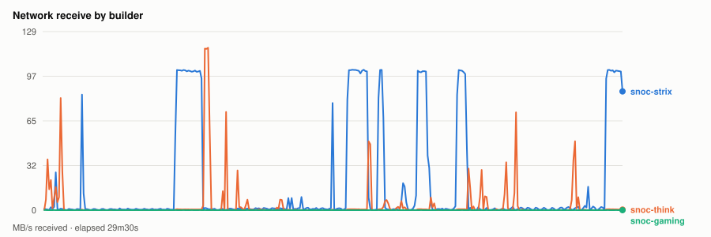
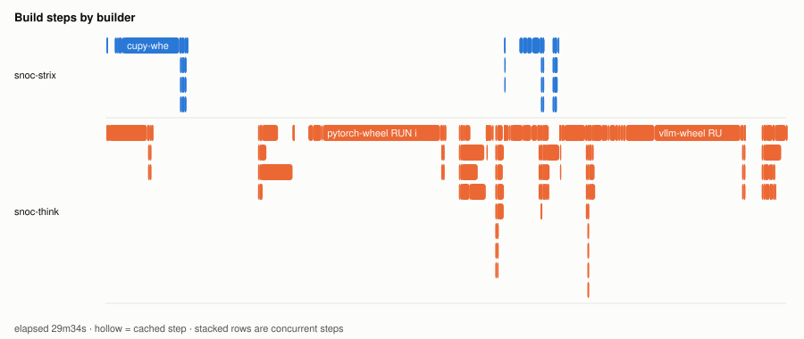
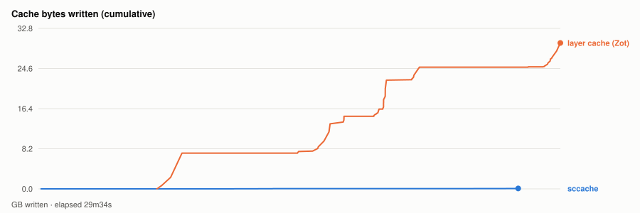

# Warm parallel wheel build — 20261103T235635Z

- **started** Tue 03 Nov 2026 17:56:35 CST
- **arch** `gfx950` · **commit** `65c57e3` (dirty)
- **wall clock** 29m34s · **exit** 0
- **sample interval** 5s · **sccache prefix** ``

> Throughput, not isolated per-target cost: the builds ran concurrently and shared the sccache store and registry, both on Strix, which is also a build node. For clean per-wheel numbers use `bench.sh cold`, which serialises on purpose.

## CPU busy by builder



## Network receive by builder



## Build steps by builder



## Interactive chart


## Cache bytes written (cumulative)



## Per-builder totals

| builder | peak CPU | mean CPU | min free mem | net received |
|---|---|---|---|---|
| snoc-gaming | 6% | 2% | 14.0GB | 27.5MB |
| snoc-strix | 21% | 6% | 17.7GB | 30.4GB |
| snoc-think | 100% | 20% | 77.8GB | 6.5GB |

## Per-target build steps

| target | node | start | build | total | prev total | change | cached |
|---|---|---|---|---|---|---|---|
| cupy-wheel | snoc-strix | 00:00:02 | 3m11s | 3m30s | 4m20s | -19% | 0/22 |
| triton-wheel | snoc-think | 00:00:03 | 1m47s | 8m04s | 7m22s | +9% | 2/23 |
| pytorch-wheel | snoc-think | 00:08:09 | 6m25s | 8m22s | 18m57s | -56% | 3/30 |
| pytorch | snoc-think | 00:16:32 | 19s | 46s | 41s | +13% | 2/22 |
| aiter-wheel | snoc-strix | 00:17:19 | 1m34s | 2m20s | 1m42s | +37% | 0/27 |
| nixl-wheel | snoc-think | 00:17:19 | 1m29s | 2m23s | 2m52s | -17% | 1/28 |
| lmcache-wheel | snoc-think | 00:19:44 | 1m07s | 1m51s | 1m12s | +53% | 2/31 |
| vllm-wheel | snoc-think | 00:21:36 | 6m02s | 7m57s | 10m08s | -22% | 4/36 |

*start* is elapsed from the beginning of this run, so it compares across runs. *build* is the span of the target's own steps; *total* is what the builder reported for it. The gap between them is setup plus cache export — which is why `change` is computed on *total*. A `*` marks a target whose previous run predates that measurement, so its comparison is build-vs-build and excludes the export on both sides.
*previous* is `20261103T220209Z`.

*buildkit transfer* is what BuildKit itself moved — context, layer pulls and exports. Downloads made **inside** a RUN step (apt, pip, git) are invisible to it and show up only in the node's network series above, which is why the two disagree.

## Cache writes

| stream | objects | bytes | first | last |
|---|---|---|---|---|
| sccache (compiler) | 353 | 82.6MB | +9s | +27m11s |
| Zot blobs (layer cache) | 122 | 29.8GB | +6m42s | +29m34s |

## Published artifacts

```
  pytorch-wheel  340.0 MB  (29 tags)
      published         arch      extra            version   rocm          size       build            wheel
      2026-11-03 17:51  gfx950    device-gfx950    2.15.0    10.1.0-full    340.0 MB  -                torch-2.15.0a0+git31a77fc-cp314-cp314-linux_x86_64.whl
      … 27 older tag(s); ZOT_TAGS=0 for all
      latest
  triton-wheel  431.0 MB  (36 tags)
      published         arch      extra            version   rocm          size       build            wheel
      2026-11-03 17:51  noarch    -                3.9.0     10.1.0-full    431.0 MB  -                triton-3.9.0+gitaad2a60d-cp314-cp314-linux_x86_64.whl
      … 34 older tag(s); ZOT_TAGS=0 for all
      latest
  aiter-wheel  133.7 MB  (21 tags)
      published         arch      extra            version   rocm          size       build            wheel
      2026-11-03 17:51  gfx950    device-gfx950    2.15.0    10.1.0-full    133.7 MB  -                amd_aiter-0.1.29.dev0+gf1965cd26.d20261104-cp314-cp314-linux_x86_64.whl
      … 19 older tag(s); ZOT_TAGS=0 for all
      latest
  nixl-wheel  12.2 MB  (23 tags)
      published         arch      extra            version   rocm          size       build            wheel
      2026-11-03 17:51  gfx950    device-gfx950    v1.5.2    10.1.0-full     12.2 MB  -                nixl-1.5.2-py3-none-any.whl
      … 21 older tag(s); ZOT_TAGS=0 for all
      latest
  cupy-wheel  41.2 MB  (22 tags)
      published         arch      extra            version   rocm          size       build            wheel
      2026-11-03 17:51  gfx950    device-gfx950    v14.2.0   10.1.0-full     41.2 MB  -                cupy-14.2.0-cp314-cp314-linux_x86_64.whl
      … 20 older tag(s); ZOT_TAGS=0 for all
      latest
  vllm-wheel  76.0 MB  (21 tags)
      published         arch      extra            version   rocm          size       build            wheel
      2026-11-03 17:51  gfx950    device-gfx950    v0.33.0   10.1.0-full     76.1 MB  -                vllm-0.33.0+rocm101-cp314-cp314-linux_x86_64.whl
      … 19 older tag(s); ZOT_TAGS=0 for all
      latest
  lmcache-wheel  8.6 MB  (22 tags)
      published         arch      extra            version   rocm          size       build            wheel
      2026-11-03 17:51  gfx950    device-gfx950    v0.5.6    10.1.0-full      8.6 MB  -                lmcache-0.5.6-cp314-cp314-linux_x86_64.whl
      … 20 older tag(s); ZOT_TAGS=0 for all
      latest
```

