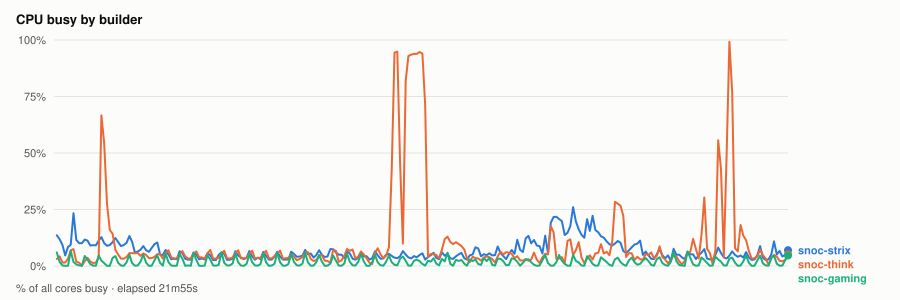
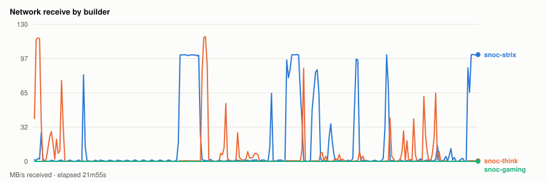
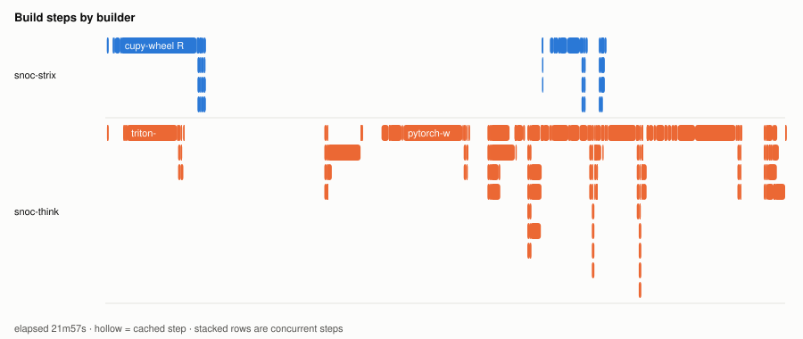
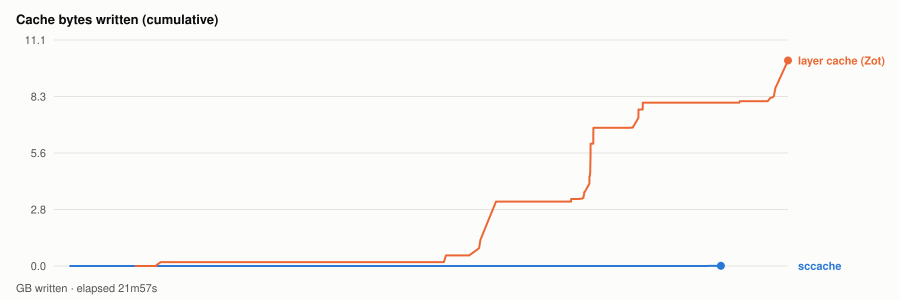

# Warm parallel wheel build — 20261104T050340Z

- **started** Tue 03 Nov 2026 23:03:40 CST
- **arch** `gfx950` · **commit** `6ddeffb`
- **wall clock** 21m57s · **exit** 0
- **sample interval** 5s · **sccache prefix** ``

> Throughput, not isolated per-target cost: the builds ran concurrently and shared the sccache store and registry, both on Strix, which is also a build node. For clean per-wheel numbers use `bench.sh cold`, which serialises on purpose.

## CPU busy by builder



## Network receive by builder



## Build steps by builder



## Interactive chart


## Cache bytes written (cumulative)



## Per-builder totals

| builder | peak CPU | mean CPU | min free mem | net received |
|---|---|---|---|---|
| snoc-gaming | 7% | 2% | 14.0GB | 20.5MB |
| snoc-strix | 26% | 7% | 17.9GB | 19.8GB |
| snoc-think | 99% | 11% | 107.6GB | 8.6GB |

## Per-target build steps

| target | node | start | build | total | prev total | change | cached |
|---|---|---|---|---|---|---|---|
| cupy-wheel | snoc-strix | 00:00:02 | 2m55s | 3m08s | 6s | +3038% | 0/22 |
| triton-wheel | snoc-think | 00:00:03 | 2m17s | 8m11s | 7m42s | +6% | 2/23 |
| pytorch-wheel | snoc-think | 00:08:15 | 3m18s | 4m57s | 4m39s | +7% | 3/30 |
| pytorch | snoc-think | 00:13:14 | 19s | 51s | 51s | -0% | 2/22 |
| aiter-wheel | snoc-strix | 00:14:05 | 1m15s | 2m02s | 2m11s | -7% | 0/27 |
| nixl-wheel | snoc-think | 00:14:06 | 1m31s | 1m54s | 1m53s | +1% | 1/28 |
| lmcache-wheel | snoc-think | 00:16:02 | 1m07s | 1m26s | 1m27s | -1% | 3/31 |
| vllm-wheel | snoc-think | 00:17:30 | 2m54s | 4m26s | 4m17s | +4% | 4/36 |

*start* is elapsed from the beginning of this run, so it compares across runs. *build* is the span of the target's own steps; *total* is what the builder reported for it. The gap between them is setup plus cache export — which is why `change` is computed on *total*. A `*` marks a target whose previous run predates that measurement, so its comparison is build-vs-build and excludes the export on both sides.
*previous* is `20261104T005929Z`.

*buildkit transfer* is what BuildKit itself moved — context, layer pulls and exports. Downloads made **inside** a RUN step (apt, pip, git) are invisible to it and show up only in the node's network series above, which is why the two disagree.

## Cache writes

| stream | objects | bytes | first | last |
|---|---|---|---|---|
| sccache (compiler) | 14 | 10.2MB | +29s | +19m57s |
| Zot blobs (layer cache) | 117 | 10.1GB | +2m26s | +21m57s |

## Published artifacts

```
  pytorch-wheel  339.9 MB  (31 tags)
      published         arch      extra            version   rocm          size       build            wheel
      2026-11-03 23:03  gfx950    device-gfx950    2.15.0    10.1.0-full    339.9 MB  -                torch-2.15.0a0+git31a77fc-cp314-cp314-linux_x86_64.whl
      … 29 older tag(s); ZOT_TAGS=0 for all
      latest
  triton-wheel  431.0 MB  (38 tags)
      published         arch      extra            version   rocm          size       build            wheel
      2026-11-03 23:03  noarch    -                3.9.0     10.1.0-full    431.0 MB  -                triton-3.9.0+gitaad2a60d-cp314-cp314-linux_x86_64.whl
      … 36 older tag(s); ZOT_TAGS=0 for all
      latest
  aiter-wheel  133.7 MB  (23 tags)
      published         arch      extra            version   rocm          size       build            wheel
      2026-11-03 23:03  gfx950    device-gfx950    2.15.0    10.1.0-full    133.7 MB  -                amd_aiter-0.1.29.dev0+gf1965cd26.d20261104-cp314-cp314-linux_x86_64.whl
      … 21 older tag(s); ZOT_TAGS=0 for all
      latest
  nixl-wheel  12.2 MB  (25 tags)
      published         arch      extra            version   rocm          size       build            wheel
      2026-11-03 23:03  gfx950    device-gfx950    v1.5.2    10.1.0-full     12.2 MB  -                nixl-1.5.2-py3-none-any.whl
      … 23 older tag(s); ZOT_TAGS=0 for all
      latest
  cupy-wheel  41.2 MB  (24 tags)
      published         arch      extra            version   rocm          size       build            wheel
      2026-11-03 23:03  gfx950    device-gfx950    v14.2.0   10.1.0-full     41.2 MB  -                cupy-14.2.0-cp314-cp314-linux_x86_64.whl
      … 22 older tag(s); ZOT_TAGS=0 for all
      latest
  vllm-wheel  76.0 MB  (23 tags)
      published         arch      extra            version   rocm          size       build            wheel
      2026-11-03 23:03  gfx950    device-gfx950    v0.33.0   10.1.0-full     76.0 MB  -                vllm-0.33.0+rocm101-cp314-cp314-linux_x86_64.whl
      … 21 older tag(s); ZOT_TAGS=0 for all
      latest
  lmcache-wheel  8.6 MB  (24 tags)
      published         arch      extra            version   rocm          size       build            wheel
      2026-11-03 23:03  gfx950    device-gfx950    v0.5.6    10.1.0-full      8.6 MB  -                lmcache-0.5.6-cp314-cp314-linux_x86_64.whl
      … 22 older tag(s); ZOT_TAGS=0 for all
      latest
```

