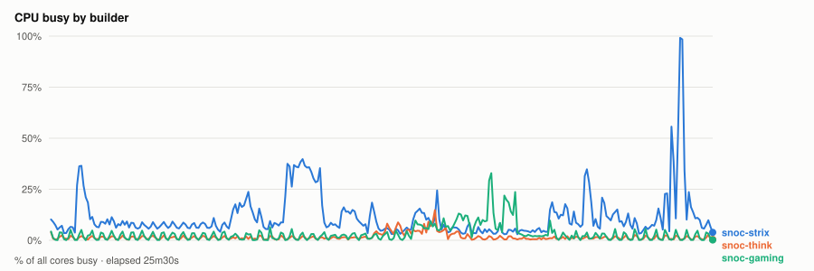
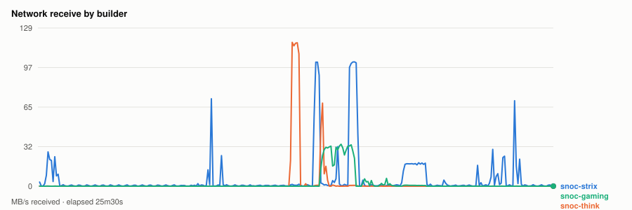
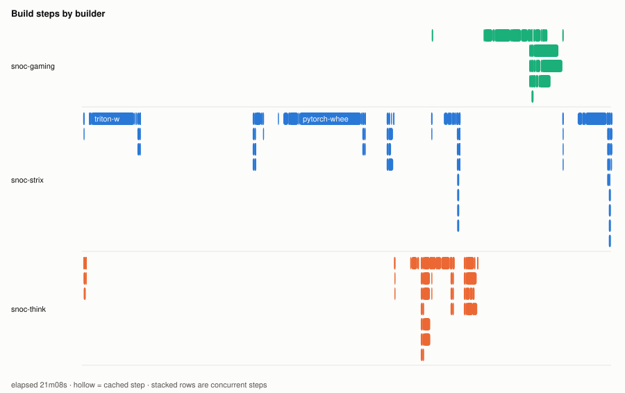
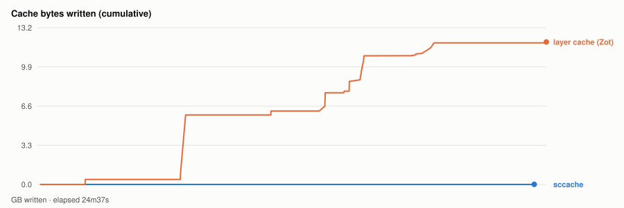

# Warm parallel wheel build — 20261104T195910Z

- **started** Wed 04 Nov 2026 13:59:10 CST
- **arch** `gfx950` · **commit** `7821ce1`
- **wall clock** 0s · **exit** ?
- **sample interval** 5s · **sccache prefix** ``

> Throughput, not isolated per-target cost: the builds ran concurrently and shared the sccache store and registry, both on Strix, which is also a build node. For clean per-wheel numbers use `bench.sh cold`, which serialises on purpose.

## CPU busy by builder

## Network receive by builder

## Build steps by builder

## Interactive chart

## Cache bytes written (cumulative)

## Per-builder totals

| builder | peak CPU | mean CPU | min free mem | net received |
|---|---|---|---|---|
| snoc-gaming | 33% | 3% | 13.0GB | 3.2GB |
| snoc-strix | 99% | 12% | 13.1GB | 8.9GB |
| snoc-think | 15% | 2% | 112.3GB | 3.7GB |

## Per-target build steps

| target | node | start | build | total | prev total | change | cached |
|---|---|---|---|---|---|---|---|
| triton-wheel | snoc-strix | 00:00:03 | 2m08s | 7m07s | 7m55s | -10% | 0/23 |
| cupy-wheel | snoc-think | 00:00:03 | 0s | 5s | 5s | -2% | 12/22 |
| pytorch-wheel | snoc-strix | 00:07:11 | 4m00s | 5m15s | 4m42s | +12% | 1/30 |
| pytorch | snoc-think | 00:12:28 | 1m00s | 1m27s | 47s | +83% | 1/22 |
| torchvision-wheel | snoc-strix | 00:13:57 | 1m01s | 1m08s | 1m15s | -10% | 0/26 |
| aiter-wheel | snoc-think | 00:13:57 | 46s | 1m50s | 8m42s | -79% | 1/27 |
| nixl-wheel | snoc-gaming | 00:13:58 | 3m53s | 5m13s | 3m46s | +38% | 1/28 |
| lmcache-wheel | snoc-strix | 00:19:11 | 1m47s | 1m57s | 1m30s | +29% | 0/31 |

*start* is elapsed from the beginning of this run, so it compares across runs. *build* is the span of the target's own steps; *total* is what the builder reported for it. The gap between them is setup plus cache export — which is why `change` is computed on *total*. A `*` marks a target whose previous run predates that measurement, so its comparison is build-vs-build and excludes the export on both sides.
*previous* is `20261104T164632Z`.

*buildkit transfer* is what BuildKit itself moved — context, layer pulls and exports. Downloads made **inside** a RUN step (apt, pip, git) are invisible to it and show up only in the node's network series above, which is why the two disagree.

## Cache writes

| stream | objects | bytes | first | last |
|---|---|---|---|---|
| sccache (compiler) | 11 | 5.2MB | +22s | +24m02s |
| Zot blobs (layer cache) | 82 | 12.0GB | +8s | +24m37s |

