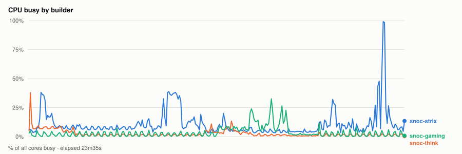
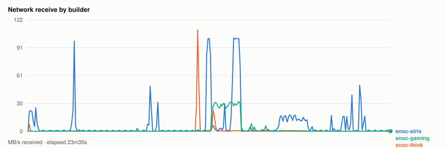
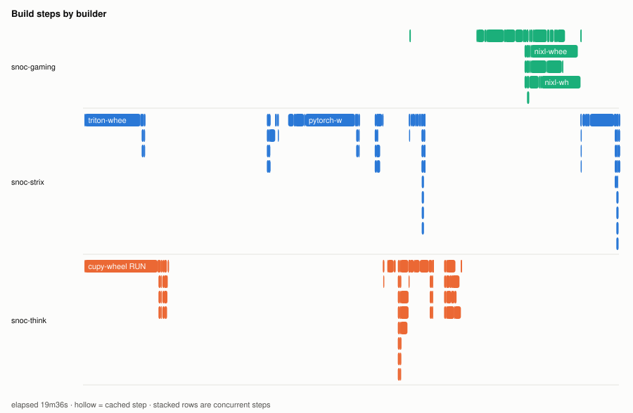
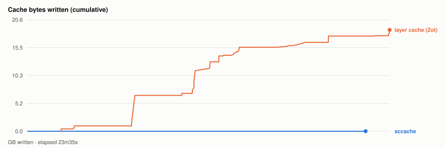

# Warm parallel wheel build — 20261104T202505Z

- **started** Wed 04 Nov 2026 14:25:05 CST
- **arch** `gfx1201` · **commit** `7821ce1`
- **wall clock** 0s · **exit** ?
- **sample interval** 5s · **sccache prefix** ``

> Throughput, not isolated per-target cost: the builds ran concurrently and shared the sccache store and registry, both on Strix, which is also a build node. For clean per-wheel numbers use `bench.sh cold`, which serialises on purpose.

## CPU busy by builder

## Network receive by builder

## Build steps by builder

## Interactive chart

## Cache bytes written (cumulative)

## Per-builder totals

| builder | peak CPU | mean CPU | min free mem | net received |
|---|---|---|---|---|
| snoc-gaming | 33% | 4% | 12.8GB | 3.5GB |
| snoc-strix | 99% | 11% | 13.9GB | 10.4GB |
| snoc-think | 38% | 2% | 109.6GB | 1.2GB |

## Per-target build steps

| target | node | start | build | total | prev total | change | cached |
|---|---|---|---|---|---|---|---|
| triton-wheel | snoc-strix | 00:00:03 | 2m05s | 6m59s | 7m07s | -2% | 7/23 |
| cupy-wheel | snoc-think | 00:00:03 | 2m42s | 3m03s | 5s | +3106% | 7/22 |
| pytorch-wheel | snoc-strix | 00:07:05 | 2m54s | 3m52s | 5m15s | -26% | 1/30 |
| pytorch | snoc-think | 00:10:58 | 28s | 56s | 1m27s | -35% | 2/22 |
| torchvision-wheel | snoc-strix | 00:11:55 | 27s | 33s | 1m08s | -50% | 0/26 |
| aiter-wheel | snoc-think | 00:11:55 | 45s | 1m54s | 1m50s | +3% | 3/27 |
| nixl-wheel | snoc-gaming | 00:11:57 | 4m12s | 6m15s | 5m13s | +20% | 1/28 |
| lmcache-wheel | snoc-strix | 00:18:12 | 1m15s | 1m24s | 1m57s | -28% | 0/31 |

*start* is elapsed from the beginning of this run, so it compares across runs. *build* is the span of the target's own steps; *total* is what the builder reported for it. The gap between them is setup plus cache export — which is why `change` is computed on *total*. A `*` marks a target whose previous run predates that measurement, so its comparison is build-vs-build and excludes the export on both sides.
*previous* is `20261104T195910Z`.

*buildkit transfer* is what BuildKit itself moved — context, layer pulls and exports. Downloads made **inside** a RUN step (apt, pip, git) are invisible to it and show up only in the node's network series above, which is why the two disagree.

## Cache writes

| stream | objects | bytes | first | last |
|---|---|---|---|---|
| sccache (compiler) | 12 | 5.2MB | +4s | +22m02s |
| Zot blobs (layer cache) | 149 | 18.8GB | +2m13s | +23m35s |

