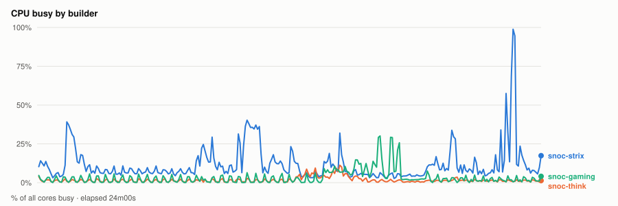
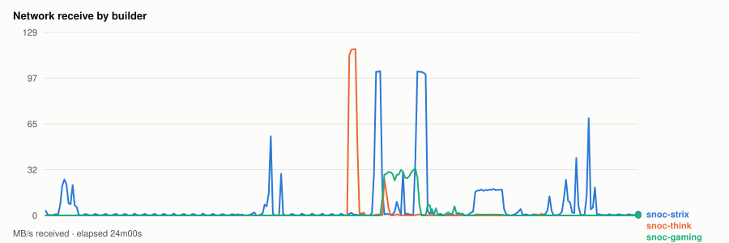
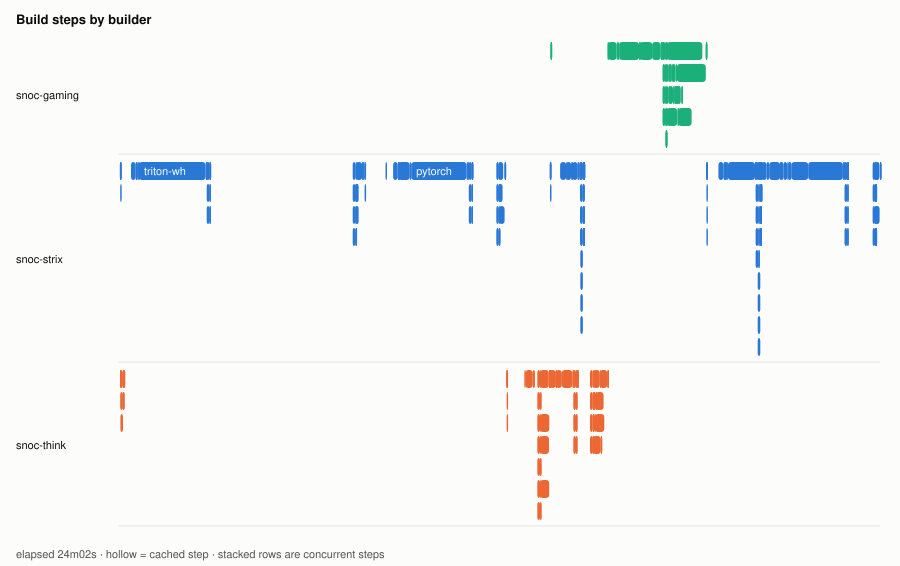
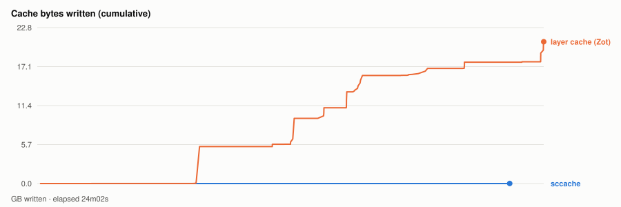

# Warm parallel wheel build — 20261104T204858Z

- **started** Wed 04 Nov 2026 14:48:58 CST
- **arch** `gfx1250` · **commit** `7821ce1`
- **wall clock** 24m03s · **exit** 0
- **sample interval** 5s · **sccache prefix** ``

> Throughput, not isolated per-target cost: the builds ran concurrently and shared the sccache store and registry, both on Strix, which is also a build node. For clean per-wheel numbers use `bench.sh cold`, which serialises on purpose.

## CPU busy by builder



## Network receive by builder



## Build steps by builder



## Interactive chart


## Cache bytes written (cumulative)



## Per-builder totals

| builder | peak CPU | mean CPU | min free mem | net received |
|---|---|---|---|---|
| snoc-gaming | 30% | 3% | 12.9GB | 2.8GB |
| snoc-strix | 99% | 12% | 14.2GB | 8.9GB |
| snoc-think | 11% | 2% | 112.8GB | 2.8GB |

## Per-target build steps

| target | node | start | build | total | prev total | change | cached |
|---|---|---|---|---|---|---|---|
| triton-wheel | snoc-strix | 00:00:03 | 2m44s | 7m39s | 6m59s | +10% | 0/23 |
| cupy-wheel | snoc-think | 00:00:03 | 0s | 7s | 3m03s | -96% | 12/22 |
| pytorch-wheel | snoc-strix | 00:07:44 | 3m18s | 4m28s | 3m52s | +16% | 0/30 |
| pytorch | snoc-think | 00:12:14 | 54s | 1m21s | 56s | +45% | 1/22 |
| torchvision-wheel | snoc-strix | 00:13:37 | 57s | 1m04s | 33s | +90% | 0/26 |
| aiter-wheel | snoc-think | 00:13:37 | 44s | 1m49s | 1m54s | -4% | 3/27 |
| nixl-wheel | snoc-gaming | 00:13:38 | 3m32s | 4m54s | 6m15s | -22% | 1/28 |
| lmcache-wheel | snoc-strix | 00:18:33 | 1m33s | 1m43s | 1m24s | +22% | 0/31 |
| vllm-wheel | snoc-strix | 00:20:17 | 2m38s | 3m45s | 4m01s | -7% | 4/38 |

*start* is elapsed from the beginning of this run, so it compares across runs. *build* is the span of the target's own steps; *total* is what the builder reported for it. The gap between them is setup plus cache export — which is why `change` is computed on *total*. A `*` marks a target whose previous run predates that measurement, so its comparison is build-vs-build and excludes the export on both sides.
*previous* is `20261104T202505Z`.

*buildkit transfer* is what BuildKit itself moved — context, layer pulls and exports. Downloads made **inside** a RUN step (apt, pip, git) are invisible to it and show up only in the node's network series above, which is why the two disagree.

## Cache writes

| stream | objects | bytes | first | last |
|---|---|---|---|---|
| sccache (compiler) | 18 | 5.5MB | +40s | +22m26s |
| Zot blobs (layer cache) | 139 | 20.8GB | +9s | +24m02s |

## Published artifacts

```
  pytorch-wheel  343.3 MB  (37 tags)
      published         arch      extra            version   rocm          size       build            wheel
      2026-11-04 13:34  gfx1201   device-gfx1201   2.15.0    10.1.0-full    382.9 MB  -                torch-2.15.0a0+git31a77fc-cp314-cp314-linux_x86_64.whl
      … 35 older tag(s); ZOT_TAGS=0 for all
      latest
  triton-wheel  431.0 MB  (40 tags)
      published         arch      extra            version   rocm          size       build            wheel
      2026-11-04 13:34  noarch    -                3.9.0     10.1.0-full    431.0 MB  -                triton-3.9.0+gitaad2a60d-cp314-cp314-linux_x86_64.whl
      … 38 older tag(s); ZOT_TAGS=0 for all
      latest
  aiter-wheel  133.6 MB  (29 tags)
      published         arch      extra            version   rocm          size       build            wheel
      2026-11-04 13:34  gfx1201   device-gfx1201   2.15.0    10.1.0-full    133.7 MB  -                amd_aiter-0.1.29.dev0+gf1965cd26.d20261104-cp314-cp314-linux_x86_64.whl
      … 27 older tag(s); ZOT_TAGS=0 for all
      latest
  nixl-wheel  12.2 MB  (31 tags)
      published         arch      extra            version   rocm          size       build            wheel
      2026-11-04 13:34  gfx1201   device-gfx1201   v1.5.2    10.1.0-full     12.2 MB  -                nixl-1.5.2-py3-none-any.whl
      … 29 older tag(s); ZOT_TAGS=0 for all
      latest
  torchvision-wheel  1.6 MB  (9 tags)
      published         arch      extra            version   rocm          size       build            wheel
      2026-11-04 13:34  gfx1201   device-gfx1201   v0.29.2   10.1.0-full      1.6 MB  -                torchvision-0.29.2+rocm10.1.0-py3-none-manylinux_2_39_x86_64.whl
      … 7 older tag(s); ZOT_TAGS=0 for all
      latest
  cupy-wheel  41.5 MB  (30 tags)
      published         arch      extra            version   rocm          size       build            wheel
      2026-11-04 13:34  gfx1201   device-gfx1201   v14.2.0   10.1.0-full     41.5 MB  -                cupy-14.2.0-cp314-cp314-linux_x86_64.whl
      … 28 older tag(s); ZOT_TAGS=0 for all
      latest
  vllm-wheel  63.0 MB  (29 tags)
      published         arch      extra            version   rocm          size       build            wheel
      2026-11-04 13:34  gfx1201   device-gfx1201   v0.33.0   10.1.0-full     74.8 MB  -                vllm-0.33.0+rocm101-cp314-cp314-linux_x86_64.whl
      … 27 older tag(s); ZOT_TAGS=0 for all
      latest
  lmcache-wheel  8.6 MB  (30 tags)
      published         arch      extra            version   rocm          size       build            wheel
      2026-11-04 13:34  gfx1201   device-gfx1201   v0.5.6    10.1.0-full      8.7 MB  -                lmcache-0.5.6-cp314-cp314-linux_x86_64.whl
      … 28 older tag(s); ZOT_TAGS=0 for all
      latest
```

