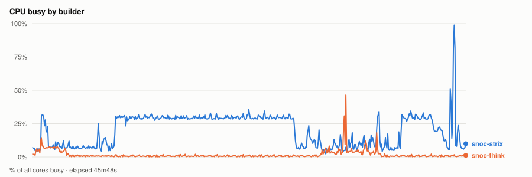
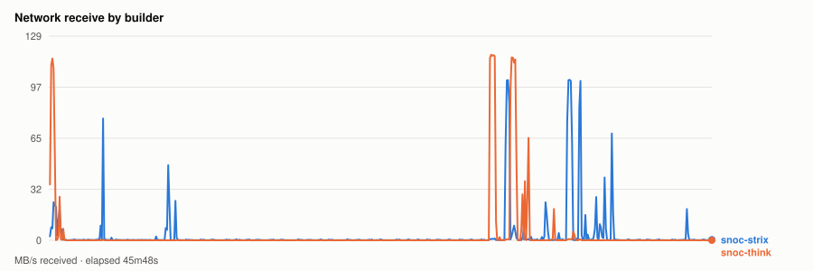
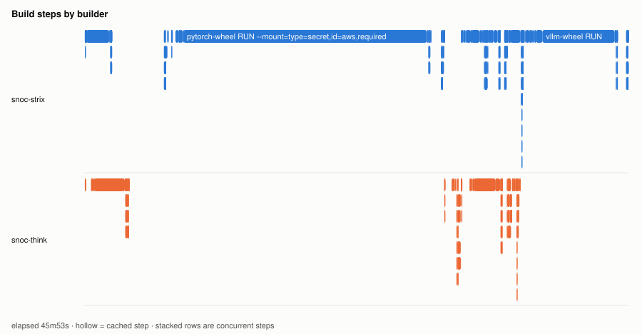
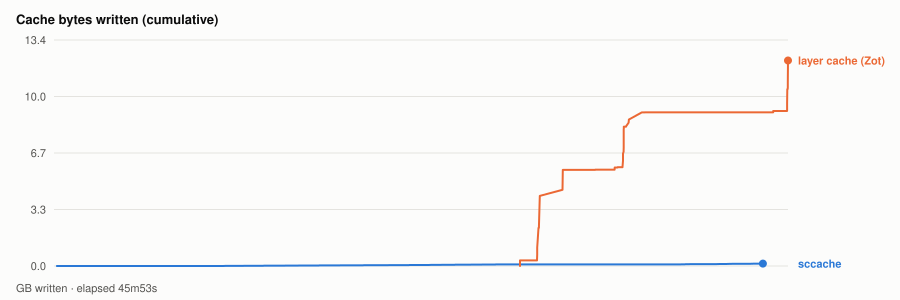

# Warm parallel wheel build — 20261105T201216Z

- **started** Thu 05 Nov 2026 14:12:16 CST
- **arch** `gfx950` · **commit** `a7daef0` (dirty)
- **wall clock** 45m53s · **exit** 0
- **sample interval** 5s · **sccache prefix** ``

> Throughput, not isolated per-target cost: the builds ran concurrently and shared the sccache store and registry, both on Strix, which is also a build node. For clean per-wheel numbers use `bench.sh cold`, which serialises on purpose.

## CPU busy by builder



## Network receive by builder



## Build steps by builder



## Interactive chart


## Cache bytes written (cumulative)



## Per-builder totals

| builder | peak CPU | mean CPU | min free mem | net received |
|---|---|---|---|---|
| snoc-strix | 99% | 20% | 9.1GB | 8.5GB |
| snoc-think | 46% | 2% | 117.3GB | 9.2GB |

## Per-target build steps

| target | node | start | build | total | prev total | change | cached |
|---|---|---|---|---|---|---|---|
| triton-wheel | snoc-strix | 00:00:03 | 2m07s | 6m59s | 7m39s | -9% | 0/23 |
| cupy-wheel | snoc-think | 00:00:03 | 3m24s | 3m41s | 7s | +2824% | 1/22 |
| pytorch-wheel | snoc-strix | 00:07:20 | 21m40s | 23m02s | 4m28s | +415% | 0/30 |
| pytorch | snoc-think | 00:30:23 | 57s | 1m25s | 1m21s | +4% | 1/22 |
| nixl-wheel | snoc-strix | 00:31:49 | 1m55s | 2m07s | 4m54s | -57% | 0/28 |
| atom-wheel | snoc-think | 00:31:49 | 3m19s | 4m18s | - | - | 1/30 |
| aiter-wheel | snoc-strix | 00:34:01 | 56s | 1m36s | 1m49s | -12% | 0/27 |
| lmcache-wheel | snoc-strix | 00:35:38 | 1m12s | 1m21s | 1m43s | -21% | 3/31 |
| torchvision-wheel | snoc-think | 00:36:08 | 20s | 36s | 1m04s | -44% | 2/26 |
| vllm-wheel | snoc-strix | 00:37:00 | 7m51s | 8m52s | 3m45s | +136% | 4/38 |

*start* is elapsed from the beginning of this run, so it compares across runs. *build* is the span of the target's own steps; *total* is what the builder reported for it. The gap between them is setup plus cache export — which is why `change` is computed on *total*. A `*` marks a target whose previous run predates that measurement, so its comparison is build-vs-build and excludes the export on both sides.
*previous* is `20261104T204858Z`.

*buildkit transfer* is what BuildKit itself moved — context, layer pulls and exports. Downloads made **inside** a RUN step (apt, pip, git) are invisible to it and show up only in the node's network series above, which is why the two disagree.

## Cache writes

| stream | objects | bytes | first | last |
|---|---|---|---|---|
| sccache (compiler) | 667 | 143.3MB | +11s | +44m19s |
| Zot blobs (layer cache) | 89 | 12.2GB | +29m07s | +45m53s |

## Published artifacts

```
  pytorch-wheel  340.6 MB  (41 tags)
      published         arch      extra            version   rocm          size       build            wheel
      2026-11-05 13:47  gfx950    device-gfx950    2.15.0    10.1.0-full    340.6 MB  -                torch-2.15.0a0+git31a77fc-cp314-cp314-linux_x86_64.whl
      … 39 older tag(s); ZOT_TAGS=0 for all
      latest
  triton-wheel  431.0 MB  (43 tags)
      published         arch      extra            version   rocm          size       build            wheel
      2026-11-05 13:47  noarch    -                3.9.0     10.1.0-full    431.0 MB  -                triton-3.9.0+gitaad2a60d-cp314-cp314-linux_x86_64.whl
      … 41 older tag(s); ZOT_TAGS=0 for all
      latest
  aiter-wheel  133.7 MB  (33 tags)
      published         arch      extra            version   rocm          size       build            wheel
      2026-11-05 13:47  gfx950    device-gfx950    2.15.0    10.1.0-full    133.7 MB  -                amd_aiter-0.1.29.dev0+gf1965cd26.d20261105-cp314-cp314-linux_x86_64.whl
      … 31 older tag(s); ZOT_TAGS=0 for all
      latest
  nixl-wheel  12.2 MB  (35 tags)
      published         arch      extra            version   rocm          size       build            wheel
      2026-11-05 13:47  gfx950    device-gfx950    v1.5.2    10.1.0-full     12.2 MB  -                nixl-1.5.2-py3-none-any.whl
      … 33 older tag(s); ZOT_TAGS=0 for all
      latest
  torchvision-wheel  1.6 MB  (13 tags)
      published         arch      extra            version   rocm          size       build            wheel
      2026-11-05 13:47  gfx950    device-gfx950    v0.29.2   10.1.0-full      1.6 MB  -                torchvision-0.29.2+rocm10.1.0-py3-none-manylinux_2_39_x86_64.whl
      … 11 older tag(s); ZOT_TAGS=0 for all
      latest
  atom-wheel  19.9 MB  (7 tags)
      published         arch      extra            version   rocm          size       build            wheel
      2026-11-05 13:47  gfx950    device-gfx950    v0.1.9    10.1.0-full     19.9 MB  -                atom-0.1.9+rocm10.1.0-cp314-none-linux_x86_64.whl
      … 5 older tag(s); ZOT_TAGS=0 for all
      latest
  cupy-wheel  41.2 MB  (34 tags)
      published         arch      extra            version   rocm          size       build            wheel
      2026-11-05 13:47  gfx950    device-gfx950    v14.2.0   10.1.0-full     41.2 MB  -                cupy-14.2.0-cp314-cp314-linux_x86_64.whl
      … 32 older tag(s); ZOT_TAGS=0 for all
      latest
  vllm-wheel  76.1 MB  (33 tags)
      published         arch      extra            version   rocm          size       build            wheel
      2026-11-05 13:47  gfx950    device-gfx950    v0.33.0   10.1.0-full     76.1 MB  -                vllm-0.33.0+rocm101-cp314-cp314-linux_x86_64.whl
      … 31 older tag(s); ZOT_TAGS=0 for all
      latest
  lmcache-wheel  8.6 MB  (34 tags)
      published         arch      extra            version   rocm          size       build            wheel
      2026-11-05 13:47  gfx950    device-gfx950    v0.5.6    10.1.0-full      8.6 MB  -                lmcache-0.5.6-cp314-cp314-linux_x86_64.whl
      … 32 older tag(s); ZOT_TAGS=0 for all
      latest
```

