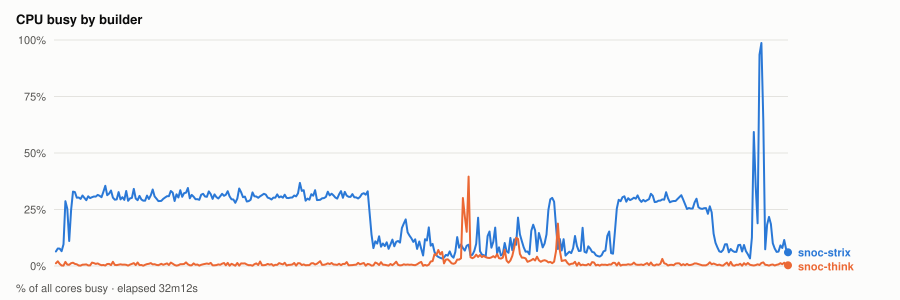
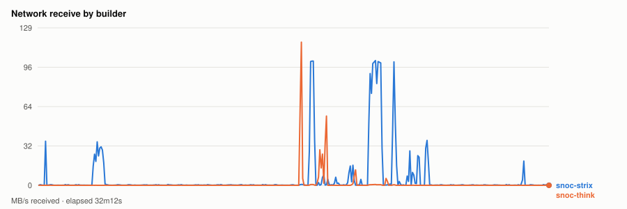
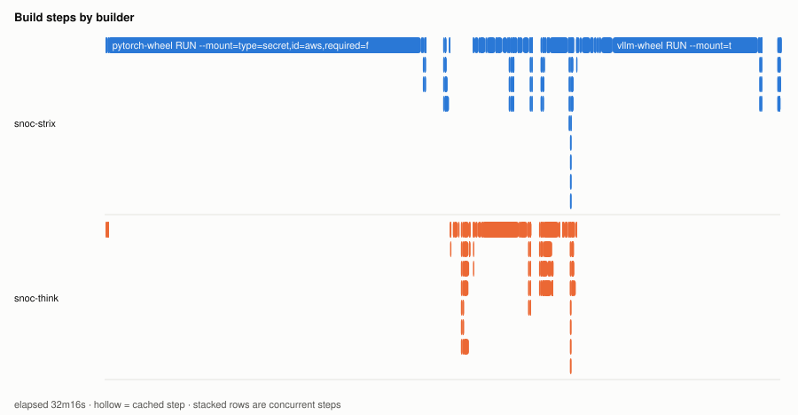
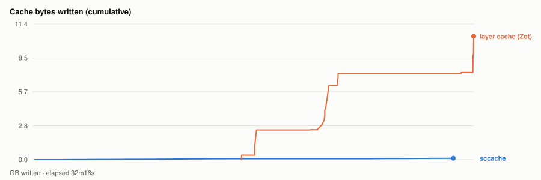

# Warm parallel wheel build — 20261105T221617Z

- **started** Thu 05 Nov 2026 16:16:17 CST
- **arch** `gfx1201` · **commit** `a7daef0` (dirty)
- **wall clock** 32m16s · **exit** 0
- **sample interval** 5s · **sccache prefix** ``

> Throughput, not isolated per-target cost: the builds ran concurrently and shared the sccache store and registry, both on Strix, which is also a build node. For clean per-wheel numbers use `bench.sh cold`, which serialises on purpose.

## CPU busy by builder



## Network receive by builder



## Build steps by builder



## Interactive chart


## Cache bytes written (cumulative)



## Per-builder totals

| builder | peak CPU | mean CPU | min free mem | net received |
|---|---|---|---|---|
| snoc-strix | 99% | 22% | 6.3GB | 10.6GB |
| snoc-think | 40% | 2% | 117.0GB | 1.9GB |

## Per-target build steps

| target | node | start | build | total | prev total | change | cached |
|---|---|---|---|---|---|---|---|
| triton-wheel | snoc-strix | 00:00:02 | 0s | 6s | 7m17s | -99% | 12/23 |
| cupy-wheel | snoc-think | 00:00:02 | 0s | 5s | 3m11s | -97% | 12/22 |
| pytorch-wheel | snoc-strix | 00:00:09 | 15m01s | 16m18s | - | - | 9/30 |
| pytorch | snoc-think | 00:16:29 | 28s | 55s | - | - | 2/22 |
| nixl-wheel | snoc-strix | 00:17:35 | 1m42s | 1m54s | - | - | 0/28 |
| atom-wheel | snoc-think | 00:17:35 | 2m38s | 4m06s | - | - | 1/30 |
| aiter-wheel | snoc-strix | 00:19:30 | 47s | 1m25s | - | - | 2/27 |
| lmcache-wheel | snoc-strix | 00:20:56 | 1m13s | 1m25s | - | - | 3/31 |
| torchvision-wheel | snoc-think | 00:21:51 | 21s | 38s | - | - | 2/26 |
| vllm-wheel | snoc-strix | 00:22:31 | 8m44s | 9m45s | - | - | 4/38 |

*start* is elapsed from the beginning of this run, so it compares across runs. *build* is the span of the target's own steps; *total* is what the builder reported for it. The gap between them is setup plus cache export — which is why `change` is computed on *total*. A `*` marks a target whose previous run predates that measurement, so its comparison is build-vs-build and excludes the export on both sides.
*previous* is `20261105T215929Z`.

*buildkit transfer* is what BuildKit itself moved — context, layer pulls and exports. Downloads made **inside** a RUN step (apt, pip, git) are invisible to it and show up only in the node's network series above, which is why the two disagree.

## Cache writes

| stream | objects | bytes | first | last |
|---|---|---|---|---|
| sccache (compiler) | 505 | 115.8MB | +9s | +30m47s |
| Zot blobs (layer cache) | 99 | 10.3GB | +15m17s | +32m16s |

## Published artifacts

```
  pytorch-wheel  383.9 MB  (42 tags)
      published         arch      extra            version   rocm          size       build            wheel
      2026-11-05 13:47  gfx1201   device-gfx1201   2.15.0    10.1.0-full    383.9 MB  -                torch-2.15.0a0+git31a77fc-cp314-cp314-linux_x86_64.whl
      … 40 older tag(s); ZOT_TAGS=0 for all
      latest
  triton-wheel  431.0 MB  (43 tags)
      published         arch      extra            version   rocm          size       build            wheel
      2026-11-05 13:47  noarch    -                3.9.0     10.1.0-full    431.0 MB  -                triton-3.9.0+gitaad2a60d-cp314-cp314-linux_x86_64.whl
      … 41 older tag(s); ZOT_TAGS=0 for all
      latest
  aiter-wheel  133.7 MB  (34 tags)
      published         arch      extra            version   rocm          size       build            wheel
      2026-11-05 13:47  gfx1201   device-gfx1201   2.15.0    10.1.0-full    133.7 MB  -                amd_aiter-0.1.29.dev0+gf1965cd26.d20261105-cp314-cp314-linux_x86_64.whl
      … 32 older tag(s); ZOT_TAGS=0 for all
      latest
  nixl-wheel  12.2 MB  (36 tags)
      published         arch      extra            version   rocm          size       build            wheel
      2026-11-05 13:47  gfx1201   device-gfx1201   v1.5.2    10.1.0-full     12.2 MB  -                nixl-1.5.2-py3-none-any.whl
      … 34 older tag(s); ZOT_TAGS=0 for all
      latest
  torchvision-wheel  1.6 MB  (14 tags)
      published         arch      extra            version   rocm          size       build            wheel
      2026-11-05 13:47  gfx1201   device-gfx1201   v0.29.2   10.1.0-full      1.6 MB  -                torchvision-0.29.2+rocm10.1.0-py3-none-manylinux_2_39_x86_64.whl
      … 12 older tag(s); ZOT_TAGS=0 for all
      latest
  atom-wheel  19.9 MB  (9 tags)
      published         arch      extra            version   rocm          size       build            wheel
      2026-11-05 13:47  gfx1201   device-gfx1201   v0.1.9    10.1.0-full     19.9 MB  -                atom-0.1.9+rocm10.1.0-cp314-none-linux_x86_64.whl
      … 7 older tag(s); ZOT_TAGS=0 for all
      latest
  cupy-wheel  41.5 MB  (35 tags)
      published         arch      extra            version   rocm          size       build            wheel
      2026-11-05 13:47  gfx1201   device-gfx1201   v14.2.0   10.1.0-full     41.5 MB  -                cupy-14.2.0-cp314-cp314-linux_x86_64.whl
      … 33 older tag(s); ZOT_TAGS=0 for all
      latest
  vllm-wheel  74.8 MB  (34 tags)
      published         arch      extra            version   rocm          size       build            wheel
      2026-11-05 13:47  gfx1201   device-gfx1201   v0.33.0   10.1.0-full     74.8 MB  -                vllm-0.33.0+rocm101-cp314-cp314-linux_x86_64.whl
      … 32 older tag(s); ZOT_TAGS=0 for all
      latest
  lmcache-wheel  8.7 MB  (35 tags)
      published         arch      extra            version   rocm          size       build            wheel
      2026-11-05 13:47  gfx1201   device-gfx1201   v0.5.6    10.1.0-full      8.7 MB  -                lmcache-0.5.6-cp314-cp314-linux_x86_64.whl
      … 33 older tag(s); ZOT_TAGS=0 for all
      latest
```

