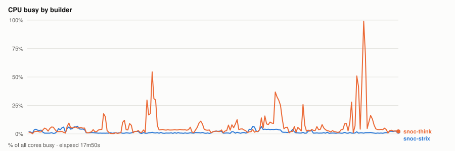
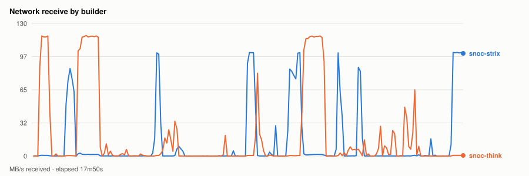
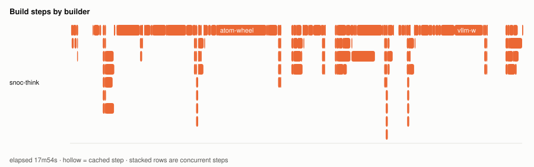
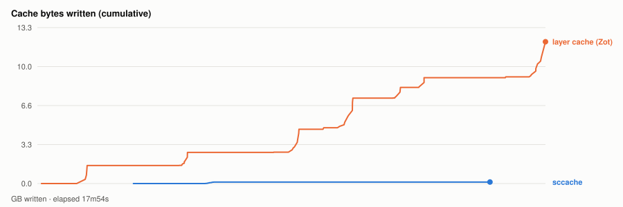

# Warm parallel wheel build — 20261109T182444Z

- **started** Mon 09 Nov 2026 12:24:44 CST
- **arch** `gfx950` · **commit** `0cc4f06`
- **wall clock** 17m54s · **exit** 0
- **sample interval** 5s · **sccache prefix** ``

> Throughput, not isolated per-target cost: the builds ran concurrently and shared the sccache store and registry, both on Strix, which is also a build node. For clean per-wheel numbers use `bench.sh cold`, which serialises on purpose.

## CPU busy by builder



## Network receive by builder



## Build steps by builder



## Interactive chart


## Cache bytes written (cumulative)



## Per-builder totals

| builder | peak CPU | mean CPU | min free mem | net received |
|---|---|---|---|---|
| snoc-strix | 7% | 2% | 6.1GB | 13.5GB |
| snoc-think | 99% | 7% | 112.6GB | 19.0GB |

## Per-target build steps

| target | node | start | build | total | prev total | change | cached |
|---|---|---|---|---|---|---|---|
| triton-wheel | snoc-think | 00:00:02 | 0s | 6s | 7m13s | -99% | 14/24 |
| pytorch-wheel | snoc-think | 00:00:09 | 0s | 5s | 9m05s | -99% | 14/31 |
| pytorch | snoc-think | 00:00:16 | 57s | 1m28s | - | - | 1/22 |
| cupy-wheel | snoc-think | 00:01:50 | 55s | 1m00s | 1m13s | -17% | 16/27 |
| nixl-wheel | snoc-think | 00:02:56 | 1m58s | 2m21s | - | - | 1/30 |
| atom-wheel | snoc-think | 00:05:18 | 2m55s | 3m54s | - | - | 2/32 |
| aiter-wheel | snoc-think | 00:09:14 | 44s | 1m53s | - | - | 2/29 |
| lmcache-wheel | snoc-think | 00:11:08 | 1m18s | 1m39s | - | - | 3/34 |
| torchvision-wheel | snoc-think | 00:13:00 | 19s | 37s | - | - | 2/26 |
| vllm-wheel | snoc-think | 00:13:38 | 2m45s | 4m15s | - | - | 4/38 |

*start* is elapsed from the beginning of this run, so it compares across runs. *build* is the span of the target's own steps; *total* is what the builder reported for it. The gap between them is setup plus cache export — which is why `change` is computed on *total*. A `*` marks a target whose previous run predates that measurement, so its comparison is build-vs-build and excludes the export on both sides.
*previous* is `20261107T014539Z`.

*buildkit transfer* is what BuildKit itself moved — context, layer pulls and exports. Downloads made **inside** a RUN step (apt, pip, git) are invisible to it and show up only in the node's network series above, which is why the two disagree.

## Cache writes

| stream | objects | bytes | first | last |
|---|---|---|---|---|
| sccache (compiler) | 119 | 130.8MB | +3m23s | +15m57s |
| Zot blobs (layer cache) | 151 | 12.1GB | +8s | +17m54s |

## Published artifacts

```
  pytorch-wheel  340.5 MB  (46 tags)
      published         arch      extra            version   rocm          size       build            wheel
      2026-11-09 12:24  gfx950    device-gfx950    2.15.0    10.1.0-full    340.5 MB  -                torch-2.15.0a0+git31a77fc.rocm10.1.0-cp314-cp314-linux_x86_64.whl
      … 44 older tag(s); ZOT_TAGS=0 for all
      latest
  triton-wheel  431.2 MB  (45 tags)
      published         arch      extra            version   rocm          size       build            wheel
      2026-11-09 12:24  noarch    -                3.9.0     10.1.0-full    431.2 MB  -                triton-3.9.0+gitaad2a60d.rocm10.1.0-cp314-cp314-linux_x86_64.whl
      … 43 older tag(s); ZOT_TAGS=0 for all
      latest
  aiter-wheel  133.6 MB  (37 tags)
      published         arch      extra            version   rocm          size       build            wheel
      2026-11-09 12:24  gfx950    device-gfx950    2.15.0    10.1.0-full    133.6 MB  -                amd_aiter-0.1.29.dev0+gf1965cd26.d20261109.rocm10.1.0-cp314-cp314-linux_x86_64.whl
      … 35 older tag(s); ZOT_TAGS=0 for all
      latest
  nixl-wheel  12.2 MB  (39 tags)
      published         arch      extra            version   rocm          size       build            wheel
      2026-11-09 12:24  gfx950    device-gfx950    v1.5.2    10.1.0-full     12.2 MB  -                nixl-1.5.2+rocm10.1.0-py3-none-any.whl
      … 37 older tag(s); ZOT_TAGS=0 for all
      latest
  torchvision-wheel  1.6 MB  (17 tags)
      published         arch      extra            version   rocm          size       build            wheel
      2026-11-09 12:24  gfx950    device-gfx950    v0.29.2   10.1.0-full      1.6 MB  -                torchvision-0.29.2+rocm10.1.0-py3-none-manylinux_2_39_x86_64.whl
      … 15 older tag(s); ZOT_TAGS=0 for all
      latest
  atom-wheel  22.9 MB  (13 tags)
      published         arch      extra            version   rocm          size       build            wheel
      2026-11-09 12:24  gfx950    device-gfx950    v0.1.9    10.1.0-full     22.9 MB  -                atom-0.1.9+rocm10.1.0-cp314-none-manylinux_2_38_x86_64.whl
      … 11 older tag(s); ZOT_TAGS=0 for all
      latest
  cupy-wheel  41.2 MB  (39 tags)
      published         arch      extra            version   rocm          size       build            wheel
      2026-11-09 12:24  gfx950    device-gfx950    v14.2.0   10.1.0-full     41.2 MB  -                cupy-14.2.0+rocm10.1.0-cp314-cp314-manylinux_2_39_x86_64.whl
      … 37 older tag(s); ZOT_TAGS=0 for all
      latest
  vllm-wheel  76.1 MB  (37 tags)
      published         arch      extra            version   rocm          size       build            wheel
      2026-11-09 12:24  gfx950    device-gfx950    v0.33.0   10.1.0-full     76.1 MB  -                vllm-0.33.0+rocm101-cp314-cp314-linux_x86_64.whl
      … 35 older tag(s); ZOT_TAGS=0 for all
      latest
  lmcache-wheel  8.6 MB  (38 tags)
      published         arch      extra            version   rocm          size       build            wheel
      2026-11-09 12:24  gfx950    device-gfx950    v0.5.6    10.1.0-full      8.6 MB  -                lmcache-0.5.6+rocm10.1.0-cp314-cp314-manylinux_2_39_x86_64.whl
      … 36 older tag(s); ZOT_TAGS=0 for all
      latest
```

