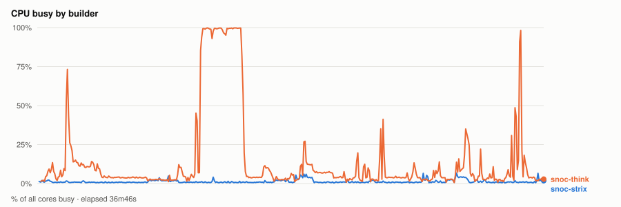
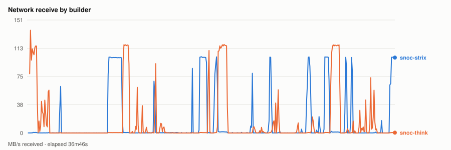
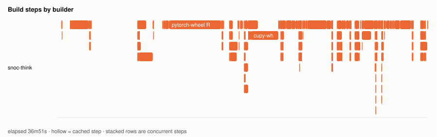
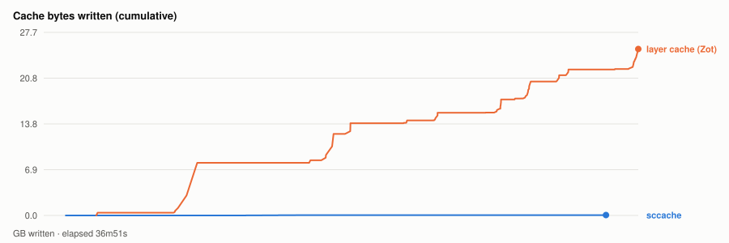

# Warm parallel wheel build — 20261109T193315Z

- **started** Mon 09 Nov 2026 13:33:15 CST
- **arch** `gfx1201` · **commit** `c890784`
- **wall clock** 36m51s · **exit** 0
- **sample interval** 5s · **sccache prefix** ``

> Throughput, not isolated per-target cost: the builds ran concurrently and shared the sccache store and registry, both on Strix, which is also a build node. For clean per-wheel numbers use `bench.sh cold`, which serialises on purpose.

## CPU busy by builder



## Network receive by builder



## Build steps by builder



## Interactive chart


## Cache bytes written (cumulative)



## Per-builder totals

| builder | peak CPU | mean CPU | min free mem | net received |
|---|---|---|---|---|
| snoc-strix | 7% | 1% | 7.0GB | 28.7GB |
| snoc-think | 100% | 15% | 79.6GB | 29.5GB |

## Per-target build steps

| target | node | start | build | total | prev total | change | cached |
|---|---|---|---|---|---|---|---|
| triton-wheel | snoc-think | 00:00:24 | 2m44s | 9m06s | 6s | +8671% | 1/24 |
| pytorch-wheel | snoc-think | 00:09:31 | 6m49s | 8m26s | 5s | +8766% | 1/31 |
| pytorch | snoc-think | 00:18:03 | 27s | 57s | 1m28s | -36% | 1/22 |
| cupy-wheel | snoc-think | 00:19:01 | 3m11s | 3m29s | 1m00s | +245% | 2/27 |
| nixl-wheel | snoc-think | 00:22:32 | 1m28s | 1m52s | 2m21s | -20% | 1/30 |
| atom-wheel | snoc-think | 00:24:25 | 2m52s | 3m55s | 3m54s | +0% | 2/32 |
| aiter-wheel | snoc-think | 00:28:21 | 43s | 1m49s | 1m53s | -3% | 3/29 |
| lmcache-wheel | snoc-think | 00:30:18 | 1m17s | 1m37s | 1m39s | -2% | 3/34 |
| torchvision-wheel | snoc-think | 00:31:57 | 17s | 33s | 37s | -9% | 2/26 |
| vllm-wheel | snoc-think | 00:32:32 | 2m45s | 4m18s | 4m15s | +1% | 4/38 |

*start* is elapsed from the beginning of this run, so it compares across runs. *build* is the span of the target's own steps; *total* is what the builder reported for it. The gap between them is setup plus cache export — which is why `change` is computed on *total*. A `*` marks a target whose previous run predates that measurement, so its comparison is build-vs-build and excludes the export on both sides.
*previous* is `20261109T182444Z`.

*buildkit transfer* is what BuildKit itself moved — context, layer pulls and exports. Downloads made **inside** a RUN step (apt, pip, git) are invisible to it and show up only in the node's network series above, which is why the two disagree.

## Cache writes

| stream | objects | bytes | first | last |
|---|---|---|---|---|
| sccache (compiler) | 345 | 57.5MB | +1m22s | +34m51s |
| Zot blobs (layer cache) | 196 | 25.2GB | +3m15s | +36m51s |

## Published artifacts

```
  pytorch-wheel  383.9 MB  (47 tags)
      published         arch      extra            version   rocm          size       build            wheel
      2026-11-09 13:19  gfx1201   device-gfx1201   2.15.0    10.1.0-full    383.9 MB  -                torch-2.15.0a0+git31a77fc.rocm10.1.0-cp314-cp314-linux_x86_64.whl
      … 45 older tag(s); ZOT_TAGS=0 for all
      latest
  triton-wheel  431.2 MB  (46 tags)
      published         arch      extra            version   rocm          size       build            wheel
      2026-11-09 13:19  noarch    -                3.9.0     10.1.0-full    431.2 MB  -                triton-3.9.0+gitaad2a60d.rocm10.1.0-cp314-cp314-linux_x86_64.whl
      … 44 older tag(s); ZOT_TAGS=0 for all
      latest
  aiter-wheel  133.6 MB  (38 tags)
      published         arch      extra            version   rocm          size       build            wheel
      2026-11-09 13:19  gfx1201   device-gfx1201   2.15.0    10.1.0-full    133.6 MB  -                amd_aiter-0.1.29.dev0+gf1965cd26.d20261109.rocm10.1.0-cp314-cp314-linux_x86_64.whl
      … 36 older tag(s); ZOT_TAGS=0 for all
      latest
  nixl-wheel  12.2 MB  (40 tags)
      published         arch      extra            version   rocm          size       build            wheel
      2026-11-09 13:19  gfx1201   device-gfx1201   v1.5.2    10.1.0-full     12.2 MB  -                nixl-1.5.2+rocm10.1.0-py3-none-any.whl
      … 38 older tag(s); ZOT_TAGS=0 for all
      latest
  torchvision-wheel  1.6 MB  (18 tags)
      published         arch      extra            version   rocm          size       build            wheel
      2026-11-09 13:19  gfx1201   device-gfx1201   v0.29.2   10.1.0-full      1.6 MB  -                torchvision-0.29.2+rocm10.1.0-py3-none-manylinux_2_39_x86_64.whl
      … 16 older tag(s); ZOT_TAGS=0 for all
      latest
  atom-wheel  22.9 MB  (14 tags)
      published         arch      extra            version   rocm          size       build            wheel
      2026-11-09 13:19  gfx1201   device-gfx1201   v0.1.9    10.1.0-full     22.9 MB  -                atom-0.1.9+rocm10.1.0-cp314-none-manylinux_2_38_x86_64.whl
      … 12 older tag(s); ZOT_TAGS=0 for all
      latest
  cupy-wheel  41.5 MB  (40 tags)
      published         arch      extra            version   rocm          size       build            wheel
      2026-11-09 13:19  gfx1201   device-gfx1201   v14.2.0   10.1.0-full     41.5 MB  -                cupy-14.2.0+rocm10.1.0-cp314-cp314-manylinux_2_39_x86_64.whl
      … 38 older tag(s); ZOT_TAGS=0 for all
      latest
  vllm-wheel  74.8 MB  (38 tags)
      published         arch      extra            version   rocm          size       build            wheel
      2026-11-09 13:19  gfx1201   device-gfx1201   v0.33.0   10.1.0-full     74.8 MB  -                vllm-0.33.0+rocm101-cp314-cp314-linux_x86_64.whl
      … 36 older tag(s); ZOT_TAGS=0 for all
      latest
  lmcache-wheel  8.6 MB  (39 tags)
      published         arch      extra            version   rocm          size       build            wheel
      2026-11-09 13:19  gfx1201   device-gfx1201   v0.5.6    10.1.0-full      8.7 MB  -                lmcache-0.5.6+rocm10.1.0-cp314-cp314-manylinux_2_39_x86_64.whl
      … 37 older tag(s); ZOT_TAGS=0 for all
      latest
```

