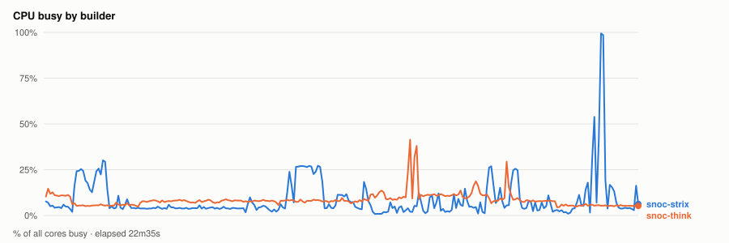
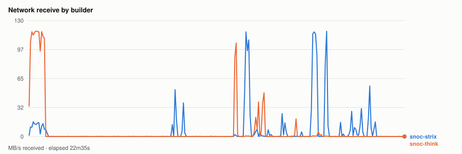
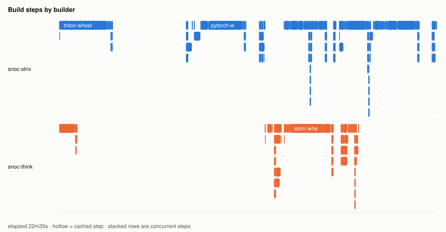
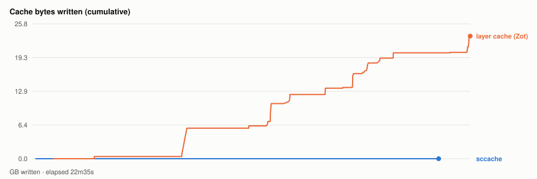

# Warm parallel wheel build — 20261111T020213Z

- **started** Tue 10 Nov 2026 20:02:13 CST
- **arch** `gfx1151` · **commit** `e3f1c3c`
- **wall clock** 22m35s · **exit** 0
- **sample interval** 5s · **sccache prefix** ``

> Throughput, not isolated per-target cost: the builds ran concurrently and shared the sccache store and registry, both on Strix, which is also a build node. For clean per-wheel numbers use `bench.sh cold`, which serialises on purpose.

## CPU busy by builder



## Network receive by builder



## Build steps by builder



## Interactive chart


## Cache bytes written (cumulative)



## Per-builder totals

| builder | peak CPU | mean CPU | min free mem | net received |
|---|---|---|---|---|
| snoc-strix | 99% | 9% | 9.8GB | 8.3GB |
| snoc-think | 41% | 9% | 96.7GB | 8.2GB |

## Per-target build steps

| target | node | start | build | total | prev total | change | cached |
|---|---|---|---|---|---|---|---|
| triton-wheel | snoc-strix | 00:00:02 | 3m02s | 7m56s | 7m51s | +1% | 2/27 |
| cupy-wheel | snoc-think | 00:00:02 | 56s | 1m02s | 1m04s | -4% | 16/27 |
| pytorch-wheel | snoc-strix | 00:08:05 | 2m59s | 4m14s | 4m05s | +4% | 4/34 |
| pytorch | snoc-think | 00:12:20 | 28s | 57s | 52s | +10% | 2/22 |
| nixl-wheel | snoc-strix | 00:13:28 | 1m28s | 1m38s | 1m42s | -4% | 1/30 |
| atom-wheel | snoc-think | 00:13:29 | 2m50s | 3m50s | 3m47s | +1% | 2/32 |
| aiter-wheel | snoc-strix | 00:15:07 | 47s | 1m26s | 1m28s | -2% | 3/32 |
| lmcache-wheel | snoc-strix | 00:16:46 | 1m41s | 1m50s | 1m41s | +10% | 3/34 |
| torchvision-wheel | snoc-think | 00:17:21 | 20s | 35s | 34s | +3% | 2/26 |
| vllm-wheel | snoc-strix | 00:18:38 | 2m49s | 3m57s | 3m42s | +7% | 4/41 |

*start* is elapsed from the beginning of this run, so it compares across runs. *build* is the span of the target's own steps; *total* is what the builder reported for it. The gap between them is setup plus cache export — which is why `change` is computed on *total*. A `*` marks a target whose previous run predates that measurement, so its comparison is build-vs-build and excludes the export on both sides.
*previous* is `20261111T013415Z`.

*buildkit transfer* is what BuildKit itself moved — context, layer pulls and exports. Downloads made **inside** a RUN step (apt, pip, git) are invisible to it and show up only in the node's network series above, which is why the two disagree.

## Cache writes

| stream | objects | bytes | first | last |
|---|---|---|---|---|
| sccache (compiler) | 18 | 5.2MB | +11s | +20m58s |
| Zot blobs (layer cache) | 183 | 23.4GB | +1m04s | +22m35s |

## Published artifacts

```
  pytorch-wheel  438.4 MB  (57 tags)
      published         arch      extra            version   rocm          size       build            wheel
      2026-11-10 19:00  gfx1151   device-gfx1151   2.15.0    10.1.0-full    438.4 MB  -                torch-2.15.0a0+git31a77fc.rocm10.1.0-cp314-cp314-linux_x86_64.whl
      … 55 older tag(s); ZOT_TAGS=0 for all
      latest
  triton-wheel  431.2 MB  (49 tags)
      published         arch      extra            version   rocm          size       build            wheel
      2026-11-10 19:00  noarch    -                3.9.0     10.1.0-full    431.2 MB  -                triton-3.9.0+gitaad2a60d.rocm10.1.0-cp314-cp314-linux_x86_64.whl
      … 47 older tag(s); ZOT_TAGS=0 for all
      latest
  aiter-wheel  134.9 MB  (48 tags)
      published         arch      extra            version   rocm          size       build            wheel
      2026-11-10 19:00  gfx1151   device-gfx1151   2.15.0    10.1.0-full    134.9 MB  -                amd_aiter-0.1.30.dev0+ga0c4b69c1.d20261111.rocm10.1.0-cp314-cp314-linux_x86_64.whl
      … 46 older tag(s); ZOT_TAGS=0 for all
      latest
  nixl-wheel  12.2 MB  (50 tags)
      published         arch      extra            version   rocm          size       build            wheel
      2026-11-10 19:00  gfx1151   device-gfx1151   v1.5.2    10.1.0-full     12.2 MB  -                nixl-1.5.2+rocm10.1.0-py3-none-any.whl
      … 48 older tag(s); ZOT_TAGS=0 for all
      latest
  torchvision-wheel  1.6 MB  (28 tags)
      published         arch      extra            version   rocm          size       build            wheel
      2026-11-10 19:00  gfx1151   device-gfx1151   v0.29.2   10.1.0-full      1.6 MB  -                torchvision-0.29.2+rocm10.1.0-py3-none-manylinux_2_39_x86_64.whl
      … 26 older tag(s); ZOT_TAGS=0 for all
      latest
  atom-wheel  22.9 MB  (24 tags)
      published         arch      extra            version   rocm          size       build            wheel
      2026-11-10 19:00  gfx1151   device-gfx1151   v0.1.9    10.1.0-full     22.9 MB  -                atom-0.1.9+rocm10.1.0-cp314-none-manylinux_2_38_x86_64.whl
      … 22 older tag(s); ZOT_TAGS=0 for all
      latest
  cupy-wheel  41.3 MB  (50 tags)
      published         arch      extra            version   rocm          size       build            wheel
      2026-11-10 19:00  gfx1151   device-gfx1151   v14.2.0   10.1.0-full     41.3 MB  -                cupy-14.2.0+rocm10.1.0-cp314-cp314-manylinux_2_39_x86_64.whl
      … 48 older tag(s); ZOT_TAGS=0 for all
      latest
  vllm-wheel  80.7 MB  (48 tags)
      published         arch      extra            version   rocm          size       build            wheel
      2026-11-10 19:00  gfx1151   device-gfx1151   v0.33.0   10.1.0-full     80.7 MB  -                vllm-0.33.0+rocm101-cp314-cp314-linux_x86_64.whl
      … 46 older tag(s); ZOT_TAGS=0 for all
      latest
  lmcache-wheel  8.9 MB  (53 tags)
      published         arch      extra            version   rocm          size       build            wheel
      2026-11-10 19:00  gfx1151   device-gfx1151   v0.5.7    10.1.0-full      8.9 MB  -                lmcache-0.5.7+rocm10.1.0-cp314-cp314-manylinux_2_39_x86_64.whl
      … 51 older tag(s); ZOT_TAGS=0 for all
      latest
```

