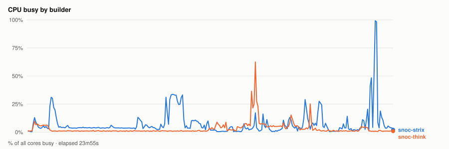
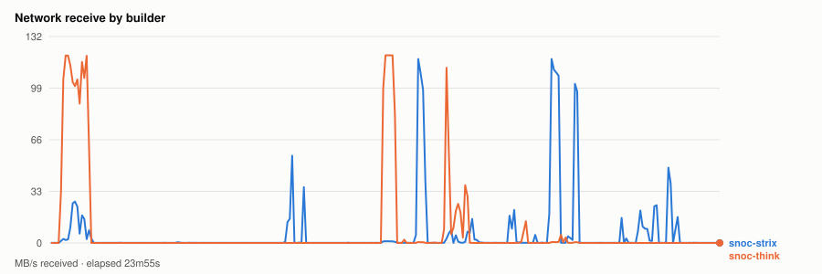
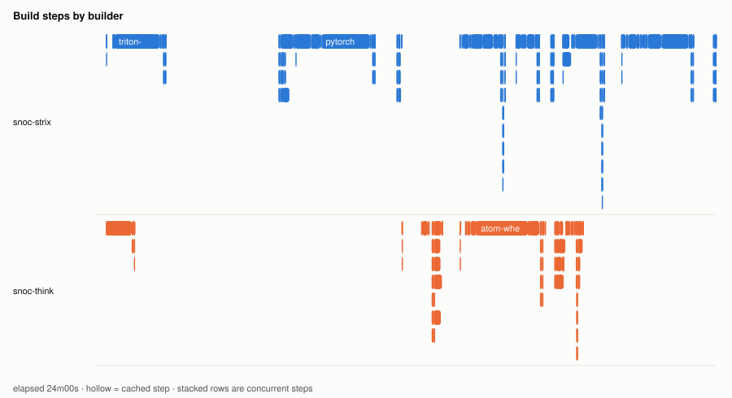
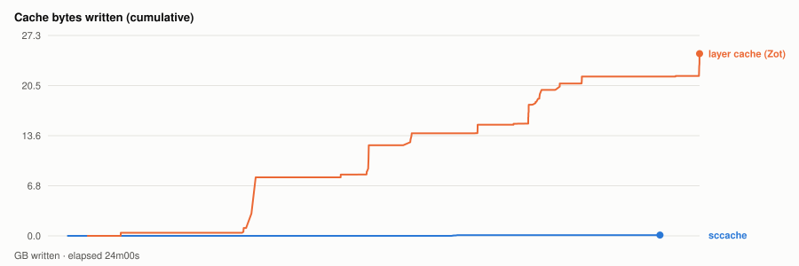

# Warm parallel wheel build — 20261113T155030Z

- **started** Fri 13 Nov 2026 09:50:30 CST
- **arch** `gfx1201` · **commit** `3c717a5`
- **wall clock** 24m01s · **exit** 0
- **sample interval** 5s · **sccache prefix** ``

> Throughput, not isolated per-target cost: the builds ran concurrently and shared the sccache store and registry, both on Strix, which is also a build node. For clean per-wheel numbers use `bench.sh cold`, which serialises on purpose.

## CPU busy by builder



## Network receive by builder



## Build steps by builder



## Interactive chart


## Cache bytes written (cumulative)



## Per-builder totals

| builder | peak CPU | mean CPU | min free mem | net received |
|---|---|---|---|---|
| snoc-strix | 99% | 8% | 12.8GB | 8.2GB |
| snoc-think | 62% | 3% | 96.7GB | 11.4GB |

## Per-target build steps

| target | node | start | build | total | prev total | change | cached |
|---|---|---|---|---|---|---|---|
| triton-wheel | snoc-strix | 00:00:22 | 2m12s | 7m16s | 7m56s | -8% | 2/27 |
| cupy-wheel | snoc-think | 00:00:23 | 59s | 1m05s | 1m02s | +5% | 16/27 |
| pytorch-wheel | snoc-strix | 00:07:40 | 3m01s | 4m09s | 4m14s | -2% | 3/34 |
| pytorch | snoc-think | 00:11:50 | 1m05s | 1m34s | 57s | +62% | 1/22 |
| nixl-wheel | snoc-strix | 00:14:04 | 1m34s | 1m45s | 1m38s | +7% | 1/30 |
| atom-wheel | snoc-think | 00:14:05 | 3m06s | 4m06s | 3m50s | +7% | 1/32 |
| aiter-wheel | snoc-strix | 00:16:15 | 48s | 1m27s | 1m26s | +1% | 3/32 |
| lmcache-wheel | snoc-strix | 00:18:04 | 1m26s | 1m36s | 1m50s | -13% | 3/34 |
| torchvision-wheel | snoc-think | 00:18:13 | 21s | 37s | 35s | +8% | 2/26 |
| vllm-wheel | snoc-strix | 00:20:20 | 2m41s | 3m40s | 3m57s | -7% | 4/41 |

*start* is elapsed from the beginning of this run, so it compares across runs. *build* is the span of the target's own steps; *total* is what the builder reported for it. The gap between them is setup plus cache export — which is why `change` is computed on *total*. A `*` marks a target whose previous run predates that measurement, so its comparison is build-vs-build and excludes the export on both sides.
*previous* is `20261111T020213Z`.

*buildkit transfer* is what BuildKit itself moved — context, layer pulls and exports. Downloads made **inside** a RUN step (apt, pip, git) are invisible to it and show up only in the node's network series above, which is why the two disagree.

## Cache writes

| stream | objects | bytes | first | last |
|---|---|---|---|---|
| sccache (compiler) | 95 | 105.2MB | +44s | +22m33s |
| Zot blobs (layer cache) | 188 | 24.8GB | +1m28s | +24m00s |

## Published artifacts

```
  pytorch-wheel  383.9 MB  (58 tags)
      published         arch      extra            version   rocm          size       build            wheel
      2026-11-13 06:51  gfx1201   device-gfx1201   2.15.0    10.1.0-full    383.9 MB  -                torch-2.15.0a0+git31a77fc.rocm10.1.0-cp314-cp314-linux_x86_64.whl
      … 56 older tag(s); ZOT_TAGS=0 for all
      latest
  triton-wheel  431.2 MB  (50 tags)
      published         arch      extra            version   rocm          size       build            wheel
      2026-11-13 06:51  noarch    -                3.9.0     10.1.0-full    431.2 MB  -                triton-3.9.0+gitaad2a60d.rocm10.1.0-cp314-cp314-linux_x86_64.whl
      … 48 older tag(s); ZOT_TAGS=0 for all
      latest
  aiter-wheel  135.0 MB  (49 tags)
      published         arch      extra            version   rocm          size       build            wheel
      2026-11-13 06:51  gfx1201   device-gfx1201   2.15.0    10.1.0-full    135.0 MB  -                amd_aiter-0.1.30.dev0+ga0c4b69c1.d20261113.rocm10.1.0-cp314-cp314-linux_x86_64.whl
      … 47 older tag(s); ZOT_TAGS=0 for all
      latest
  nixl-wheel  12.2 MB  (51 tags)
      published         arch      extra            version   rocm          size       build            wheel
      2026-11-13 06:51  gfx1201   device-gfx1201   v1.5.2    10.1.0-full     12.2 MB  -                nixl-1.5.2+rocm10.1.0-py3-none-any.whl
      … 49 older tag(s); ZOT_TAGS=0 for all
      latest
  torchvision-wheel  1.6 MB  (29 tags)
      published         arch      extra            version   rocm          size       build            wheel
      2026-11-13 06:51  gfx1201   device-gfx1201   v0.29.2   10.1.0-full      1.6 MB  -                torchvision-0.29.2+rocm10.1.0-py3-none-manylinux_2_39_x86_64.whl
      … 27 older tag(s); ZOT_TAGS=0 for all
      latest
  atom-wheel  22.9 MB  (25 tags)
      published         arch      extra            version   rocm          size       build            wheel
      2026-11-13 06:51  gfx1201   device-gfx1201   v0.1.9    10.1.0-full     22.9 MB  -                atom-0.1.9+rocm10.1.0-cp314-none-manylinux_2_38_x86_64.whl
      … 23 older tag(s); ZOT_TAGS=0 for all
      latest
  cupy-wheel  41.5 MB  (51 tags)
      published         arch      extra            version   rocm          size       build            wheel
      2026-11-13 06:51  gfx1201   device-gfx1201   v14.2.0   10.1.0-full     41.5 MB  -                cupy-14.2.0+rocm10.1.0-cp314-cp314-manylinux_2_39_x86_64.whl
      … 49 older tag(s); ZOT_TAGS=0 for all
      latest
  vllm-wheel  74.8 MB  (49 tags)
      published         arch      extra            version   rocm          size       build            wheel
      2026-11-13 06:51  gfx1201   device-gfx1201   v0.33.0   10.1.0-full     74.8 MB  -                vllm-0.33.0+rocm101-cp314-cp314-linux_x86_64.whl
      … 47 older tag(s); ZOT_TAGS=0 for all
      latest
  lmcache-wheel  8.9 MB  (54 tags)
      published         arch      extra            version   rocm          size       build            wheel
      2026-11-13 06:51  gfx1201   device-gfx1201   v0.5.7    10.1.0-full      8.9 MB  -                lmcache-0.5.7+rocm10.1.0-cp314-cp314-manylinux_2_39_x86_64.whl
      … 52 older tag(s); ZOT_TAGS=0 for all
      latest
```

