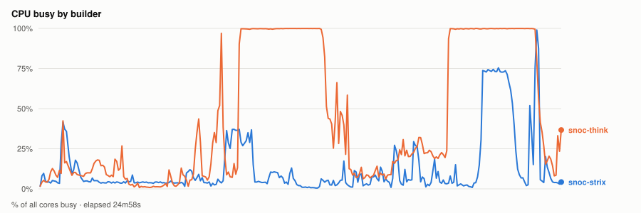
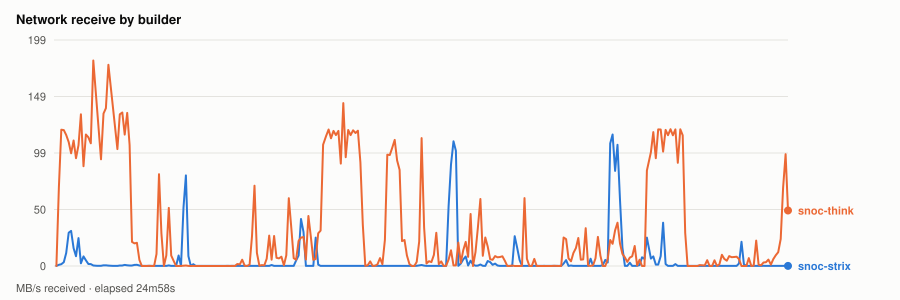
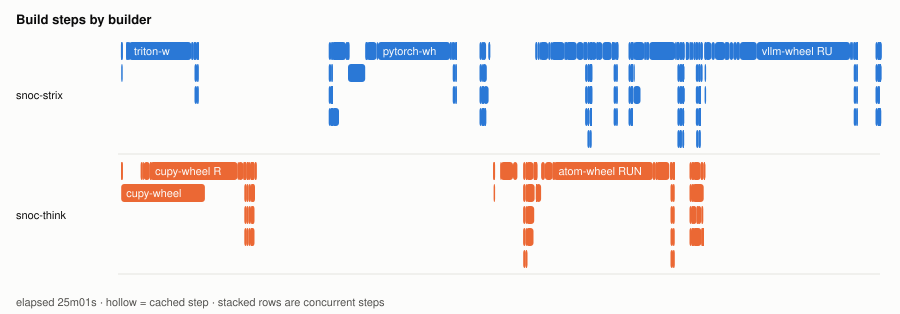
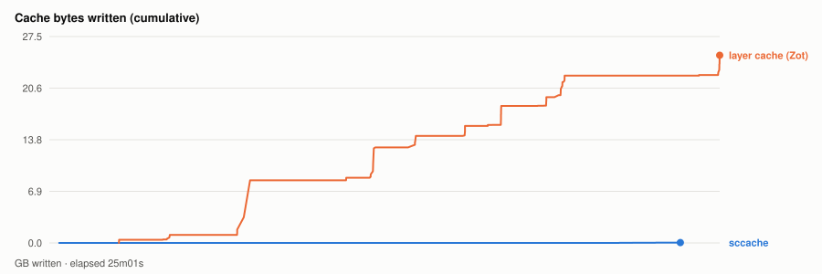

# Warm parallel wheel build — 20261117T204334Z

- **started** Tue 17 Nov 2026 14:43:34 CST
- **arch** `gfx950` · **commit** `fcd5d44`
- **wall clock** 25m02s · **exit** 0
- **sample interval** 5s · **sccache prefix** ``

> Throughput, not isolated per-target cost: the builds ran concurrently and shared the sccache store and registry, both on Strix, which is also a build node. For clean per-wheel numbers use `bench.sh cold`, which serialises on purpose.

## CPU busy by builder



## Network receive by builder



## Build steps by builder



## Interactive chart


## Cache bytes written (cumulative)



## Per-builder totals

| builder | peak CPU | mean CPU | min free mem | net received |
|---|---|---|---|---|
| snoc-strix | 99% | 13% | 7.6GB | 7.4GB |
| snoc-think | 100% | 45% | 15.0GB | 48.6GB |

## Per-target build steps

| target | node | start | build | total | prev total | change | cached |
|---|---|---|---|---|---|---|---|
| triton-wheel | snoc-strix | 00:00:05 | 2m24s | 7m24s | 8s | +5423% | 2/27 |
| cupy-wheel | snoc-think | 00:00:06 | 4m02s | 4m23s | 1m05s | +302% | 1/27 |
| pytorch-wheel | snoc-strix | 00:07:30 | 3m28s | 4m40s | 3m23s | +38% | 4/34 |
| pytorch | snoc-think | 00:12:19 | 47s | 1m21s | 1m37s | -16% | 2/22 |
| nixl-wheel | snoc-strix | 00:13:42 | 1m37s | 1m48s | 1m29s | +21% | 1/30 |
| atom-wheel | snoc-think | 00:13:42 | 4m25s | 5m31s | 5m37s | -2% | 2/32 |
| aiter-wheel | snoc-strix | 00:15:31 | 44s | 1m20s | 1m17s | +5% | 3/32 |
| lmcache-wheel | snoc-strix | 00:16:52 | 1m29s | 1m40s | 1m23s | +21% | 3/34 |
| torchvision-wheel | snoc-strix | 00:18:38 | 19s | 29s | 28s | +4% | 2/26 |
| vllm-wheel | snoc-strix | 00:19:15 | 4m53s | 5m45s | 6m11s | -7% | 4/41 |

*start* is elapsed from the beginning of this run, so it compares across runs. *build* is the span of the target's own steps; *total* is what the builder reported for it. The gap between them is setup plus cache export — which is why `change` is computed on *total*. A `*` marks a target whose previous run predates that measurement, so its comparison is build-vs-build and excludes the export on both sides.
*previous* is `20261117T201441Z`.

*buildkit transfer* is what BuildKit itself moved — context, layer pulls and exports. Downloads made **inside** a RUN step (apt, pip, git) are invisible to it and show up only in the node's network series above, which is why the two disagree.

## Cache writes

| stream | objects | bytes | first | last |
|---|---|---|---|---|
| sccache (compiler) | 86 | 47.0MB | +22s | +23m33s |
| Zot blobs (layer cache) | 215 | 25.0GB | +2m35s | +25m01s |

## Published artifacts

```
  pytorch-wheel  340.5 MB  (60 tags)
      published         arch      extra            version   rocm          size       build            wheel
      2026-11-17 14:43  gfx950    device-gfx950    2.15.0    10.1.0-full    340.5 MB  -                torch-2.15.0a0+git31a77fc.rocm10.1.0-cp314-cp314-linux_x86_64.whl
      … 58 older tag(s); ZOT_TAGS=0 for all
      latest
  triton-wheel  431.2 MB  (52 tags)
      published         arch      extra            version   rocm          size       build            wheel
      2026-11-17 14:43  noarch    -                3.9.0     10.1.0-full    431.2 MB  -                triton-3.9.0+gitaad2a60d.rocm10.1.0-cp314-cp314-linux_x86_64.whl
      … 50 older tag(s); ZOT_TAGS=0 for all
      latest
  aiter-wheel  134.9 MB  (51 tags)
      published         arch      extra            version   rocm          size       build            wheel
      2026-11-17 14:43  gfx950    device-gfx950    2.15.0    10.1.0-full    134.9 MB  -                amd_aiter-0.1.29.post2.dev0+gcfd296392.d20261117.rocm10.1.0-cp314-cp314-linux_x86_64.whl
      … 49 older tag(s); ZOT_TAGS=0 for all
      latest
  nixl-wheel  12.2 MB  (54 tags)
      published         arch      extra            version   rocm          size       build            wheel
      2026-11-17 14:43  gfx950    device-gfx950    v1.5.2    10.1.0-full     12.2 MB  -                nixl-1.5.2+rocm10.1.0-py3-none-any.whl
      … 52 older tag(s); ZOT_TAGS=0 for all
      latest
  torchvision-wheel  1.6 MB  (32 tags)
      published         arch      extra            version   rocm          size       build            wheel
      2026-11-17 14:43  gfx950    device-gfx950    v0.29.2   10.1.0-full      1.6 MB  -                torchvision-0.29.2+rocm10.1.0-py3-none-manylinux_2_39_x86_64.whl
      … 30 older tag(s); ZOT_TAGS=0 for all
      latest
  atom-wheel  28.6 MB  (29 tags)
      published         arch      extra            version   rocm          size       build            wheel
      2026-11-17 14:43  gfx950    device-gfx950    v0.1.10   10.1.0-full     28.6 MB  -                atom-0.1.10+rocm10.1.0-cp314-none-manylinux_2_38_x86_64.whl
      … 27 older tag(s); ZOT_TAGS=0 for all
      latest
  cupy-wheel  41.2 MB  (54 tags)
      published         arch      extra            version   rocm          size       build            wheel
      2026-11-17 14:43  gfx950    device-gfx950    v14.2.0   10.1.0-full     41.2 MB  -                cupy-14.2.0+rocm10.1.0-cp314-cp314-manylinux_2_39_x86_64.whl
      … 52 older tag(s); ZOT_TAGS=0 for all
      latest
  vllm-wheel  79.2 MB  (53 tags)
      published         arch      extra            version   rocm          size       build            wheel
      2026-11-17 14:43  gfx950    device-gfx950    v0.34.0   10.1.0-full     79.2 MB  -                vllm-0.34.0+rocm101-cp314-cp314-linux_x86_64.whl
      … 51 older tag(s); ZOT_TAGS=0 for all
      latest
  lmcache-wheel  8.9 MB  (58 tags)
      published         arch      extra            version   rocm          size       build            wheel
      2026-11-17 14:43  gfx950    device-gfx950    v0.5.7.post1 10.1.0-full      8.9 MB  -                lmcache-0.5.7.post1+rocm10.1.0-cp314-cp314-manylinux_2_39_x86_64.whl
      … 56 older tag(s); ZOT_TAGS=0 for all
      latest
```

