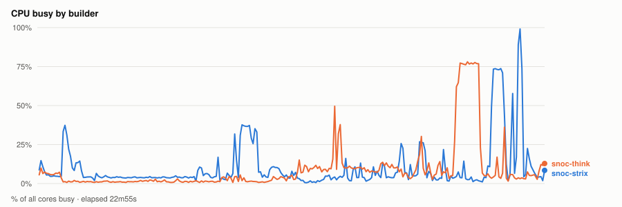
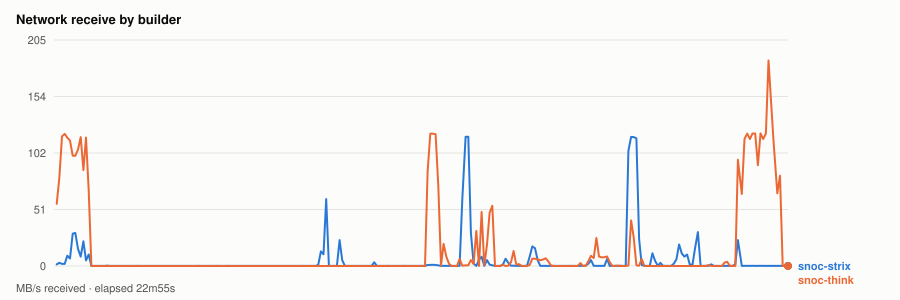
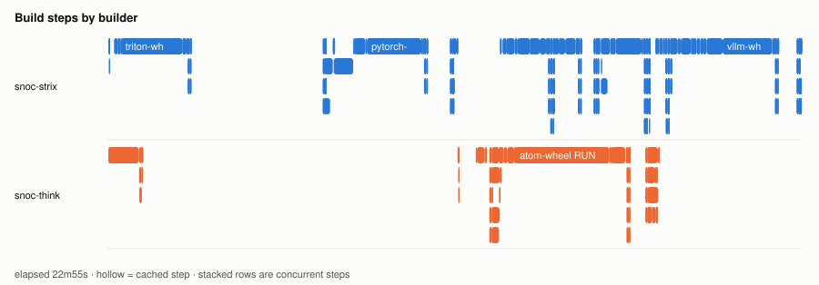
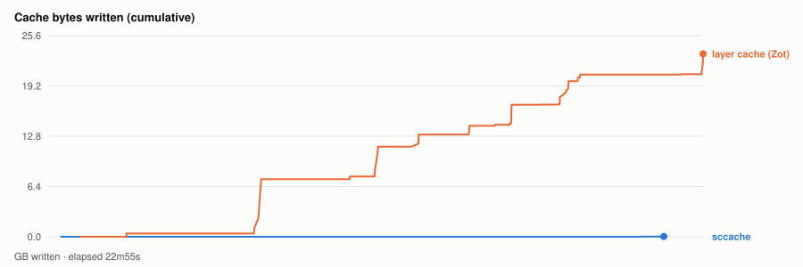

# Warm parallel wheel build — 20261117T220524Z

- **started** Tue 17 Nov 2026 16:05:24 CST
- **arch** `gfx1250` · **commit** `fcd5d44` (dirty)
- **wall clock** 22m55s · **exit** 0
- **sample interval** 5s · **sccache prefix** ``

> Throughput, not isolated per-target cost: the builds ran concurrently and shared the sccache store and registry, both on Strix, which is also a build node. For clean per-wheel numbers use `bench.sh cold`, which serialises on purpose.

## CPU busy by builder



## Network receive by builder



## Build steps by builder



## Interactive chart


## Cache bytes written (cumulative)



## Per-builder totals

| builder | peak CPU | mean CPU | min free mem | net received |
|---|---|---|---|---|
| snoc-strix | 99% | 10% | 17.0GB | 6.7GB |
| snoc-think | 78% | 9% | 99.1GB | 20.0GB |

## Per-target build steps

| target | node | start | build | total | prev total | change | cached |
|---|---|---|---|---|---|---|---|
| triton-wheel | snoc-strix | 00:00:02 | 2m36s | 7m25s | 7m20s | +1% | 2/27 |
| cupy-wheel | snoc-think | 00:00:02 | 1m00s | 1m05s | 7m16s | -85% | 16/27 |
| pytorch-wheel | snoc-strix | 00:07:27 | 2m59s | 4m05s | 4m02s | +1% | 4/34 |
| pytorch | snoc-think | 00:11:34 | 58s | 1m23s | 1m05s | +26% | 1/22 |
| nixl-wheel | snoc-strix | 00:12:58 | 1m35s | 1m45s | 2m04s | -15% | 1/30 |
| atom-wheel | snoc-think | 00:12:59 | 4m10s | 5m13s | 6m10s | -15% | 2/32 |
| aiter-wheel | snoc-strix | 00:14:44 | 48s | 1m28s | 1m27s | +1% | 3/32 |
| lmcache-wheel | snoc-strix | 00:16:14 | 1m29s | 1m40s | 1m31s | +9% | 3/34 |
| torchvision-wheel | snoc-strix | 00:18:07 | 19s | 29s | 29s | +3% | 2/26 |
| vllm-wheel | snoc-strix | 00:18:37 | 3m25s | 4m17s | 6m46s | -37% | 4/41 |

*start* is elapsed from the beginning of this run, so it compares across runs. *build* is the span of the target's own steps; *total* is what the builder reported for it. The gap between them is setup plus cache export — which is why `change` is computed on *total*. A `*` marks a target whose previous run predates that measurement, so its comparison is build-vs-build and excludes the export on both sides.
*previous* is `20261117T213229Z`.

*buildkit transfer* is what BuildKit itself moved — context, layer pulls and exports. Downloads made **inside** a RUN step (apt, pip, git) are invisible to it and show up only in the node's network series above, which is why the two disagree.

## Cache writes

| stream | objects | bytes | first | last |
|---|---|---|---|---|
| sccache (compiler) | 74 | 31.2MB | +27s | +21m33s |
| Zot blobs (layer cache) | 188 | 23.3GB | +1m07s | +22m55s |

## Published artifacts

```
  pytorch-wheel  344.2 MB  (62 tags)
      published         arch      extra            version   rocm          size       build            wheel
      2026-11-17 14:43  gfx1151   device-gfx1151   2.15.0    10.1.0-full    438.4 MB  -                torch-2.15.0a0+git31a77fc.rocm10.1.0-cp314-cp314-linux_x86_64.whl
      … 60 older tag(s); ZOT_TAGS=0 for all
      latest
  triton-wheel  431.2 MB  (52 tags)
      published         arch      extra            version   rocm          size       build            wheel
      2026-11-17 14:43  noarch    -                3.9.0     10.1.0-full    431.2 MB  -                triton-3.9.0+gitaad2a60d.rocm10.1.0-cp314-cp314-linux_x86_64.whl
      … 50 older tag(s); ZOT_TAGS=0 for all
      latest
  aiter-wheel  135.0 MB  (53 tags)
      published         arch      extra            version   rocm          size       build            wheel
      2026-11-17 14:43  gfx1151   device-gfx1151   2.15.0    10.1.0-full    135.0 MB  -                amd_aiter-0.1.29.post2.dev0+gcfd296392.d20261117.rocm10.1.0-cp314-cp314-linux_x86_64.whl
      … 51 older tag(s); ZOT_TAGS=0 for all
      latest
  nixl-wheel  12.2 MB  (56 tags)
      published         arch      extra            version   rocm          size       build            wheel
      2026-11-17 14:43  gfx1151   device-gfx1151   v1.5.2    10.1.0-full     12.2 MB  -                nixl-1.5.2+rocm10.1.0-py3-none-any.whl
      … 54 older tag(s); ZOT_TAGS=0 for all
      latest
  torchvision-wheel  1.6 MB  (34 tags)
      published         arch      extra            version   rocm          size       build            wheel
      2026-11-17 14:43  gfx1151   device-gfx1151   v0.29.2   10.1.0-full      1.6 MB  -                torchvision-0.29.2+rocm10.1.0-py3-none-manylinux_2_39_x86_64.whl
      … 32 older tag(s); ZOT_TAGS=0 for all
      latest
  atom-wheel  28.6 MB  (33 tags)
      published         arch      extra            version   rocm          size       build            wheel
      2026-11-17 14:43  gfx1151   device-gfx1151   v0.1.10   10.1.0-full     28.6 MB  -                atom-0.1.10+rocm10.1.0-cp314-none-manylinux_2_38_x86_64.whl
      … 31 older tag(s); ZOT_TAGS=0 for all
      latest
  cupy-wheel  41.4 MB  (56 tags)
      published         arch      extra            version   rocm          size       build            wheel
      2026-11-17 14:43  gfx1151   device-gfx1151   v14.2.0   10.1.0-full     41.3 MB  -                cupy-14.2.0+rocm10.1.0-cp314-cp314-manylinux_2_39_x86_64.whl
      … 54 older tag(s); ZOT_TAGS=0 for all
      latest
  vllm-wheel  67.3 MB  (57 tags)
      published         arch      extra            version   rocm          size       build            wheel
      2026-11-17 14:43  gfx1151   device-gfx1151   v0.34.0   10.1.0-full     85.1 MB  -                vllm-0.34.0+rocm101-cp314-cp314-linux_x86_64.whl
      … 55 older tag(s); ZOT_TAGS=0 for all
      latest
  lmcache-wheel  8.9 MB  (62 tags)
      published         arch      extra            version   rocm          size       build            wheel
      2026-11-17 14:43  gfx1151   device-gfx1151   v0.5.7.post1 10.1.0-full      8.9 MB  -                lmcache-0.5.7.post1+rocm10.1.0-cp314-cp314-manylinux_2_39_x86_64.whl
      … 60 older tag(s); ZOT_TAGS=0 for all
      latest
```

