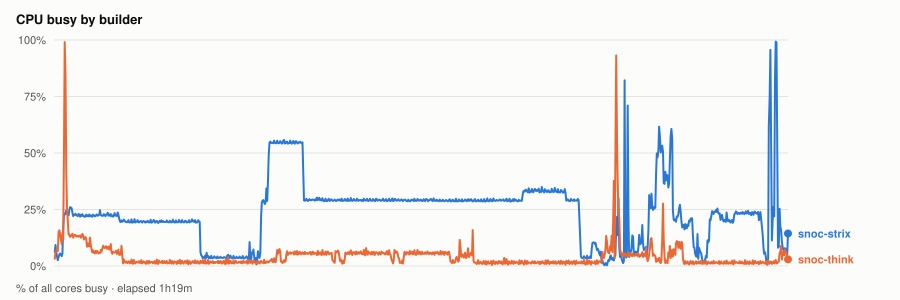
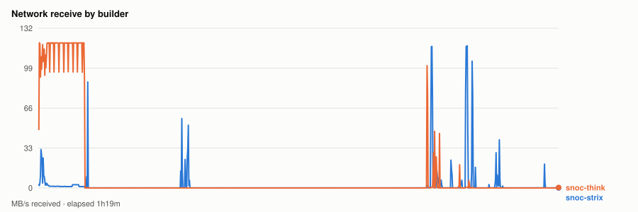
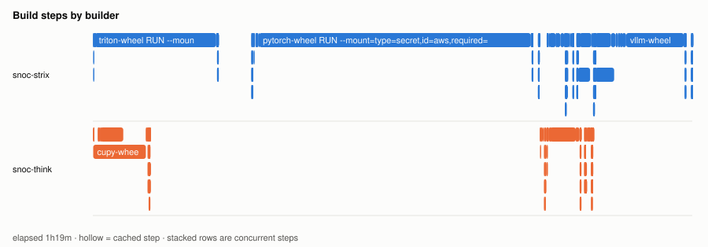
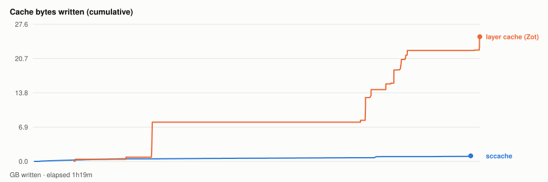

# Warm parallel wheel build — 20261123T202309Z

- **started** Mon 23 Nov 2026 14:23:09 CST
- **arch** `gfx1201` · **commit** `2b1ffc4`
- **wall clock** 1h19m · **exit** 0
- **sample interval** 5s · **sccache prefix** ``

> Throughput, not isolated per-target cost: the builds ran concurrently and shared the sccache store and registry, both on Strix, which is also a build node. For clean per-wheel numbers use `bench.sh cold`, which serialises on purpose.

## CPU busy by builder



## Network receive by builder



## Build steps by builder



## Interactive chart


## Cache bytes written (cumulative)



## Per-builder totals

| builder | peak CPU | mean CPU | min free mem | net received |
|---|---|---|---|---|
| snoc-strix | 99% | 24% | 4.5GB | 9.9GB |
| snoc-think | 99% | 4% | 76.9GB | 49.4GB |

## Per-target build steps

| target | node | start | build | total | prev total | change | cached |
|---|---|---|---|---|---|---|---|
| triton-wheel | snoc-strix | 00:00:01 | 16m28s | 21m16s | 8m14s | +158% | 0/27 |
| cupy-wheel | snoc-think | 00:00:02 | 7m14s | 7m31s | 3m51s | +95% | 0/27 |
| pytorch-wheel | snoc-strix | 00:21:23 | 37m00s | 38m00s | 14m38s | +160% | 3/34 |
| pytorch | snoc-think | 00:59:30 | 27s | 53s | 46s | +14% | 2/22 |
| nixl-wheel | snoc-strix | 01:00:24 | 2m24s | 2m36s | 2m15s | +15% | 1/32 |
| atom-wheel | snoc-think | 01:00:25 | 4m22s | 5m22s | 5m21s | +0% | 1/33 |
| aiter-wheel | snoc-strix | 01:03:07 | 42s | 1m19s | 2m06s | -37% | 3/32 |
| lmcache-wheel | snoc-strix | 01:04:32 | 2m01s | 2m18s | 1m50s | +26% | 3/35 |
| torchvision-wheel | snoc-think | 01:05:56 | 20s | 38s | 51s | -25% | 2/26 |
| vllm-wheel | snoc-strix | 01:06:52 | 11m53s | 12m55s | 5m49s | +122% | 4/41 |

*start* is elapsed from the beginning of this run, so it compares across runs. *build* is the span of the target's own steps; *total* is what the builder reported for it. The gap between them is setup plus cache export — which is why `change` is computed on *total*. A `*` marks a target whose previous run predates that measurement, so its comparison is build-vs-build and excludes the export on both sides.
*previous* is `20261119T234819Z`.

*buildkit transfer* is what BuildKit itself moved — context, layer pulls and exports. Downloads made **inside** a RUN step (apt, pip, git) are invisible to it and show up only in the node's network series above, which is why the two disagree.

## Cache writes

| stream | objects | bytes | first | last |
|---|---|---|---|---|
| sccache (compiler) | 8948 | 1.1GB | +17s | +1h18m |
| Zot blobs (layer cache) | 207 | 25.1GB | +7m21s | +1h19m |

## Published artifacts

```
  pytorch-wheel  379.0 MB  (71 tags)
      published         arch      extra            version   rocm          size       build            wheel
      2026-11-23 14:02  gfx1201   device-gfx1201   2.15.0    10.2.0-full    379.0 MB  -                torch-2.15.0a0+git31a77fc.rocm10.2.0-cp314-cp314-linux_x86_64.whl
      … 69 older tag(s); ZOT_TAGS=0 for all
      latest
  triton-wheel  431.2 MB  (57 tags)
      published         arch      extra            version   rocm          size       build            wheel
      2026-11-23 14:02  noarch    -                3.9.0     10.2.0-full    431.2 MB  -                triton-3.9.0+gitaad2a60d.rocm10.2.0-cp314-cp314-linux_x86_64.whl
      … 55 older tag(s); ZOT_TAGS=0 for all
      latest
  aiter-wheel  149.6 MB  (62 tags)
      published         arch      extra            version   rocm          size       build            wheel
      2026-11-23 14:02  gfx1201   device-gfx1201   2.15.0    10.2.0-full    149.6 MB  -                amd_aiter-0.1.30+rocm10.2.0-cp314-cp314-linux_x86_64.whl
      … 60 older tag(s); ZOT_TAGS=0 for all
      latest
  nixl-wheel  13.7 MB  (65 tags)
      published         arch      extra            version   rocm          size       build            wheel
      2026-11-23 14:02  gfx1201   device-gfx1201   v1.5.2    10.2.0-full     13.7 MB  -                nixl-1.5.2+rocm10.2.0-py3-none-any.whl
      … 63 older tag(s); ZOT_TAGS=0 for all
      latest
  torchvision-wheel  1.6 MB  (43 tags)
      published         arch      extra            version   rocm          size       build            wheel
      2026-11-23 14:02  gfx1201   device-gfx1201   v0.29.2   10.2.0-full      1.6 MB  -                torchvision-0.29.2+rocm10.2.0-py3-none-manylinux_2_39_x86_64.whl
      … 41 older tag(s); ZOT_TAGS=0 for all
      latest
  atom-wheel  28.6 MB  (44 tags)
      published         arch      extra            version   rocm          size       build            wheel
      2026-11-23 14:02  gfx1201   device-gfx1201   v0.1.10   10.2.0-full     28.6 MB  -                atom-0.1.10+rocm10.2.0-cp314-none-manylinux_2_38_x86_64.whl
      … 42 older tag(s); ZOT_TAGS=0 for all
      latest
  cupy-wheel  41.5 MB  (65 tags)
      published         arch      extra            version   rocm          size       build            wheel
      2026-11-23 14:02  gfx1201   device-gfx1201   v14.2.0   10.2.0-full     41.5 MB  -                cupy-14.2.0+rocm10.2.0-cp314-cp314-manylinux_2_39_x86_64.whl
      … 63 older tag(s); ZOT_TAGS=0 for all
      latest
  vllm-wheel  79.3 MB  (66 tags)
      published         arch      extra            version   rocm          size       build            wheel
      2026-11-23 14:02  gfx1201   device-gfx1201   v0.34.0   10.2.0-full     79.3 MB  -                vllm-0.34.0+rocm102-cp314-cp314-linux_x86_64.whl
      … 64 older tag(s); ZOT_TAGS=0 for all
      latest
  lmcache-wheel  10.1 MB  (76 tags)
      published         arch      extra            version   rocm          size       build            wheel
      2026-11-23 14:02  gfx1201   device-gfx1201   v0.5.8    10.2.0-full     10.1 MB  -                lmcache-0.5.8+rocm10.2.0-cp314-cp314-manylinux_2_39_x86_64.whl
      … 74 older tag(s); ZOT_TAGS=0 for all
      latest
```

