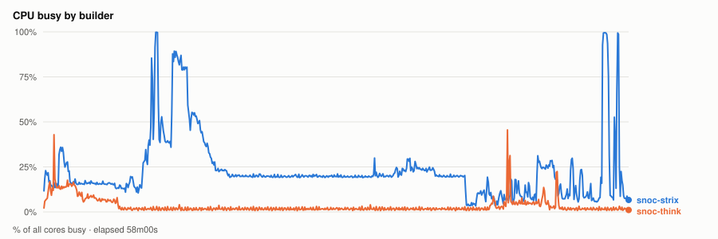
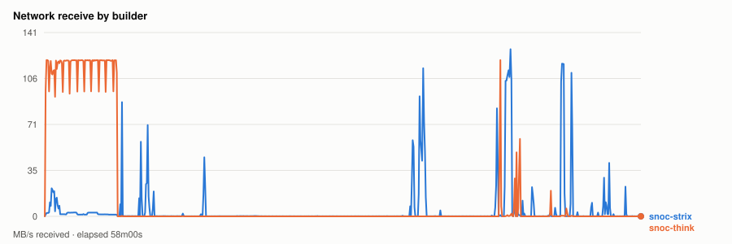
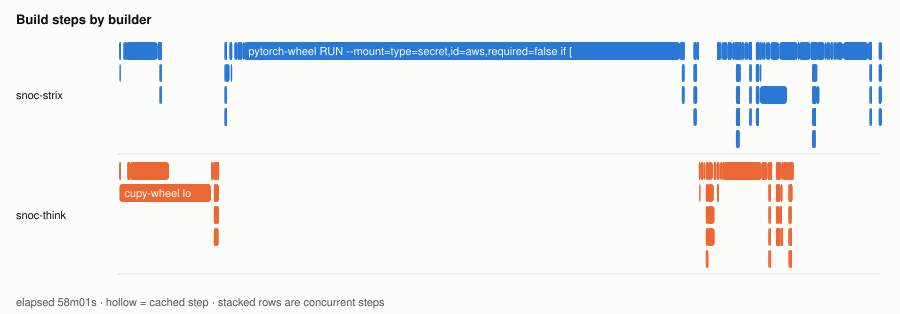
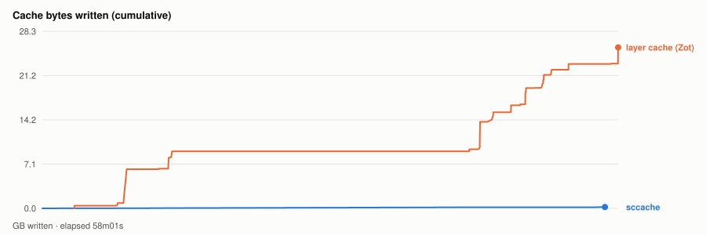

# Warm parallel wheel build — 20261123T233947Z

- **started** Mon 23 Nov 2026 17:39:47 CST
- **arch** `gfx1250` · **commit** `44f2d31`
- **wall clock** 58m01s · **exit** 0
- **sample interval** 5s · **sccache prefix** ``

> Throughput, not isolated per-target cost: the builds ran concurrently and shared the sccache store and registry, both on Strix, which is also a build node. For clean per-wheel numbers use `bench.sh cold`, which serialises on purpose.

## CPU busy by builder



## Network receive by builder



## Build steps by builder



## Interactive chart


## Cache bytes written (cumulative)



## Per-builder totals

| builder | peak CPU | mean CPU | min free mem | net received |
|---|---|---|---|---|
| snoc-strix | 100% | 23% | 2.6GB | 16.9GB |
| snoc-think | 46% | 3% | 82.7GB | 49.4GB |

## Per-target build steps

| target | node | start | build | total | prev total | change | cached |
|---|---|---|---|---|---|---|---|
| triton-wheel | snoc-strix | 00:00:05 | 3m02s | 8m23s | 7m42s | +9% | 2/27 |
| cupy-wheel | snoc-think | 00:00:06 | 7m11s | 7m28s | 7m40s | -2% | 1/27 |
| pytorch-wheel | snoc-strix | 00:08:34 | 34m21s | 35m32s | 31m04s | +14% | 3/34 |
| pytorch | snoc-think | 00:44:13 | 27s | 1m12s | 58s | +25% | 2/22 |
| nixl-wheel | snoc-strix | 00:45:36 | 1m26s | 1m37s | 1m30s | +8% | 1/32 |
| atom-wheel | snoc-think | 00:45:36 | 3m53s | 4m56s | 4m56s | -0% | 2/33 |
| aiter-wheel | snoc-strix | 00:47:18 | 44s | 1m26s | 1m17s | +11% | 4/32 |
| lmcache-wheel | snoc-strix | 00:48:50 | 3m59s | 4m10s | 3m57s | +5% | 3/35 |
| torchvision-wheel | snoc-think | 00:50:39 | 21s | 39s | 39s | +0% | 2/26 |
| vllm-wheel | snoc-strix | 00:53:07 | 4m04s | 4m53s | 17m16s | -72% | 4/41 |

*start* is elapsed from the beginning of this run, so it compares across runs. *build* is the span of the target's own steps; *total* is what the builder reported for it. The gap between them is setup plus cache export — which is why `change` is computed on *total*. A `*` marks a target whose previous run predates that measurement, so its comparison is build-vs-build and excludes the export on both sides.
*previous* is `20261123T224833Z`.

*buildkit transfer* is what BuildKit itself moved — context, layer pulls and exports. Downloads made **inside** a RUN step (apt, pip, git) are invisible to it and show up only in the node's network series above, which is why the two disagree.

## Cache writes

| stream | objects | bytes | first | last |
|---|---|---|---|---|
| sccache (compiler) | 3058 | 213.7MB | +0s | +56m41s |
| Zot blobs (layer cache) | 229 | 25.7GB | +3m13s | +58m01s |

## Published artifacts

```
  pytorch-wheel  338.9 MB  (73 tags)
      published         arch      extra            version   rocm          size       build            wheel
      2026-11-23 17:30  gfx1250   device-gfx1250   2.15.0    10.2.0-full    338.9 MB  -                torch-2.15.0a0+git31a77fc.rocm10.2.0-cp314-cp314-linux_x86_64.whl
      … 71 older tag(s); ZOT_TAGS=0 for all
      latest
  triton-wheel  431.2 MB  (58 tags)
      published         arch      extra            version   rocm          size       build            wheel
      2026-11-23 17:30  noarch    -                3.9.0     10.2.0-full    431.2 MB  -                triton-3.9.0+gitaad2a60d.rocm10.2.0-cp314-cp314-linux_x86_64.whl
      … 56 older tag(s); ZOT_TAGS=0 for all
      latest
  aiter-wheel  149.6 MB  (64 tags)
      published         arch      extra            version   rocm          size       build            wheel
      2026-11-23 17:30  gfx1250   device-gfx1250   2.15.0    10.2.0-full    149.6 MB  -                amd_aiter-0.1.30+rocm10.2.0-cp314-cp314-linux_x86_64.whl
      … 62 older tag(s); ZOT_TAGS=0 for all
      latest
  nixl-wheel  13.7 MB  (67 tags)
      published         arch      extra            version   rocm          size       build            wheel
      2026-11-23 17:30  gfx1250   device-gfx1250   v1.5.2    10.2.0-full     13.7 MB  -                nixl-1.5.2+rocm10.2.0-py3-none-any.whl
      … 65 older tag(s); ZOT_TAGS=0 for all
      latest
  torchvision-wheel  1.6 MB  (45 tags)
      published         arch      extra            version   rocm          size       build            wheel
      2026-11-23 17:30  gfx1250   device-gfx1250   v0.29.2   10.2.0-full      1.6 MB  -                torchvision-0.29.2+rocm10.2.0-py3-none-manylinux_2_39_x86_64.whl
      … 43 older tag(s); ZOT_TAGS=0 for all
      latest
  atom-wheel  28.6 MB  (46 tags)
      published         arch      extra            version   rocm          size       build            wheel
      2026-11-23 17:30  gfx1250   device-gfx1250   v0.1.10   10.2.0-full     28.7 MB  -                atom-0.1.10+rocm10.2.0-cp314-none-manylinux_2_38_x86_64.whl
      … 44 older tag(s); ZOT_TAGS=0 for all
      latest
  cupy-wheel  41.5 MB  (67 tags)
      published         arch      extra            version   rocm          size       build            wheel
      2026-11-23 17:30  gfx1250   device-gfx1250   v14.2.0   10.2.0-full     41.5 MB  -                cupy-14.2.0+rocm10.2.0-cp314-cp314-manylinux_2_39_x86_64.whl
      … 65 older tag(s); ZOT_TAGS=0 for all
      latest
  vllm-wheel  67.1 MB  (68 tags)
      published         arch      extra            version   rocm          size       build            wheel
      2026-11-23 17:30  gfx1250   device-gfx1250   v0.34.0   10.2.0-full     67.1 MB  -                vllm-0.34.0+rocm102-cp314-cp314-linux_x86_64.whl
      … 66 older tag(s); ZOT_TAGS=0 for all
      latest
  lmcache-wheel  10.1 MB  (80 tags)
      published         arch      extra            version   rocm          size       build            wheel
      2026-11-23 17:30  gfx1250   device-gfx1250   v0.5.8    10.2.0-full     10.1 MB  -                lmcache-0.5.8+rocm10.2.0-cp314-cp314-manylinux_2_39_x86_64.whl
      … 78 older tag(s); ZOT_TAGS=0 for all
      latest
```

