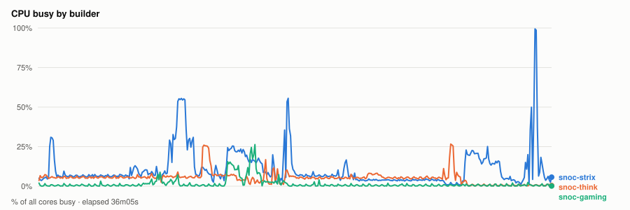
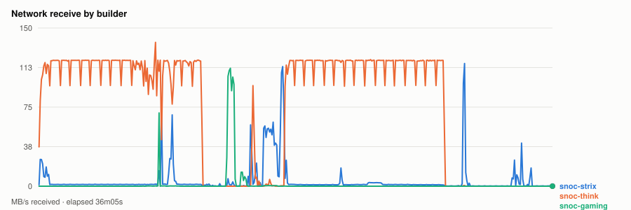
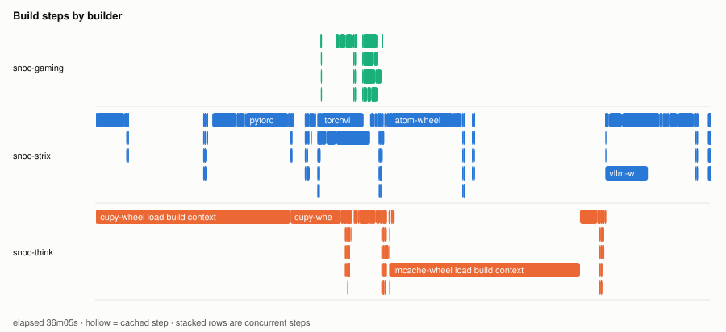
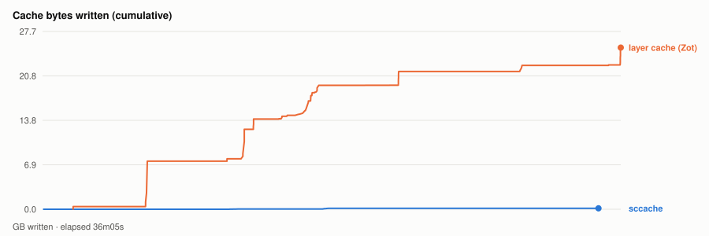

# Warm parallel wheel build — 20261125T204900Z

- **started** Wed 25 Nov 2026 14:49:00 CST
- **arch** `gfx1201` · **commit** `7b01aff`
- **wall clock** 36m05s · **exit** 0
- **sample interval** 5s · **sccache prefix** ``

> Throughput, not isolated per-target cost: the builds ran concurrently and shared the sccache store and registry, both on Strix, which is also a build node. For clean per-wheel numbers use `bench.sh cold`, which serialises on purpose.

## CPU busy by builder



## Network receive by builder



## Build steps by builder



## Interactive chart


## Cache bytes written (cumulative)



## Per-builder totals

| builder | peak CPU | mean CPU | min free mem | net received |
|---|---|---|---|---|
| snoc-gaming | 26% | 2% | 13.4GB | 3.8GB |
| snoc-strix | 99% | 11% | 98.5GB | 11.7GB |
| snoc-think | 27% | 5% | 111.6GB | 153.7GB |

## Per-target build steps

| target | node | start | build | total | cached |
|---|---|---|---|---|---|
| triton-wheel | snoc-strix | 00:00:03 | 1m45s | 6m29s | 8/27 |
| cupy-wheel | snoc-think | 00:00:03 | 14m35s | 14m53s | 8/27 |
| pytorch-wheel | snoc-strix | 00:06:32 | 4m52s | 6m03s | 3/34 |
| pytorch | snoc-strix | 00:12:37 | 21s | 34s | 2/22 |
| torchvision-wheel | snoc-strix | 00:13:12 | 3m25s | 3m35s | 2/27 |
| aiter-wheel | snoc-gaming | 00:13:13 | 1m55s | 3m36s | 0/32 |
| nixl-wheel | snoc-think | 00:14:58 | 1m49s | 2m16s | 1/33 |
| atom-wheel | snoc-strix | 00:16:50 | 4m41s | 5m22s | 2/33 |
| lmcache-wheel | snoc-think | 00:17:15 | 12m20s | 12m40s | 1/35 |
| vllm-wheel | snoc-strix | 00:29:56 | 5m18s | 6m09s | 3/41 |

*start* is elapsed from the beginning of this run, so it compares across runs. *build* is the span of the target's own steps; *total* is what the builder reported for it. The gap between them is setup plus cache export — which is why `change` is computed on *total*. A `*` marks a target whose previous run predates that measurement, so its comparison is build-vs-build and excludes the export on both sides.
*previous* is `20261125T204802Z`.

*buildkit transfer* is what BuildKit itself moved — context, layer pulls and exports. Downloads made **inside** a RUN step (apt, pip, git) are invisible to it and show up only in the node's network series above, which is why the two disagree.

## Cache writes

| stream | objects | bytes | first | last |
|---|---|---|---|---|
| sccache (compiler) | 139 | 151.3MB | +4s | +34m42s |
| Zot blobs (layer cache) | 207 | 25.2GB | +1m54s | +36m05s |

## Published artifacts

```
  pytorch-wheel  379.1 MB  (74 tags)
      published         arch      extra            version   rocm          size       build            wheel
      2026-11-25 14:47  gfx1201   device-gfx1201   2.15.0    10.2.0-full    379.1 MB  -                torch-2.15.0a0+git31a77fc.rocm10.2.0-cp314-cp314-linux_x86_64.whl
      … 72 older tag(s); ZOT_TAGS=0 for all
      latest
  triton-wheel  431.2 MB  (59 tags)
      published         arch      extra            version   rocm          size       build            wheel
      2026-11-25 14:47  noarch    -                3.9.0     10.2.0-full    431.2 MB  -                triton-3.9.0+gitaad2a60d.rocm10.2.0-cp314-cp314-linux_x86_64.whl
      … 57 older tag(s); ZOT_TAGS=0 for all
      latest
  aiter-wheel  149.6 MB  (65 tags)
      published         arch      extra            version   rocm          size       build            wheel
      2026-11-25 14:47  gfx1201   device-gfx1201   2.15.0    10.2.0-full    149.6 MB  -                amd_aiter-0.1.30+rocm10.2.0-cp314-cp314-linux_x86_64.whl
      … 63 older tag(s); ZOT_TAGS=0 for all
      latest
  nixl-wheel  13.7 MB  (68 tags)
      published         arch      extra            version   rocm          size       build            wheel
      2026-11-25 14:47  gfx1201   device-gfx1201   v1.5.2    10.2.0-full     13.7 MB  -                nixl-1.5.2+rocm10.2.0-py3-none-any.whl
      … 66 older tag(s); ZOT_TAGS=0 for all
      latest
  torchvision-wheel  1.6 MB  (46 tags)
      published         arch      extra            version   rocm          size       build            wheel
      2026-11-25 14:47  gfx1201   device-gfx1201   v0.29.2   10.2.0-full      1.6 MB  -                torchvision-0.29.2+rocm10.2.0-py3-none-manylinux_2_39_x86_64.whl
      … 44 older tag(s); ZOT_TAGS=0 for all
      latest
  atom-wheel  28.6 MB  (47 tags)
      published         arch      extra            version   rocm          size       build            wheel
      2026-11-25 14:47  gfx1201   device-gfx1201   v0.1.10   10.2.0-full     28.6 MB  -                atom-0.1.10+rocm10.2.0-cp314-none-manylinux_2_38_x86_64.whl
      … 45 older tag(s); ZOT_TAGS=0 for all
      latest
  cupy-wheel  41.6 MB  (68 tags)
      published         arch      extra            version   rocm          size       build            wheel
      2026-11-25 14:47  gfx1201   device-gfx1201   v14.2.0   10.2.0-full     41.6 MB  -                cupy-14.2.0+rocm10.2.0-cp314-cp314-manylinux_2_39_x86_64.whl
      … 66 older tag(s); ZOT_TAGS=0 for all
      latest
  vllm-wheel  79.3 MB  (69 tags)
      published         arch      extra            version   rocm          size       build            wheel
      2026-11-25 14:47  gfx1201   device-gfx1201   v0.34.0   10.2.0-full     79.3 MB  -                vllm-0.34.0+rocm102-cp314-cp314-linux_x86_64.whl
      … 67 older tag(s); ZOT_TAGS=0 for all
      latest
  lmcache-wheel  10.1 MB  (81 tags)
      published         arch      extra            version   rocm          size       build            wheel
      2026-11-25 14:47  gfx1201   device-gfx1201   v0.5.8    10.2.0-full     10.1 MB  -                lmcache-0.5.8+rocm10.2.0-cp314-cp314-manylinux_2_39_x86_64.whl
      … 79 older tag(s); ZOT_TAGS=0 for all
      latest
```

