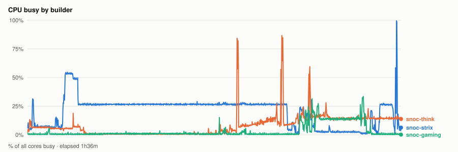
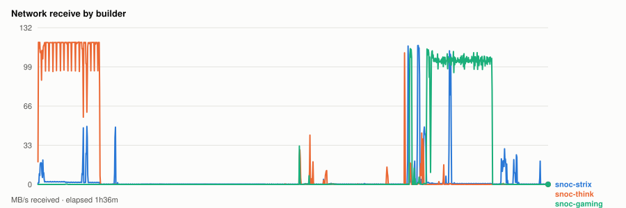
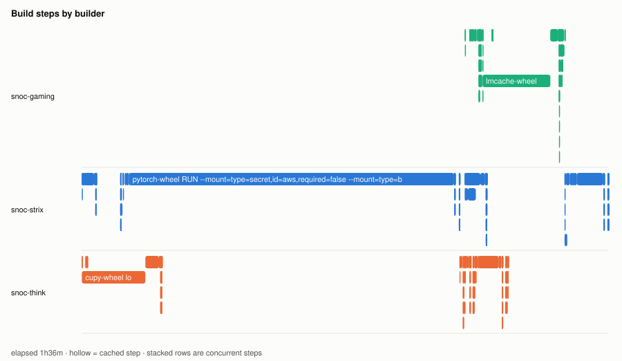
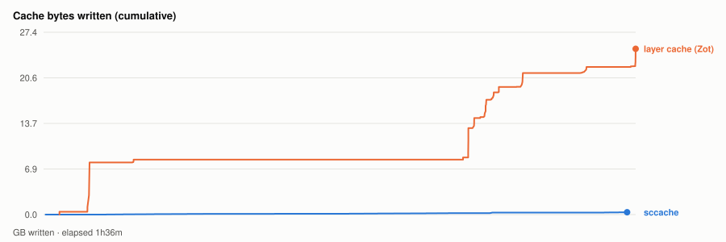

# Warm parallel wheel build — 20261125T214254Z

- **started** Wed 25 Nov 2026 15:42:54 CST
- **arch** `gfx950` · **commit** `7b01aff` (dirty)
- **wall clock** 1h36m · **exit** 0
- **sample interval** 5s · **sccache prefix** ``

> Throughput, not isolated per-target cost: the builds ran concurrently and shared the sccache store and registry, both on Strix, which is also a build node. For clean per-wheel numbers use `bench.sh cold`, which serialises on purpose.

## CPU busy by builder



## Network receive by builder



## Build steps by builder



## Interactive chart


## Cache bytes written (cumulative)



## Per-builder totals

| builder | peak CPU | mean CPU | min free mem | net received |
|---|---|---|---|---|
| snoc-gaming | 34% | 3% | 10.3GB | 79.0GB |
| snoc-strix | 100% | 20% | 92.4GB | 15.4GB |
| snoc-think | 87% | 8% | 56.8GB | 82.1GB |

## Per-target build steps

| target | node | start | build | total | prev total | change | cached |
|---|---|---|---|---|---|---|---|
| triton-wheel | snoc-strix | 00:00:02 | 2m25s | 7m28s | 6m29s | +15% | 2/27 |
| cupy-wheel | snoc-think | 00:00:03 | 14m22s | 14m39s | 14m53s | -2% | 1/27 |
| pytorch-wheel | snoc-strix | 00:07:32 | 1h00m | 1h01m | 6m03s | +922% | 3/34 |
| pytorch | snoc-think | 01:09:24 | 29s | 56s | 34s | +66% | 2/22 |
| torchvision-wheel | snoc-strix | 01:10:21 | 3m49s | 4m00s | 3m35s | +12% | 2/27 |
| aiter-wheel | snoc-think | 01:10:22 | 50s | 1m57s | 3m36s | -46% | 3/32 |
| nixl-wheel | snoc-gaming | 01:10:23 | 2m29s | 3m11s | 2m16s | +40% | 1/33 |
| atom-wheel | snoc-think | 01:12:21 | 4m48s | 5m56s | 5m22s | +10% | 2/33 |
| lmcache-wheel | snoc-gaming | 01:13:36 | 13m59s | 15m05s | 12m40s | +19% | 1/35 |
| vllm-wheel | snoc-strix | 01:28:42 | 7m07s | 8m00s | 6m09s | +30% | 2/41 |

*start* is elapsed from the beginning of this run, so it compares across runs. *build* is the span of the target's own steps; *total* is what the builder reported for it. The gap between them is setup plus cache export — which is why `change` is computed on *total*. A `*` marks a target whose previous run predates that measurement, so its comparison is build-vs-build and excludes the export on both sides.
*previous* is `20261125T204900Z`.

*buildkit transfer* is what BuildKit itself moved — context, layer pulls and exports. Downloads made **inside** a RUN step (apt, pip, git) are invisible to it and show up only in the node's network series above, which is why the two disagree.

## Cache writes

| stream | objects | bytes | first | last |
|---|---|---|---|---|
| sccache (compiler) | 5446 | 357.4MB | +20s | +1h35m |
| Zot blobs (layer cache) | 207 | 24.9GB | +2m35s | +1h36m |

## Published artifacts

```
  pytorch-wheel  336.5 MB  (75 tags)
      published         arch      extra            version   rocm          size       build            wheel
      2026-11-25 14:47  gfx1201   device-gfx1201   2.15.0    10.2.0-full    379.1 MB  -                torch-2.15.0a0+git31a77fc.rocm10.2.0-cp314-cp314-linux_x86_64.whl
      … 73 older tag(s); ZOT_TAGS=0 for all
      latest
  triton-wheel  431.2 MB  (59 tags)
      published         arch      extra            version   rocm          size       build            wheel
      2026-11-25 14:47  noarch    -                3.9.0     10.2.0-full    431.2 MB  -                triton-3.9.0+gitaad2a60d.rocm10.2.0-cp314-cp314-linux_x86_64.whl
      … 57 older tag(s); ZOT_TAGS=0 for all
      latest
  aiter-wheel  149.7 MB  (66 tags)
      published         arch      extra            version   rocm          size       build            wheel
      2026-11-25 14:47  gfx1201   device-gfx1201   2.15.0    10.2.0-full    149.6 MB  -                amd_aiter-0.1.30+rocm10.2.0-cp314-cp314-linux_x86_64.whl
      … 64 older tag(s); ZOT_TAGS=0 for all
      latest
  nixl-wheel  13.7 MB  (69 tags)
      published         arch      extra            version   rocm          size       build            wheel
      2026-11-25 14:47  gfx1201   device-gfx1201   v1.5.2    10.2.0-full     13.7 MB  -                nixl-1.5.2+rocm10.2.0-py3-none-any.whl
      … 67 older tag(s); ZOT_TAGS=0 for all
      latest
  torchvision-wheel  1.6 MB  (47 tags)
      published         arch      extra            version   rocm          size       build            wheel
      2026-11-25 14:47  gfx1201   device-gfx1201   v0.29.2   10.2.0-full      1.6 MB  -                torchvision-0.29.2+rocm10.2.0-py3-none-manylinux_2_39_x86_64.whl
      … 45 older tag(s); ZOT_TAGS=0 for all
      latest
  atom-wheel  28.6 MB  (48 tags)
      published         arch      extra            version   rocm          size       build            wheel
      2026-11-25 14:47  gfx1201   device-gfx1201   v0.1.10   10.2.0-full     28.6 MB  -                atom-0.1.10+rocm10.2.0-cp314-none-manylinux_2_38_x86_64.whl
      … 46 older tag(s); ZOT_TAGS=0 for all
      latest
  cupy-wheel  41.2 MB  (69 tags)
      published         arch      extra            version   rocm          size       build            wheel
      2026-11-25 14:47  gfx1201   device-gfx1201   v14.2.0   10.2.0-full     41.6 MB  -                cupy-14.2.0+rocm10.2.0-cp314-cp314-manylinux_2_39_x86_64.whl
      … 67 older tag(s); ZOT_TAGS=0 for all
      latest
  vllm-wheel  79.1 MB  (70 tags)
      published         arch      extra            version   rocm          size       build            wheel
      2026-11-25 14:47  gfx1201   device-gfx1201   v0.34.0   10.2.0-full     79.3 MB  -                vllm-0.34.0+rocm102-cp314-cp314-linux_x86_64.whl
      … 68 older tag(s); ZOT_TAGS=0 for all
      latest
  lmcache-wheel  10.1 MB  (83 tags)
      published         arch      extra            version   rocm          size       build            wheel
      2026-11-25 14:47  gfx1201   device-gfx1201   v0.5.8    10.2.0-full     10.1 MB  -                lmcache-0.5.8+rocm10.2.0-cp314-cp314-manylinux_2_39_x86_64.whl
      … 81 older tag(s); ZOT_TAGS=0 for all
      latest
```

