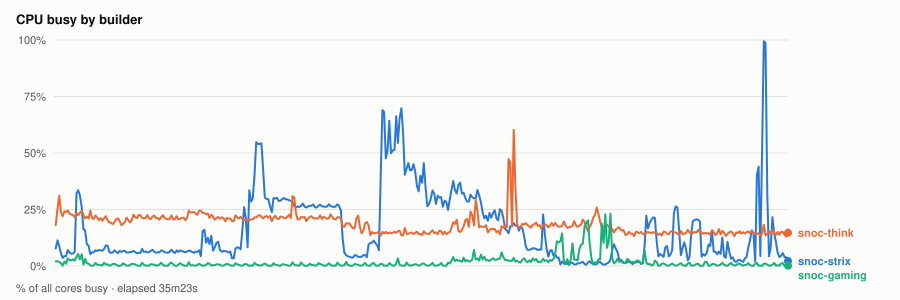
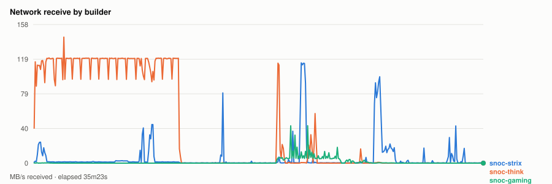
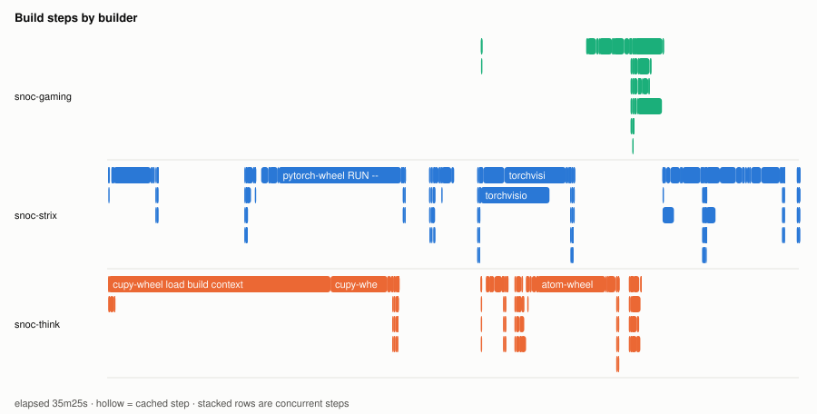
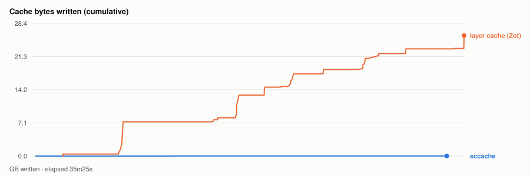

# Warm parallel wheel build — 20261125T233651Z

- **started** Wed 25 Nov 2026 17:36:51 CST
- **arch** `gfx1151` · **commit** `48cc0b0`
- **wall clock** 35m25s · **exit** 0
- **sample interval** 5s · **sccache prefix** ``

> Throughput, not isolated per-target cost: the builds ran concurrently and shared the sccache store and registry, both on Strix, which is also a build node. For clean per-wheel numbers use `bench.sh cold`, which serialises on purpose.

## CPU busy by builder



## Network receive by builder



## Build steps by builder



## Interactive chart


## Cache bytes written (cumulative)



## Per-builder totals

| builder | peak CPU | mean CPU | min free mem | net received |
|---|---|---|---|---|
| snoc-gaming | 23% | 2% | 12.6GB | 2.8GB |
| snoc-strix | 99% | 16% | 94.7GB | 11.6GB |
| snoc-think | 60% | 19% | 43.9GB | 79.6GB |

## Per-target build steps

| target | node | start | build | total | prev total | change | cached |
|---|---|---|---|---|---|---|---|
| triton-wheel | snoc-strix | 00:00:03 | 2m21s | 7m26s | 7m28s | -1% | 2/27 |
| cupy-wheel | snoc-think | 00:00:03 | 14m32s | 14m50s | 14m39s | +1% | 2/27 |
| pytorch-wheel | snoc-strix | 00:07:31 | 7m35s | 9m28s | 1h01m | -85% | 3/34 |
| pytorch | snoc-strix | 00:17:02 | 43s | 2m03s | 56s | +118% | 2/22 |
| torchvision-wheel | snoc-strix | 00:19:06 | 4m35s | 4m46s | 4m00s | +19% | 2/27 |
| aiter-wheel | snoc-think | 00:19:07 | 1m08s | 2m20s | 1m57s | +20% | 1/32 |
| nixl-wheel | snoc-gaming | 00:19:08 | 7m39s | 9m17s | 3m11s | +192% | 1/33 |
| atom-wheel | snoc-think | 00:21:30 | 4m33s | 5m48s | 5m56s | -2% | 2/33 |
| lmcache-wheel | snoc-strix | 00:28:25 | 2m01s | 2m12s | 15m05s | -85% | 3/35 |
| vllm-wheel | snoc-strix | 00:30:39 | 3m53s | 4m45s | 8m00s | -41% | 4/41 |

*start* is elapsed from the beginning of this run, so it compares across runs. *build* is the span of the target's own steps; *total* is what the builder reported for it. The gap between them is setup plus cache export — which is why `change` is computed on *total*. A `*` marks a target whose previous run predates that measurement, so its comparison is build-vs-build and excludes the export on both sides.
*previous* is `20261125T214254Z`.

*buildkit transfer* is what BuildKit itself moved — context, layer pulls and exports. Downloads made **inside** a RUN step (apt, pip, git) are invisible to it and show up only in the node's network series above, which is why the two disagree.

## Cache writes

| stream | objects | bytes | first | last |
|---|---|---|---|---|
| sccache (compiler) | 143 | 28.8MB | +20s | +34m00s |
| Zot blobs (layer cache) | 207 | 25.8GB | +2m33s | +35m25s |

## Published artifacts

```
  pytorch-wheel  433.0 MB  (76 tags)
      published         arch      extra            version   rocm          size       build            wheel
      2026-11-25 17:09  gfx1151   device-gfx1151   2.15.0    10.2.0-full    433.0 MB  -                torch-2.15.0a0+git31a77fc.rocm10.2.0-cp314-cp314-linux_x86_64.whl
      … 74 older tag(s); ZOT_TAGS=0 for all
      latest
  triton-wheel  431.2 MB  (60 tags)
      published         arch      extra            version   rocm          size       build            wheel
      2026-11-25 17:09  noarch    -                3.9.0     10.2.0-full    431.2 MB  -                triton-3.9.0+gitaad2a60d.rocm10.2.0-cp314-cp314-linux_x86_64.whl
      … 58 older tag(s); ZOT_TAGS=0 for all
      latest
  aiter-wheel  149.6 MB  (67 tags)
      published         arch      extra            version   rocm          size       build            wheel
      2026-11-25 17:09  gfx1151   device-gfx1151   2.15.0    10.2.0-full    149.6 MB  -                amd_aiter-0.1.30+rocm10.2.0-cp314-cp314-linux_x86_64.whl
      … 65 older tag(s); ZOT_TAGS=0 for all
      latest
  nixl-wheel  13.7 MB  (70 tags)
      published         arch      extra            version   rocm          size       build            wheel
      2026-11-25 17:09  gfx1151   device-gfx1151   v1.5.2    10.2.0-full     13.7 MB  -                nixl-1.5.2+rocm10.2.0-py3-none-any.whl
      … 68 older tag(s); ZOT_TAGS=0 for all
      latest
  torchvision-wheel  1.6 MB  (48 tags)
      published         arch      extra            version   rocm          size       build            wheel
      2026-11-25 17:09  gfx1151   device-gfx1151   v0.29.2   10.2.0-full      1.6 MB  -                torchvision-0.29.2+rocm10.2.0-py3-none-manylinux_2_39_x86_64.whl
      … 46 older tag(s); ZOT_TAGS=0 for all
      latest
  atom-wheel  28.6 MB  (49 tags)
      published         arch      extra            version   rocm          size       build            wheel
      2026-11-25 17:09  gfx1151   device-gfx1151   v0.1.10   10.2.0-full     28.7 MB  -                atom-0.1.10+rocm10.2.0-cp314-none-manylinux_2_38_x86_64.whl
      … 47 older tag(s); ZOT_TAGS=0 for all
      latest
  cupy-wheel  41.4 MB  (70 tags)
      published         arch      extra            version   rocm          size       build            wheel
      2026-11-25 17:09  gfx1151   device-gfx1151   v14.2.0   10.2.0-full     41.4 MB  -                cupy-14.2.0+rocm10.2.0-cp314-cp314-manylinux_2_39_x86_64.whl
      … 68 older tag(s); ZOT_TAGS=0 for all
      latest
  vllm-wheel  84.5 MB  (71 tags)
      published         arch      extra            version   rocm          size       build            wheel
      2026-11-25 17:09  gfx1151   device-gfx1151   v0.34.0   10.2.0-full     84.5 MB  -                vllm-0.34.0+rocm102-cp314-cp314-linux_x86_64.whl
      … 69 older tag(s); ZOT_TAGS=0 for all
      latest
  lmcache-wheel  10.1 MB  (84 tags)
      published         arch      extra            version   rocm          size       build            wheel
      2026-11-25 17:09  gfx1151   device-gfx1151   v0.5.8    10.2.0-full     10.1 MB  -                lmcache-0.5.8+rocm10.2.0-cp314-cp314-manylinux_2_39_x86_64.whl
      … 82 older tag(s); ZOT_TAGS=0 for all
      latest
```

