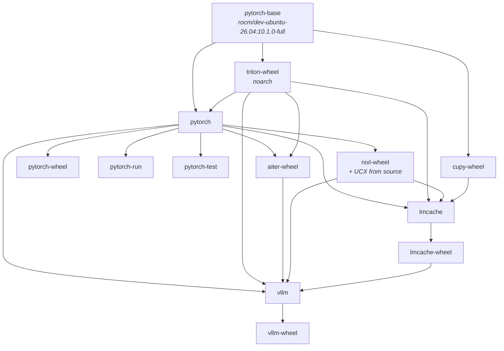

# Build graph

`rocm-bake.hcl` declares thirteen targets. Bake derives the build DAG
from the `contexts` each one names, and orders the graph itself — which
is why asking for `vllm` alone also builds `pytorch-base`,
`triton-wheel`, `pytorch`, `aiter-wheel`, `nixl-wheel`, `cupy-wheel` and
`lmcache-wheel`, in dependency order.



Four edges are worth explaining because they are not obvious from the
names.

**`triton-wheel` builds from the base, not from `pytorch`.** Triton
needs `cmake<4` while PyTorch pulls cmake 4.x, so they cannot share an
environment. That also means Triton can build in parallel with PyTorch
on another node. It is the only target with no architecture in its tag:
Triton is a compiler and publishes one noarch wheel.

**`cupy-wheel` hangs off the base too**, because CuPy has no torch
dependency. It is not optional. LMCache's multi-process server imports
cupy at module scope to build a `cupy.cuda.ExternalStream`, and no
published wheel fits this stack — PyPI's `cupy-rocm-7-0` targets a
different ROCm major, and plain `cupy` ships only an sdist. Without it
the server dies on the first request and vLLM waits five minutes before
reporting a generic engine failure.

**`vllm` consumes `lmcache-wheel`.** vLLM ships the LMCache MP
connector but imports `lmcache.utils` from it, so the wheel has to exist
first. On the scheduled path it has to be *published* first, not merely
building somewhere else.

**`lmcache` takes no AITER context.** Its extension is cache movement,
not GEMMs, and it has no AITER code path.

## Groups

| Group | Members |
| --- | --- |
| `default` | `pytorch-base`, `pytorch`, `pytorch-wheel`, `triton-wheel`, `aiter-wheel`, `cupy-wheel`, `nixl-wheel`, `vllm`, `vllm-wheel`, `lmcache`, `lmcache-wheel` |
| `wheels` | `pytorch-wheel`, `triton-wheel`, `aiter-wheel`, `nixl-wheel`, `cupy-wheel`, `vllm-wheel`, `lmcache-wheel` |
| `serving` | `cupy-wheel`, `nixl-wheel`, `vllm`, `vllm-wheel`, `lmcache`, `lmcache-wheel` |

There is no `all` group. Two targets are deliberately outside `default`:

- **`pytorch-test`** cannot run inside the build graph at all. Its stage
  exits 1 when `torch.cuda.is_available()` is false, and a BuildKit
  `RUN` step has no `/dev/kfd`. It is a verification step for a finished
  image on a real GPU (`make test` on a GPU node), and including it in
  `default` made `build-all` and `push-all` fail at the last target
  every time.
- **`pytorch-run`** is excluded because no node currently has a usable
  GPU to exercise the runtime image on, and building it every run costs
  time and a registry push for an artifact nobody can test.
  `make push-runtime` still builds it, and it belongs back in `default`
  once a GPU node is available.

## How inputs are wired

Targets take their inputs from sibling targets through `target:` named
contexts. That is bake's dependency mechanism and the only one it has.

```hcl
contexts = USE_PUB ? {} : {
  triton-wheels = "target:triton-wheel"
  base-img      = "target:pytorch-base"
}
args = {
  TRITON_WHEEL_IMAGE = USE_PUB ? PUB_TRITON : "triton-wheels"
  BASE_IMAGE         = USE_PUB ? PUB_BASE   : "base-img"
}
```

A target with no context on its inputs is, as far as bake is concerned,
independent — and may run concurrently with the thing it needs.

### `PUBLISHED_INPUTS`

Set `PUBLISHED_INPUTS=1` and every one of those contexts collapses to a
registry reference instead. The `PUB_*` locals in `rocm-bake.hcl` hold
those references, and they must track the `tags` of the target they
mirror — a change to one is a change to the other.

This is what makes cross-node scheduling possible. A `target:` context
only works within one bake invocation, so one-bake-per-node would
rebuild the whole chain on every node rather than pulling what the
previous stage just pushed.

`pytorch-run` is the exception: its context has to resolve in both
modes, so it uses a `docker-image://` reference.

!!! note
    `PUBLISHED_INPUTS` is read by bake from the environment, so it needs
    `PUBLISHED_INPUTS=1 make …`, not `make … PUBLISHED_INPUTS=1`. The
    same is true of `SCCACHE_LOG`, `RUN_ID`, `CACHE_TAG_SUFFIX` and the
    `SDE_*` overrides.

## The balancer

buildx's multi-node builder does not balance. Node selection is driven
by platform matching, and when every node advertises `linux/amd64` the
choice among them ignores capacity: all five targets once landed on
`snoc-gaming` (16 cores, 15 GB) while `snoc-think` (32 cores, 122 GB)
sat idle. There is no hook to change that, so the scheduling happens in
`.builders/balance.sh` instead — one bake invocation per target, each
pinned to a builder it picks.

```bash
make push-all BUILDER=snoc-pool       # the usual way to build everything
make push-wheels BUILDER=snoc-pool    # just the wheel artifacts
.builders/balance.sh --dry-run        # what it would schedule, and where
.builders/balance.sh --best           # the strongest node right now
```

Nodes are scored by free GB of RAM plus idle cores, weighted equally on
purpose: a cold PyTorch build runs one `cc1plus` per core and each takes
1–2 GB, so RAM is what actually bounds a big node. Nodes below
`MIN_MEM_GB` (default 8) are skipped.

Work is scheduled from the dependency graph, not from a list kept
beside it. `.builders/depgraph.py` asks bake for each target's
`contexts` — the same `target:` edges that define the build DAG — and
`balance.sh` starts a target once every dependency *inside the run* has
finished and been pushed.

```bash
.builders/depgraph.py --deps pytorch vllm-wheel
# pytorch pytorch-base triton-wheel
# vllm-wheel aiter-wheel lmcache-wheel nixl-wheel pytorch triton-wheel
```

What to build is a set, and ordering takes care of itself:

```bash
TARGETS="pytorch-wheel triton-wheel" .builders/balance.sh
```

It defaults to bake's `default` group. `make push-wheels` uses the
`wheels` group plus `pytorch` and `pytorch-base`, because every wheel
builds `FROM` one or both of those and neither is a wheel.

This replaced a hand-written `STAGE_1`..`STAGE_5`. That list was a
second copy of what `rocm-bake.hcl` already stated, and the two could
drift without anything saying so: a `gfx1250` run scheduled
`vllm-wheel` when no `gfx1250` pytorch image existed anywhere, and it
died resolving that base image at step 1 of 7, 0 s in, taking the rest
of its node's queue with it.

Three orderings the old stages asserted by hand are now edges in
`rocm-bake.hcl`, enforced by construction:

- `triton-wheel` before `pytorch` — the pytorch image installs that wheel
- `lmcache-wheel` before `vllm-wheel` — vLLM takes a `lmcache-wheel` context, and results cross nodes through Zot, so it must be *published* first
- `pytorch-base` before everything

### Preflight

Before any build starts, every image the run resolves from the registry
— minus the ones it publishes itself — is checked against Zot. A
missing input is named up front, with the make target that creates it,
instead of surfacing as a target dying at step 1 after the scheduler
has already committed work to a node.

```
depgraph: these images are needed but not published, and nothing in
this run builds them:
  …/rocm-pytorch/pytorch:2.15.0-10.1.0-full-gfx1250
      needed by: aiter-wheel, lmcache-wheel, nixl-wheel, vllm-wheel
   build it with: make push-pytorch
```

Only a 404 counts as absent. The corporate proxy answers 403 for the
tailnet unless `no_proxy` covers it, and blocking a build on that would
be wrong.

### Packing

Among the targets eligible at any moment, the longest goes to the node
that would finish it soonest, and each node runs one build at a time —
several concurrent builds on one box each derive `MAX_JOBS` from
`MemAvailable` as though they were alone, and oversubscribe it.

The packing cost model is `.builders/target-costs`, and it ranks by
which node would *finish* a target soonest rather than which is least
loaded, because this fleet's upload speeds span a factor of 25.

`--queue` is still accepted and ignored. It named the mode that
dropped stage barriers entirely, which was safe only while nothing in a
run depended on anything else in it; dependency ordering supersedes it,
and callers still passing it get the better behaviour rather than an
unknown-argument error mid-build.

### Why `build-all` refuses the pool

`make build-all BUILDER=snoc-pool` exits with an error rather than
scheduling. Scheduling makes every target its own bake invocation, so
they cannot hand results to each other through `target:` contexts —
stage 2 would build against whatever happens to be in the registry
rather than what stage 1 just produced, silently. On a single builder
the contexts resolve in-process and it is fine.

```bash
make push-all  BUILDER=snoc-pool    # scheduled, publishes
make build-all BUILDER=snoc-think   # single builder, no push
```

## `MAX_JOBS`

Left empty, each build derives its own job count from the node it lands
on, sized by `MemAvailable` rather than by core count, with a per-job
memory budget of 2 GB. Set `MAX_JOBS` to pin one.

The derivation is sampled when the *compile* step starts, by which point
the build's own earlier steps have taken memory of their own. A cold
PyTorch that settled at 21 GB available still derived 5 jobs, where the
same node gives a hot run 10 — because a hot run's early steps are all
cache hits. The derivation therefore tracks how much work precedes the
compile, which differs by scenario. That is why
[the benchmark harness](../performance/methodology.md) keys its results
by job count and can pin it.

## Telling builds apart

Every target stamps `rocm-pytorch-build/<target>/<arch>/<RUN_ID>` into
its BuildKit history record. `RUN_ID` defaults to `dev`.

The prefix is this repository's name rather than something shorter
because a sibling project builds on the same nodes, uses the same
convention, and produces images with the same names — `pytorch`,
`triton`, `aiter`. A shared prefix made its builds indistinguishable
from these in `make watch`.
