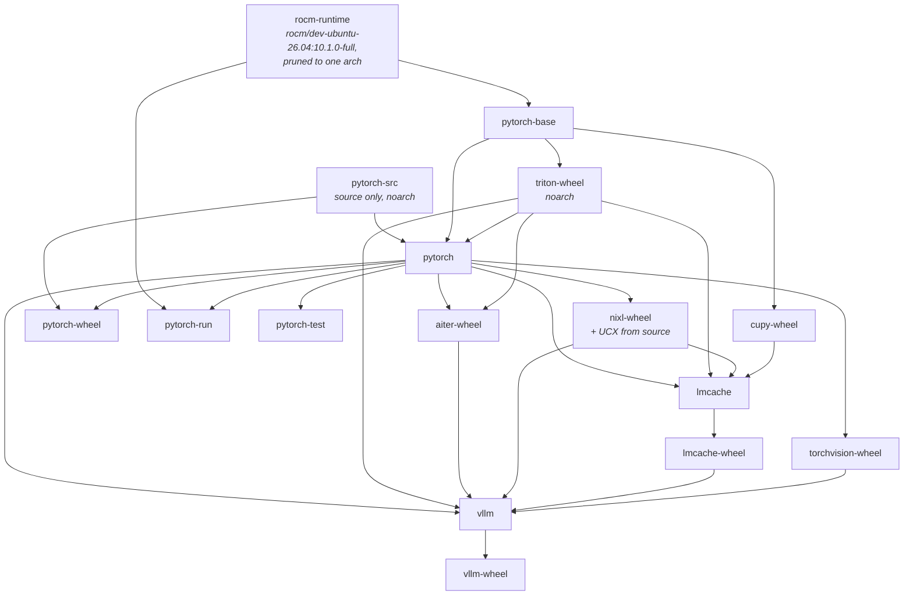

# Build Graph

`rocm-bake.hcl` declares sixteen buildable targets. Bake derives the
DAG from the `contexts` each names and orders it itself, so asking for
`vllm` alone builds everything beneath it in dependency order.



Five edges are not obvious from the names.

**`triton-wheel` builds from the base, not from `pytorch`.** Triton
needs `cmake<4` while PyTorch pulls cmake 4.x, so they cannot share an
environment — which also lets Triton build in parallel with PyTorch. It
is the only target with no architecture in its tag.

**`cupy-wheel` hangs off the base too**, because CuPy has no torch
dependency. It is not optional: LMCache's MP server imports cupy at
module scope, no published wheel fits this stack, and without it the
server dies on the first request while vLLM waits five minutes before
reporting a generic engine failure.

**`vllm` consumes `lmcache-wheel`.** vLLM ships the LMCache MP
connector but imports `lmcache.utils` from it, so the wheel must exist
first — and on the scheduled path, be *published* first.

**`lmcache` takes no AITER context**: its extension is cache movement,
not GEMMs.

**`vllm` consumes `torchvision-wheel`**, which looks like an optional
extra and is not. vLLM's build requirements pull `timm`, `timm`
requires torchvision, and `transformers`' `image_utils` imports
`torchvision.io` at module scope. PyPI publishes only CUDA builds of
it, so without this edge the serving image carries a torchvision that
cannot load on ROCm. It hangs off `pytorch` because its `setup.py`
imports torch to decide it is building for ROCm at all — which is also
why it cannot be installed into `pytorch` itself.

## Groups

| Group | Members |
| --- | --- |
| `default` | `rocm-runtime`, `pytorch-src`, `pytorch-base`, `pytorch`, `pytorch-wheel`, `triton-wheel`, `aiter-wheel`, `torchvision-wheel`, `cupy-wheel`, `nixl-wheel`, `vllm`, `vllm-wheel`, `lmcache`, `lmcache-wheel` |
| `wheels` | `pytorch-wheel`, `triton-wheel`, `aiter-wheel`, `nixl-wheel`, `torchvision-wheel`, `cupy-wheel`, `vllm-wheel`, `lmcache-wheel` |
| `serving` | `torchvision-wheel`, `cupy-wheel`, `nixl-wheel`, `vllm`, `vllm-wheel`, `lmcache`, `lmcache-wheel` |

There is no `all` group. Two targets are deliberately outside `default`:

- **`pytorch-test`** cannot run inside the build graph: its stage exits
  1 when `torch.cuda.is_available()` is false, and a BuildKit `RUN` step
  has no `/dev/kfd`. Use `make test` on a GPU node.
- **`pytorch-run`** is excluded because no node has a usable GPU to
  exercise it on. `make push-runtime` still builds it.

## How Inputs Are Wired

Targets take their inputs from siblings through `target:` named
contexts — bake's dependency mechanism, and the only one it has.

```hcl
contexts = USE_PUB ? {} : {
  triton-wheels = "target:triton-wheel"
  base-img      = "target:pytorch-base"
}
args = {
  TRITON_WHEEL_IMAGE = USE_PUB ? PUB_TRITON : "triton-wheels"
  BASE_IMAGE         = USE_PUB ? PUB_BASE   : "base-img"
}
```

A target with no context on its inputs is, as far as bake is concerned,
independent — and may run concurrently with the thing it needs.

### `PUBLISHED_INPUTS`

Set `PUBLISHED_INPUTS=1` and every one of those contexts collapses to a
registry reference; the `PUB_*` locals hold them and must track the
`tags` of the target they mirror.

This is what makes cross-node scheduling possible: a `target:` context
only works within one bake invocation, so one-bake-per-node would
rebuild the whole chain rather than pulling what the previous stage
pushed. `pytorch-run` is the exception — its context must resolve in
both modes, so it uses `docker-image://`.

!!! note
    `PUBLISHED_INPUTS` is read by bake from the environment, so it needs
    `PUBLISHED_INPUTS=1 make …`, not `make … PUBLISHED_INPUTS=1`. Same
    for `SCCACHE_LOG`, `RUN_ID`, `CACHE_TAG_SUFFIX` and the `SDE_*`
    overrides.

## The Balancer

buildx's multi-node builder does not balance: selection is by platform
match, so when every node advertises `linux/amd64` the choice ignores
capacity — all five targets once landed on `snoc-gaming` (16 cores,
15 GB) while `snoc-think` (32 cores, 122 GB) sat idle. There is no hook
to change it, so scheduling happens in `.builders/balance.sh` instead,
one bake invocation per target pinned to a builder it picks.

```bash
make push-all BUILDER=snoc-pool       # the usual way to build everything
make push-wheels BUILDER=snoc-pool    # just the wheel artifacts
.builders/balance.sh --dry-run        # what it would schedule, and where
.builders/balance.sh --best           # the strongest node right now
```

Nodes are scored by free GB of RAM plus idle cores, weighted equally on
purpose: a cold PyTorch runs one `cc1plus` per core at 1–2 GB each, so
RAM is what bounds a big node.

Work is scheduled from the dependency graph, not a list kept beside it.
`.builders/depgraph.py` asks bake for each target's `contexts`, and
`balance.sh` starts a target once every dependency *inside the run* has
finished and been pushed, so what to build is a set
(`TARGETS="pytorch-wheel triton-wheel" .builders/balance.sh`).

This replaced a hand-written `STAGE_1`..`STAGE_5` — a second copy of
what `rocm-bake.hcl` already stated, which drifted: a `gfx1250` run
scheduled `vllm-wheel` when no `gfx1250` pytorch image existed, and died
resolving it 0 s in, taking the rest of its node's queue with it.

### Preflight

Before any build starts, every image the run resolves from the registry
— minus the ones it publishes itself — is checked against Zot, so a
missing input is named up front with the make target that creates it,
rather than killing a target at step 1 after work is committed.

```
depgraph: these images are needed but not published, and nothing in
this run builds them:
  …/rocm-pytorch/pytorch:2.15.0-10.1.0-full-gfx1250
      needed by: aiter-wheel, lmcache-wheel, nixl-wheel,
                 torchvision-wheel, vllm-wheel
   build it with: make push-pytorch
```

Only a 404 counts as absent: the corporate proxy answers 403 for the
tailnet unless `no_proxy` covers it.

### Packing

Among the targets eligible at any moment, the longest goes to the node
that would finish it soonest, one build per node — several concurrent
builds on one box each derive `MAX_JOBS` from `MemAvailable` as though
alone, and oversubscribe it. The cost model is `target-costs` plus each
node's `link_mbps` from the [fleet manifest](fleet.md), ranked on
finishing soonest rather than least loaded because this fleet's upload
speeds span a factor of 25.

### Why `build-all` Refuses The Pool

`make build-all BUILDER=snoc-pool` errors rather than scheduling: every
target would be its own bake invocation, so stage 2 would silently build
against whatever is in the registry rather than what stage 1 produced.
On a single builder the contexts resolve in-process and it is fine.

```bash
make push-all  BUILDER=snoc-pool    # scheduled, publishes
make build-all BUILDER=snoc-think   # single builder, no push
```

## `MAX_JOBS`

Left empty, each build derives its job count from `MemAvailable` at
2 GB per job, sampled when the *compile* step starts — by which point
its own earlier steps have taken memory. A cold PyTorch that settled at
21 GB derived 5 jobs where the same node gives a hot run 10, which is
why [the benchmark harness](../performance/methodology.md) keys its
results by job count.

## Telling Builds Apart

Every target stamps `rocm-pytorch-build/<target>/<arch>/<RUN_ID>` into
its BuildKit history record. `RUN_ID` defaults to `dev`.

The prefix is this repository's name because a sibling project builds on
the same nodes with the same convention and the same image names, and a
shared prefix made its builds indistinguishable from these in `make
watch`.
