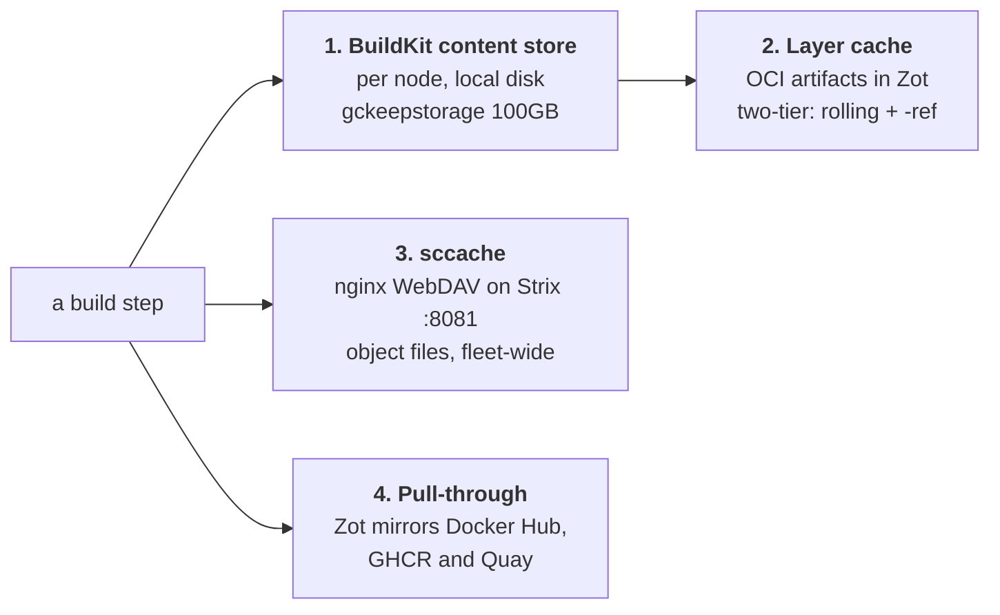

# Caching

Four caches sit between a `make build-pytorch` and a from-scratch
compile, and they are independent: a Dockerfile edit can drop layer
reuse to 5% while sccache still serves every compile, and a changed
compiler flag does the opposite.



Each is removed by a different lever, which is what the
[benchmark scenarios](../performance/index.md) are built on.

## 1. The Node's Content Store

BuildKit keeps every blob it has pulled or produced on the node's disk,
bounded by `buildkit.gc_keep_storage` in the
[fleet manifest](fleet.md). `docker buildx prune` is the only lever, and
it is shared with any other project on that node.

## 2. The Layer Cache, In Zot

Each target exports its layers as OCI artifacts to a `*-cache`
repository in Zot, so a layer built on one node is reusable from any of
them.

| Target | Cache Repository |
| --- | --- |
| `rocm-runtime` | `rocm-runtime-cache` |
| `pytorch-base` | `base-cache` |
| `pytorch`, `pytorch-wheel` | `pytorch-cache` |
| `triton-wheel` | `triton-wheel-cache` |
| `aiter-wheel` | `aiter-wheel-cache` |
| `torchvision-wheel` | `torchvision-wheel-cache` |
| `pytorch-run` | `runtime-cache` |
| `cupy-wheel` | `cupy-wheel-cache` |
| `nixl-wheel` | `nixl-wheel-cache` |
| `vllm`, `vllm-wheel` | `vllm-cache` |
| `lmcache`, `lmcache-wheel` | `lmcache-cache` |

### Two Tiers

Reads always consult two refs: the rolling tag, and a frozen `-ref`
baseline. Writes go to the rolling tag unless `CACHE_TAG_SUFFIX=-ref`
(`CACHE_TAG_SUFFIX=-ref make push-pytorch`), which is how the baseline
is deliberately refreshed. Without the second tier, one bad build
overwrites the only cache everyone reads.

### Scoped By Architecture

Image tags have carried the architecture since `ARCH_TAG` landed; the
cache refs did not. A `gfx1201` build overwrote the `gfx950` cache with
layers `gfx950` can never hit, and the next `gfx950` build rebuilt cold
and did the same back — so alternating architectures cost two cold
builds, every time. `CACHE_ARCH` scopes those refs now.

`triton-wheel` stays on the shared ref deliberately: Triton is a
compiler that publishes one noarch wheel. `pytorch-base` used to, and no
longer does — it builds FROM `rocm-runtime`, whose kernel libraries are
for one card, so one arch reading another's cache would take the wrong
ones as a hit.

!!! warning "The unqualified `base` tag is no longer written"
    `base:${ROCM_VERSION}-${PYTHON_VERSION}` was published once for the
    whole fleet and is now `...-${ARCH_TAG}`. Anything pinning the old
    form keeps resolving to the last image written under it, which gets
    staler from here. See [Build targets](../reference/build-targets.md).

Arch-sensitive targets also read the old unscoped `latest`, kept
transitionally; it goes once each architecture has been built once.

!!! warning "Cache exports fail silently"
    Every `cache-to` carries `ignore-error=true`. A registry that is
    down, full, or refusing the push does not fail the build — it just
    means the next build has nothing to read. `make builder-logs` is
    where that shows up; the build itself only looks slow next time.

```bash
make layer-summary    # per image, most recent build, with the node it ran on
make build-inspect    # one build: duration, steps, cached steps
```

## 3. The Compiler Cache

Every build container runs its own sccache server, all sharing one
object store: nginx with the WebDAV modules at
`/var/cache/sccache-webdav` on Strix, port 8081. An object compiled on
any node is a hit on the others.

```
SCCACHE_WEBDAV_ENDPOINT     http://<resolved-ip>:8081
SCCACHE_WEBDAV_KEY_PREFIX   rocm-pytorch
SCCACHE_SERVER_UDS          /tmp/sccache.sock
CMAKE_C_COMPILER_LAUNCHER   sccache
CMAKE_CXX_COMPILER_LAUNCHER sccache
CMAKE_HIP_COMPILER_LAUNCHER sccache
HIP_CLANG_LAUNCHER          /usr/local/bin/sccache
```

Off the fleet the same cache runs on S3 — `SCCACHE_BUCKET` outranks the
WebDAV endpoint, and an empty bucket name is treated as unset. See
[Building on AWS](../operations/aws.md).

Three constraints make this work, and each fails quietly if broken.

**A shared *server* is impossible.** sccache's client sends a *path*,
and the server reads and hashes the file itself — so a server on the
host cannot see a build container's sources. Only storage can be shared.

**The server is addressed over a unix socket, not a TCP port.** The
builders run with `network=host`, so a fixed port would be shared
fleet-wide: a Triton build's client once connected to a concurrent
PyTorch build's server, which could not see the files it was asked to
hash. There is deliberately no port variable.

**The store is addressed by IP, not by name** — see
[the tailnet DNS problem](index.md#why-a-tailnet). The Makefile resolves
the host once, so setting `SCCACHE_WEBDAV_ENDPOINT` yourself only
affects a bare bake.

### Refusing To Build Uncached

`docker/Dockerfile.pytorch` probes the store at image build time and
refuses to start a compile when it is unreachable, rather than spending
an hour rebuilding everything:

```bash
docker buildx bake -f rocm-bake.hcl --set '*.args.REQUIRE_SCCACHE=0' pytorch
```

The build prints `sccache --show-stats` as its last action, which is
where [the telemetry wrapper](../performance/telemetry.md) reads the
counters — they cannot be queried afterwards, since the server dies with
the build container.

### Inspecting The Store

```bash
make cache-summary    # endpoint, size, disk, deltas, hit rates
make cache-check      # can every build node reach it?
make cache-logs       # the WebDAV access log
```

`cache-summary` prints a delta and a rate as well as totals, because
"+412 objects" means something very different over eight seconds than
over an hour. The hit rate comes from the telemetry textfile, not the
store: WebDAV has no stats verb.

`SCCACHE_WEBDAV_KEY_PREFIX` is a directory in the store, so an
experiment can run against an isolated namespace and delete it
afterwards — which is what the
[benchmark harness](../performance/methodology.md) does for its frozen
and cold runs.

### Why Not Distributed Compilation

sccache has a second, separate feature:
[sccache-dist](https://github.com/mozilla/sccache/blob/main/docs/DistributedQuickstart.md),
a scheduler plus build servers that ship individual preprocessed
compile jobs to other machines. It is orthogonal to the shared store
above — a fleet would run both, not one instead of the other. We do not
run it, and the reasoning is recorded here so the question does not
have to be re-opened from scratch.

**It is not a fleet balancer, and could not replace one.** Its unit of
work is a single object file. `balance.sh` schedules *bake targets*: a
clone, apt, pip, cmake, the compile, wheel packaging, the layer export
and a registry push. Most of what it schedules around is not
compilation at all, and
[`target-costs`](https://github.com/sbates130272/rocm-bake/blob/main/.builders/target-costs)
says so in measured numbers — `pytorch-src` is 1260s of almost pure
network, `rocm-runtime` is I/O with no compiler in it, and
`torchvision-wheel` is 27s of build against 2.6 GB of export. The
export term that `balance.sh` charges against each node's `link_mbps`
is invisible to sccache-dist. Adopting it would add a scheduler beside
the one we have rather than removing it.

**On a warm build there is nothing to distribute.** Distribution only
does work on a *miss*. The best recorded nightly ran 4494 requests for
4129 hits and 116 misses — 97.3 %, measured in the
[AWS analysis](../operations/aws.md). A scheduler, build servers and a
sandbox, to parallelise 116 compiles.

**The one case where it would pay is cold.**
[Packing](build-graph.md#packing) runs one build per node, so once the
short targets drain, the nodes that finished sit idle while
`pytorch-wheel` runs alone — at 2336s against a ~5232s
total, it *is* the makespan lower bound, and no amount of target-level
packing can go below it. Splitting that one target's compiles across
the idle nodes is the only thing that breaks that floor. But it only
bites when the objects are genuinely missing: a version bump, a
compiler-flag change, a `FORCE_RECACHE` run. At the current cadence
those are the rare nights, and `--skip-cold` means most nightlies never
see one.

So the precondition for revisiting is a change in that ratio — cold or
bump builds becoming routine rather than exceptional, or a measurement
showing the cold critical path costs more than the operational price
below.

!!! warning "ROCm makes that price higher than the quickstart suggests"
    HIP compiles reach sccache through `clang.rs`, which does emit a
    distributable command — unlike `nvcc.rs`, which returns `None` and
    cannot be distributed at all. But `--hip-path` and
    `--hip-device-lib-path` are `PassThroughPath`: sccache packages the
    compiler by scanning its shared libraries, and the device bitcode
    is not a shared library. Every build server would need the
    identical ROCm tree at identical paths, matching the version pinned
    in the image — which is the one thing our containers exist to avoid
    depending on. On top of that the build servers want bubblewrap and
    run as root on bare metal, while our compiles happen inside
    BuildKit containers.

## 4. Pull-Through

`.builders/buildkitd.toml.in` points `docker.io`, `ghcr.io` and
`quay.io` at Zot, which syncs them on demand. The ROCm base image is
8.67 GB in a single layer, so this is the difference between a build
that starts in seconds and one that starts after a WAN transfer — which
is what the [frozen scenario](../performance/index.md#frozen) measures.

What each cache is worth has a measured answer rather than an estimated
one: see [Performance](../performance/index.md).
