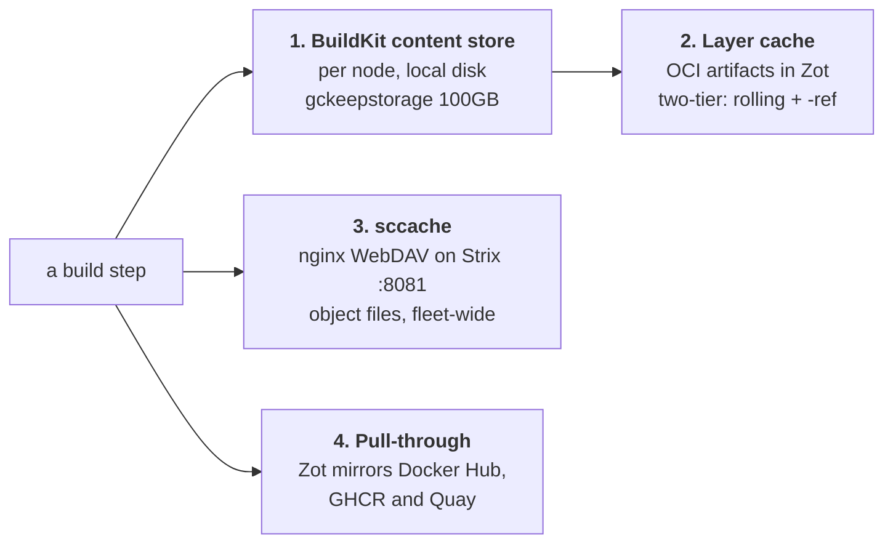

# Caching

Four caches sit between a `make build-pytorch` and a from-scratch
compile. They are independent: a Dockerfile edit can drop layer reuse to
5% while sccache still serves every compile, and a changed compiler flag
can do the opposite.



Each one is removed by a different lever, which is exactly what the
[benchmark scenarios](../performance/index.md) are built on.

## 1. The node's content store

BuildKit keeps every blob it has pulled or produced on the node's own
disk, bounded by `gckeepstorage = "100GB"` in
`.builders/buildkitd-strix.toml`. Nothing in this repository manages it;
`docker buildx prune` is the only lever, and it is shared with any other
project building on that node.

## 2. The layer cache, in Zot

Each target exports its layers as OCI artifacts to a `*-cache`
repository in Zot, so a layer built on one node is reusable from any of
them.

| Target | Cache repository |
| --- | --- |
| `pytorch-base` | `base-cache` |
| `pytorch`, `pytorch-wheel` | `pytorch-cache` |
| `triton-wheel` | `triton-wheel-cache` |
| `aiter-wheel` | `aiter-wheel-cache` |
| `pytorch-run` | `runtime-cache` |
| `cupy-wheel` | `cupy-wheel-cache` |
| `nixl-wheel` | `nixl-wheel-cache` |
| `vllm`, `vllm-wheel` | `vllm-cache` |
| `lmcache`, `lmcache-wheel` | `lmcache-cache` |

### Two tiers

Reads always consult two refs: the rolling tag, and a frozen `-ref`
baseline. Writes go to the rolling tag unless `CACHE_TAG_SUFFIX=-ref`,
which is how the baseline is deliberately refreshed.

```bash
# Refresh the known-good baseline from a build you trust
CACHE_TAG_SUFFIX=-ref make push-pytorch
```

Without the second tier, one bad build overwrites the only cache
everyone reads.

### Scoped by architecture

Image tags have carried the architecture since `ARCH_TAG` landed, but
the cache refs did not: every arch-sensitive target wrote
`<repo>-cache:latest`. A `gfx1201` build overwrote the `gfx950` cache
with layers `gfx950` can never hit, and the next `gfx950` build rebuilt
cold and did the same back — so alternating architectures cost two cold
builds, every time. `CACHE_ARCH` scopes those refs now, and
`arches-*` is safe to repeat.

`pytorch-base` and `triton-wheel` stay on the shared, unscoped ref
deliberately. Neither takes `PYTORCH_ROCM_ARCH`, Triton is a compiler
that publishes one noarch wheel, and both are built once for the whole
fleet.

Arch-sensitive targets currently read a third ref as well: the old
unscoped `latest`, kept transitionally so the pre-`CACHE_ARCH` cache is
not wasted. It is marked for deletion once each architecture in `ARCHES`
has been built at least once.

!!! warning "Cache exports fail silently"
    Every `cache-to` carries `ignore-error=true`. A registry that is
    down, full, or refusing the push does not fail the build — it just
    means the next build has nothing to read. `make builder-logs` is
    where that shows up; the build itself only looks slow next time.

Inspect reuse with:

```bash
make layer-summary    # per image, most recent build, with the node it ran on
make build-inspect    # one build: duration, steps, cached steps
```

## 3. The compiler cache

Every build container runs its own sccache server, and all of them share
one object store: nginx with the WebDAV modules serving a plain
directory tree at `/var/cache/sccache-webdav` on Strix, port 8081. An
object compiled on any node is a hit on the others.

```
SCCACHE_WEBDAV_ENDPOINT     http://<resolved-ip>:8081
SCCACHE_WEBDAV_KEY_PREFIX   rocm-pytorch
SCCACHE_SERVER_UDS          /tmp/sccache.sock
CMAKE_C_COMPILER_LAUNCHER   sccache
CMAKE_CXX_COMPILER_LAUNCHER sccache
CMAKE_HIP_COMPILER_LAUNCHER sccache
HIP_CLANG_LAUNCHER          /usr/local/bin/sccache
```

sccache intercepts compiler invocations, caches object files by a hash
of source plus flags, and returns the cached object when both match.

Three constraints make this work, and each one fails quietly if broken.

**A shared *server* is impossible.** sccache's client sends a *path*,
and the server reads and hashes the file itself. A server on the host
cannot see a build container's sources — every compile dies with
`No such file or directory`. Only the storage layer can be shared.

**The server is addressed over a unix socket, not a TCP port.** The
builders run with `network=host`, so a fixed `SCCACHE_SERVER_PORT` would
be shared fleet-wide: a Triton build's client once connected to a
concurrent PyTorch build's sccache server, which then could not see the
files it was asked to hash. `SCCACHE_SERVER_UDS=/tmp/sccache.sock`
removes the possibility. There is deliberately no `SCCACHE_SERVER_PORT`
variable in `rocm-bake.hcl`.

**The store is addressed by IP, not by name.** See
[the tailnet DNS problem](index.md#why-a-tailnet). The Makefile resolves
`SCCACHE_WEBDAV_HOST` once on the host and exports the resolved form as
`SCCACHE_WEBDAV_ENDPOINT`. A consequence worth knowing: setting
`SCCACHE_WEBDAV_ENDPOINT` yourself only takes effect for a bare bake,
because the Makefile exports its own value unconditionally.

### Refusing to build uncached

`docker/Dockerfile.pytorch` probes the store at image build time and
refuses to start a compile when it is unreachable, rather than spending
an hour rebuilding everything from scratch:

```bash
docker buildx bake -f rocm-bake.hcl --set '*.args.REQUIRE_SCCACHE=0' pytorch
```

The build prints `sccache --show-stats` as its last action, which is
where [the telemetry wrapper](../performance/telemetry.md) reads the
counters from. They cannot be queried afterwards: the sccache server
lives and dies with the build container.

### Inspecting the store

```bash
make cache-summary    # endpoint, size, disk, deltas, hit rates
make cache-check      # can every build node reach it?
make cache-logs       # the WebDAV access log
```

`cache-summary` prints a delta and a rate as well as the totals,
because totals alone say nothing about the build in front of you —
objects arriving is the number that moves while a build runs, and
"+412 objects" means something very different over eight seconds than
over an hour.

The hit rate does not come from the store. WebDAV has no stats verb, so
the store can report its size and object count and nothing else; sccache
prints `--show-stats` at the end of each build step, `telemetry/build.sh`
parses that into `rocm_build_sccache_hit_ratio`, and `cache-summary`
reads it back per target from the textfile collector.

### Isolating a run

`SCCACHE_WEBDAV_KEY_PREFIX` is a directory in the store, so a benchmark
or an experiment can run against an isolated namespace and delete it
afterwards without touching the fleet's objects. The
[benchmark harness](../performance/methodology.md) does exactly this for
its frozen and cold runs.

## 4. Pull-through

`.builders/buildkitd-strix.toml` points `docker.io`, `ghcr.io` and
`quay.io` at Zot, which syncs them on demand. The ROCm base image is
8.67 GB in a single layer, so this is the difference between a build
that starts in seconds and one that starts after a WAN transfer —
which is precisely what the
[frozen scenario](../performance/index.md#frozen) measures.

## What each one is worth

That question has a measured answer rather than an estimated one. See
[Performance](../performance/index.md).
