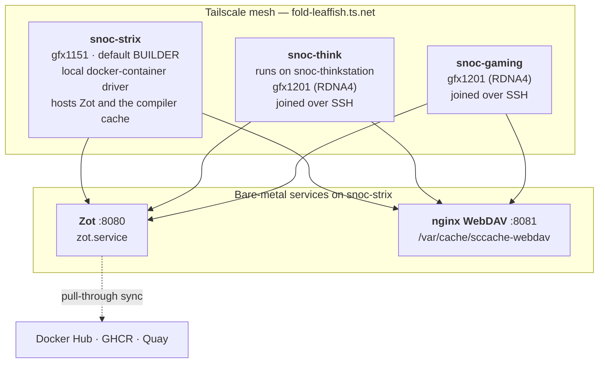

# Architecture

Three machines, one registry, one compiler-cache store, and a bake file
that describes every image as a node in a graph.

## The fleet

### Node roles

**`snoc-strix`** is the default `BUILDER` and hosts both shared
services. Its GPU is `gfx1151`; no node in the fleet has a `gfx950`
card, which is the default build target, so `make test` — the in-graph
test stage — only proves anything when `PYTORCH_ROCM_ARCH` matches the
hardware it runs on. `make gpu-test` can drive any host with a GPU and
`/dev/kfd`, which on this fleet means matching the arch to the host.

**`snoc-think`** and **`snoc-gaming`** are build capacity. They are
joined to buildx over SSH to their Docker daemons, so buildx creates and
owns a buildkit container on each: neither needs buildkitd, TLS
certificates, or the buildx plugin installed. Both are `gfx1201`
(RDNA4). They cross-compile for `gfx950` without difficulty — compiling
for an architecture does not require having one — but cannot run the
test stage.

**`snoc-pool`** is not a node. It is a sentinel: `BUILDER=snoc-pool`
routes the request through `.builders/balance.sh` instead of to a
buildx builder. A buildx multi-node builder does exist and can be
created with `make builder-snoc-pool`, but nothing is built against it
now, which is why `make watch` skips it — its build records never
update. See [the balancer](build-graph.md#the-balancer).

### Why a tailnet

The three machines are not on one LAN, and the corporate proxy must
never see tailnet traffic. Two consequences run through everything else:

- `no_proxy` has to include `.ts.net` or every proxy-aware tool fails
  against `snoc-*`. The Makefile exports it; interactive shells need it
  in a profile.
- Name resolution inside a build container is not the node's. BuildKit
  writes its own `resolv.conf` for the build sandbox and defaults it to
  a public resolver, so `.builders/buildkitd-strix.toml` carries a
  `[dns]` block listing MagicDNS first and two public resolvers after
  it. The public entries are load-bearing, not belt-and-braces: this
  tailnet has no global nameservers, so MagicDNS SERVFAILs on anything
  outside it and `apt`, `pip` and the PyTorch clone would all fail.

Even that was not enough for the compiler cache. Under load a tailnet
lookup falls through to a public resolver, which answers NXDOMAIN,
after which the search domain is appended and the query becomes
`snoc-strix.fold-leaffish.ts.net.fold-leaffish.ts.net`. That cost 79 of
361 compiles in one Triton build — objects compiled and then thrown
away. So the Makefile resolves the store's hostname to an address once,
on the host, and the build containers address it by IP. The name stays
the configuration surface; only containers see an address.

## The pieces

| Piece | What it is | Owned here? |
| --- | --- | --- |
| `rocm-bake.hcl` | The build graph: 13 targets, 3 groups, 45 variables | Yes |
| `Makefile` | A wrapper that reads every default out of `rocm-bake.hcl` | Yes |
| `docker/Dockerfile.*` | Nine Dockerfiles; the build context is always the repo root | Yes |
| `telemetry/build.sh` | Wraps a bake, emits Prometheus metrics, exits with bake's status | Yes |
| `.builders/*` | Node setup, the balancer, the benchmark harness, registry readers | Yes |
| Zot | OCI registry: images, layer cache, pull-through mirror | No — `zot.service` |
| nginx WebDAV | sccache object store | Deployed by `.builders/deploy-webdav.sh` |
| node_exporter | Scrapes the telemetry textfile on `:9100` | No |

## Single source of truth

`rocm-bake.hcl` owns every value a build reads. The Makefile does not
keep a copy of any of them: it parses the `variable` blocks at make
parse time and reads the defaults out. This matters because the two used
to disagree silently — a `make` target and a bare `docker buildx bake`
would have built different images from the same tree, and nothing would
have said so.

`.builders/check-defaults.py` enforces it in CI. It fails the build if a
bake default is re-declared in the Makefile, if the Makefile reads a
variable `rocm-bake.hcl` does not define, if `$(call bake,…)` names a
target that does not exist, or if `WHEEL_REPOS` drifts from the `wheels`
group.

The same pattern applies to the serving stack:
`serving/docker-compose.yml` owns the runtime defaults, and the Makefile
reads `${NAME:-default}` out of it.

## Read on

- [Build graph](build-graph.md) — targets, contexts, and how work is
  scheduled across nodes
- [Caching](caching.md) — the four caches and what each one buys
- [Reproducibility](reproducibility.md) — why two builds of one commit
  produce the same digest
- [Multiple GFX targets](multi-arch.md) — `ARCHES` vs
  `PYTORCH_ROCM_ARCH`, and the per-arch pip index
- [Serving stack](serving.md) — vLLM, LMCache and NIXL
