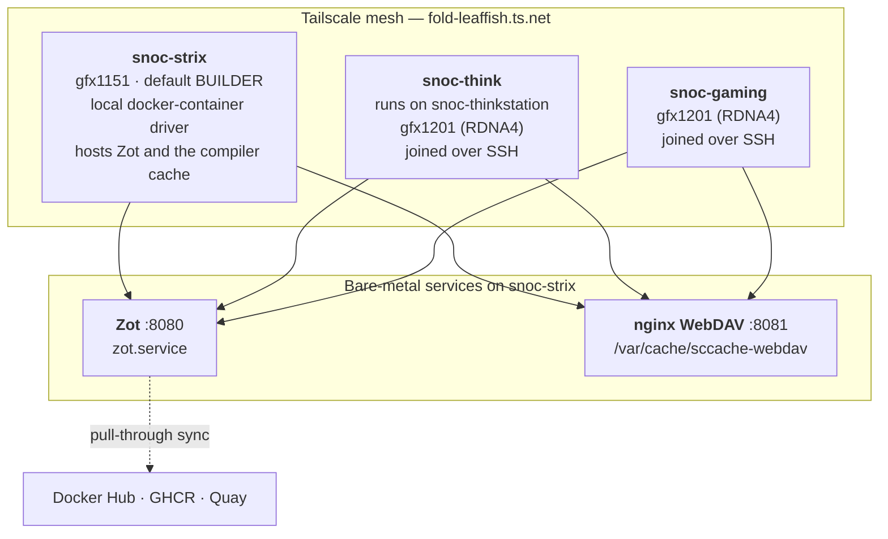

# Architecture

Three machines, one registry, one compiler-cache store, and a bake file
that describes every image as a node in a graph.

## The Fleet

### Node Roles

**`snoc-strix`** is the default `BUILDER` and hosts both shared
services. Its GPU is `gfx1151`; no node has a `gfx950` card, which is
the default build target, so `make test` only proves anything when
`PYTORCH_ROCM_ARCH` matches the hardware it runs on.

**`snoc-think`** and **`snoc-gaming`** are build capacity, joined to
buildx over SSH to their Docker daemons, so neither needs buildkitd, TLS
certificates or the plugin. Both are `gfx1201` (RDNA4) and cross-compile
for `gfx950` without difficulty, but cannot run the test stage.

**`snoc-pool`** is a sentinel, not a node: it routes through
`.builders/balance.sh` rather than to a buildx builder. See
[the balancer](build-graph.md#the-balancer).

### Why A Tailnet

The three machines are not on one LAN, and the corporate proxy must
never see tailnet traffic. Two consequences run through everything else:

- `no_proxy` has to include `.ts.net` or every proxy-aware tool fails
  against `snoc-*`. The Makefile exports it; interactive shells need it
  in a profile.
- **Name resolution inside a build container is not the node's.**
  BuildKit writes its own `resolv.conf` and defaults it to a public
  resolver, so `.builders/buildkitd.toml.in` carries a `[dns]` block
  listing MagicDNS first and two public resolvers after. The public
  entries are load-bearing: this tailnet has no global nameservers, so
  MagicDNS SERVFAILs on anything outside it and `apt`, `pip` and the
  PyTorch clone would all fail.

Even that was not enough for the compiler cache. Under load a tailnet
lookup falls through to a public resolver, which answers NXDOMAIN, the
search domain is appended, and the query becomes
`snoc-strix.fold-leaffish.ts.net.fold-leaffish.ts.net` — 79 of 361
compiles lost in one Triton build. So the Makefile resolves the store's
hostname once on the host, and build containers address it by IP.

## The Pieces

| Piece | What It Is | Owned Here? |
| --- | --- | --- |
| `rocm-bake.hcl` | The build graph: 16 targets, 3 groups, 52 variables | Yes |
| `Makefile` | A wrapper that reads every default out of `rocm-bake.hcl` | Yes |
| `docker/Dockerfile.*` | Ten Dockerfiles; the build context is always the repo root | Yes |
| `telemetry/build.sh` | Wraps a bake, emits Prometheus metrics, exits with bake's status | Yes |
| `.builders/*` | Node setup, the balancer, the benchmark harness, registry readers | Yes |
| Zot | OCI registry: images, layer cache, pull-through mirror | No — `zot.service` |
| nginx WebDAV | sccache object store | Deployed by `.builders/deploy-webdav.sh` |
| node_exporter | Scrapes the telemetry textfile on `:9100` | No |

## Single Source Of Truth

`rocm-bake.hcl` owns every value a build reads. The Makefile keeps no
copy: it parses the `variable` blocks at parse time and reads the
defaults out. The two used to disagree silently — a `make` target and a
bare `docker buildx bake` built different images from the same tree, and
nothing said so.

`.builders/check-defaults.py` enforces it in CI, failing the build if a
default is re-declared in the Makefile, if the Makefile reads a variable
that does not exist, if `$(call bake,…)` names a missing target, or if
`WHEEL_REPOS` drifts from the `wheels` group. The same pattern applies
to `serving/docker-compose.yml`, which owns the runtime defaults.

## Read On

- [The fleet](fleet.md) — the manifest every tool reads, what a node
  declares, and the Ansible that makes a machine match it
- [Build graph](build-graph.md) — targets, contexts, and how work is
  scheduled across nodes
- [Caching](caching.md) — the four caches and what each one buys
- [Reproducibility](reproducibility.md) — why two builds of one commit
  produce the same digest
- [Multiple GFX targets](multi-arch.md) — `ARCHES` vs
  `PYTORCH_ROCM_ARCH`, and the per-arch pip index
- [Serving stack](serving.md) — vLLM, LMCache and NIXL
