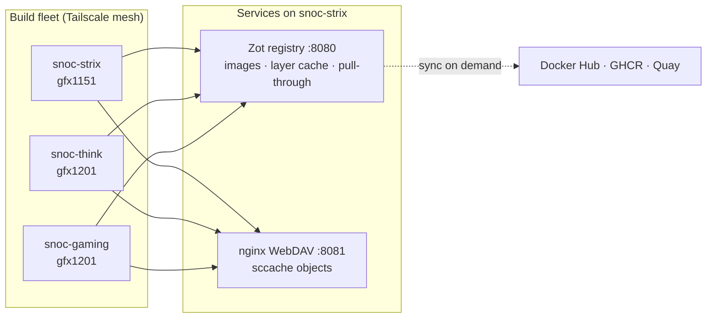

# rocm-bake

Reproducible builds of PyTorch, Triton, AITER, CuPy, NIXL, vLLM and
LMCache against ROCm, on a three-node BuildKit fleet, with every
artifact published to a local OCI registry.

The build is one `docker buildx bake` file and one Makefile. Everything
else exists to make that build fast, repeatable and measurable.

## What It Builds

PyTorch from source against ROCm, with Triton, AITER, CuPy, NIXL, vLLM
and LMCache on top, for `gfx950` (default), `gfx1201` and `gfx1250`.

Every pinned version is on the
[bake variables](reference/bake-variables.md) page, generated from
`rocm-bake.hcl` — the single source for every value a build reads.
`make list-vars` prints what is in effect; `make version-check`
compares it against upstream and against the published wheels.

## Live Reports

Two lanes publish measurements continuously. They are **not**
comparable with each other — see [Live reports](reports.md).

-   __[Fleet Runs ↗](https://sbates130272.github.io/rocm-bake/data/perf/)__

    Every wheel across all three SNOC nodes at once, instrumented.
    Newest run, with a selector for every earlier one. The same chart
    serves a run still in flight — `make perf-serve`.

-   __[Nightly Builds ↗](https://sbates130272.github.io/rocm-bake/data/nightly/)__

    One warm bake per architecture on AWS CodeBuild, 02:17 UTC,
    published to ECR.

## Where To Start

-   __Build Something__

    The [quick start](quickstart.md) takes a fresh node from nothing to
    a published PyTorch image.

-   __Understand The Pipeline__

    [Architecture](architecture/index.md) covers the fleet, the build
    graph, and the four caches that make a rebuild cheap.

-   __See What It Costs__

    [Performance](performance/index.md) tracks build time under four
    cache conditions — frozen, cold, warm and hot.

-   __Look Something Up__

    [Reference](reference/make-targets.md) has the make targets, the
    bake variables and the published image tags.

## The Shape Of It

Both services run on `snoc-strix` as bare-metal systemd units, deployed
and owned outside this repository. The build targets inspect them and
never start, stop or configure them.

A second lane builds on AWS CodeBuild each night — no fleet, no
instances to own, $13.94 a run. See [Building on AWS](operations/aws.md).

## Conventions

Commands run from the repository root on `snoc-strix` unless stated
otherwise. `make help` lists every target; targets marked `*` build and
push to the registry, which needs the `ci` login.

The repository is at
[sbates130272/rocm-bake](https://github.com/sbates130272/rocm-bake) and
is MIT licensed.
