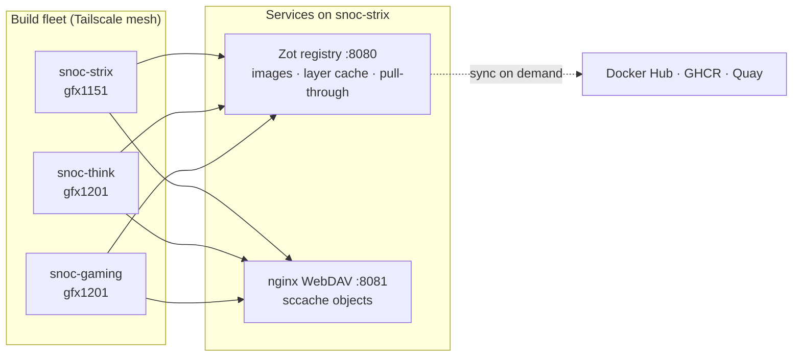

# rocm-bake

Reproducible builds of PyTorch, Triton, AITER, CuPy, NIXL, vLLM and
LMCache against ROCm, on a three-node BuildKit fleet, with every
artifact published to a local OCI registry.

The build is one `docker buildx bake` file and one Makefile. Everything
else in the repository exists to make that build fast, repeatable, and
measurable.

## What it builds

PyTorch compiled from source against ROCm, with Triton, AITER, CuPy,
NIXL, vLLM and LMCache on top, for `gfx950` (default), `gfx1201` and
`gfx1250`.

Every pinned version is on the
[bake variables](reference/bake-variables.md) page, generated from
`rocm-bake.hcl` — the single source for every value a build reads.
`make list-vars` prints what is actually in effect, and
`make version-check` compares it against the latest upstream releases
and against the wheels published in the registry.

## Where to start

-   __Build something__

    The [quick start](quickstart.md) takes a fresh node from nothing to
    a published PyTorch image.

-   __Understand the pipeline__

    [Architecture](architecture/index.md) covers the fleet, the build
    graph, and the four caches that make a rebuild cheap.

-   __See what it costs__

    [Performance](performance/index.md) tracks build time under four
    cache conditions — frozen, cold, warm and hot — with the measured
    numbers.

-   __Look something up__

    [Reference](reference/make-targets.md) has the make targets, the
    bake variables and the published image tags.

## The shape of it

Both services run on `snoc-strix` as bare-metal systemd units, deployed
and owned outside this repository. The build targets inspect them and
never start, stop or configure them.

## Conventions in this documentation

Commands are run from the repository root on `snoc-strix` unless stated
otherwise. `make help` lists every target; targets marked `*` build and
push to the registry, which needs the `ci` login.

The repository is at
[sbates130272/rocm-bake](https://github.com/sbates130272/rocm-bake) and
is MIT licensed.
