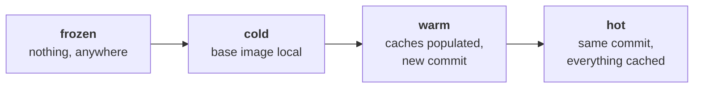

# Build Performance

Two harnesses, answering different questions.

**This page** is `bench.sh`: one target at a time, four cache
conditions, an isolated compiler cache. It answers *what does this
target cost*, and its numbers are comparable run to run.

**[Instrumented fleet runs](perf-runs.md)** is `make perf-cold`: every
wheel at once, across all three nodes, with CPU, cache and registry
traffic sampled throughout. It answers *what does a full cold build look
like*, and its numbers are throughput under contention.

A third lane, the [nightly on AWS](../operations/aws.md), times two bake
invocations on one rented machine. Do not quote a number from any of
them as if it came from another.

## The Four Cache Conditions

Measured rather than estimated. They nest: each is the one below it with
a further cache taken away.



## The Scenarios

### Frozen

Cold, **and** Zot holds no pull-through copy of the upstream base image
either, so its layers egress from Docker Hub. The ROCm base is a single
8.67 GB layer, so the difference between frozen and cold is essentially
WAN bandwidth — the number to quote when someone asks what the local
registry is worth.

```bash
make bench BENCH_SCENARIO=frozen BUILDER=snoc-think
```

!!! warning "frozen is destructive and is not in the nightly rotation"
    It deletes Zot's cached manifest for the upstream base and runs
    `docker buildx prune -af` on the target node, emptying that node's
    content store including any other project's layers.
    `BENCH_FROZEN_PRUNE=0` skips the prune. If Zot refuses the delete,
    the run is shown as `frozen*` and excluded from every published
    ratio rather than averaged in.

### Cold

No layer cache, no compiler cache, but the base image is resident in
Zot. What a new build node, or a changed base image, costs. The upper
bound on compile cost.

`--no-cache` alone is **not** cold: sccache would still serve every
object from the shared store and the build would finish in minutes while
measuring nothing. The harness also sets `FORCE_RECACHE` and isolates
the run under its own `SCCACHE_WEBDAV_KEY_PREFIX`.

```bash
make bench BENCH_SCENARIO=cold
make build-cold COLD_TARGET=pytorch   # the same conditions, outside the harness
```

### Warm

Layer and compiler caches are populated, but `SOURCE_DATE_EPOCH` moved —
which is what every new commit does. The case that matters day to day.

Under the current design that costs nothing, and **the result is the
assertion rather than the number**: if warm ever diverges from hot, some
per-commit value has found its way back into an image digest. That has
happened twice. See
[Reproducibility](../architecture/reproducibility.md).

### Hot

Same commit, everything cached. The lower bound, and mostly a check that
the caches are read at all. The harness distinguishes two kinds when it
computes ratios: one where the compile ran and sccache served every
object, and one where BuildKit skipped the step outright.

## Measured Results

<p id="bench-generated"></p>

<div class="bench-chart" markdown="0">
  <canvas id="bench-bars"></canvas>
</div>

<div id="bench-summary"></div>

Medians, keyed by target, builder, **architecture** and job count. Both
architecture and job count are in the key because both are dominant
variables: the same cold PyTorch is 6892 s at 5 jobs and 2342 s at 32,
and vLLM's kernel prebuild is about 50 minutes on `gfx950` against hours
on `gfx1201`. Cold on one architecture over hot on another is not a
ratio. See [Methodology](methodology.md).

### Every Run

<div class="bench-chart" markdown="0">
  <canvas id="bench-history"></canvas>
</div>

Each point is one build. The spread is real and large — PyTorch's hot
time varies about threefold run to run — which is why the tables above
quote medians and print `n` beside them.

## Reproducing This

```bash
make bench BENCH_SCENARIO=cold BUILDER=snoc-think   # one scenario
make bench BENCH_SCENARIO=all                       # cold, warm, hot
make bench BENCH_SCENARIO=everything                # and frozen first
make bench-report                                   # render as markdown
```

The harness refuses to run while a real build is in flight on the target
builder — two builds on one node contend for cores and memory. It exits
0 rather than failing, so it is safe to drive from cron. Results
accumulate as JSON lines in `/var/tmp/rocm-bench/results.jsonl`.

## Publishing

The numbers on this page come from a file on the `gh-pages` branch, not
from the repository. Nothing in `main` carries benchmark data.

```bash
make bench-data              # aggregate into dist/bench/bench.json
make bench-publish PUSH=1    # commit it onto gh-pages and push
make perf-publish PUSH=1     # the newest instrumented fleet run
```

Instrumented fleet runs land at
**[data/perf/](https://sbates130272.github.io/rocm-bake/data/perf/)**,
which opens on the newest run and offers every published run in a
selector; each run keeps a permalink of the form `data/perf/<stamp>/`.
The nightly lands at
**[data/nightly/](https://sbates130272.github.io/rocm-bake/data/nightly/)**,
written by CI rather than from a build node.

Those links point at the selector root rather than a stamp, which is
correct for exactly one run, and they are absolute because `data/` lives
on `gh-pages` and never in the docs source — a relative link would be a
broken internal link to `mkdocs --strict`.

Perf runs publish from a build node because that is the only place the
data exists. The docs workflow preserves `data/` when it deploys.
