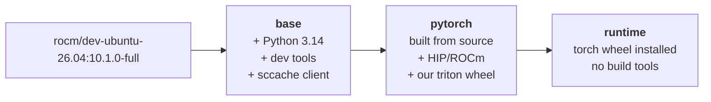

# Build targets and tags

Thirteen targets. Every published repository is under
`snoc-strix.fold-leaffish.ts.net:8080/rocm-pytorch/`, elided below.

Each target emits **three** tags: a versioned one, `:latest`, and an
immutable `-g<sha>` tag whenever `VCS_REF` is non-empty.

| Target | Repository | Versioned tag |
| --- | --- | --- |
| `pytorch-base` | `base` | `${ROCM_VERSION}-${PYTHON_VERSION}` |
| `pytorch` | `pytorch` | `${PYTORCH_VERSION}-${ROCM_VERSION}-${ARCH}` |
| `pytorch-wheel` | `pytorch-wheel` | `${PYTORCH_VERSION}-${ROCM_VERSION}-${ARCH}` |
| `pytorch-run` | `runtime` | `${PYTORCH_VERSION}-${ROCM_VERSION}-${ARCH}` |
| `pytorch-test` | `pytorch` | `${PYTORCH_VERSION}-${ROCM_VERSION}-${ARCH}-test` |
| `triton-wheel` | `triton-wheel` | `${TRITON_VERSION}-${ROCM_VERSION}` |
| `aiter-wheel` | `aiter-wheel` | `${PYTORCH_VERSION}-${ROCM_VERSION}-${ARCH}` |
| `cupy-wheel` | `cupy-wheel` | `${CUPY_REF}-${ROCM_VERSION}-${ARCH}` |
| `nixl-wheel` | `nixl-wheel` | `${NIXL_REF}-${ROCM_VERSION}-${ARCH}` |
| `vllm` | `vllm` | `${VLLM_REF}-${ROCM_VERSION}-${ARCH}` |
| `vllm-wheel` | `vllm-wheel` | `${VLLM_REF}-${ROCM_VERSION}-${ARCH}` |
| `lmcache` | `lmcache` | `${LMCACHE_REF}-${ROCM_VERSION}-${ARCH}` |
| `lmcache-wheel` | `lmcache-wheel` | `${LMCACHE_REF}-${ROCM_VERSION}-${ARCH}` |

With the current defaults that resolves to:

```
base:10.1.0-full-3.14
pytorch:2.14.1-10.1.0-full-gfx950
pytorch-wheel:2.14.1-10.1.0-full-gfx950
runtime:2.14.1-10.1.0-full-gfx950
triton-wheel:3.8.0-10.1.0-full
aiter-wheel:2.14.1-10.1.0-full-gfx950
cupy-wheel:v14.2.0-10.1.0-full-gfx950
nixl-wheel:v1.5.1-10.1.0-full-gfx950
vllm:v0.32.0-10.1.0-full-gfx950
vllm-wheel:v0.32.0-10.1.0-full-gfx950
lmcache:v0.5.6-10.1.0-full-gfx950
lmcache-wheel:v0.5.6-10.1.0-full-gfx950
```

`make zot-tags REPO=rocm-pytorch/pytorch` lists what is actually
published.

## Two tags that are not what you would guess

**`triton-wheel` carries no architecture and is version-prefixed.**
Triton is a compiler and publishes one noarch wheel, so the tag is
`3.8.0-10.1.0-full`, not `10.1.0-full-gfx950`. `wheelhouse.py` parses it
without a gfx component for the same reason.

**`pytorch-run` publishes to `runtime`, with the architecture.** It
takes no `PYTORCH_ROCM_ARCH` argument — it compiles nothing — but it
`COPY`s the torch wheel out of `pytorch`, so what it ships is as
architecture-specific as that wheel is. Without the architecture in the
tag a `gfx1201` runtime overwrote the `gfx950` one and only the digest
told them apart.

## Groups

| Group | Members |
| --- | --- |
| `default` | `pytorch-base`, `pytorch`, `pytorch-wheel`, `triton-wheel`, `aiter-wheel`, `cupy-wheel`, `nixl-wheel`, `vllm`, `vllm-wheel`, `lmcache`, `lmcache-wheel` |
| `wheels` | `pytorch-wheel`, `triton-wheel`, `aiter-wheel`, `nixl-wheel`, `cupy-wheel`, `vllm-wheel`, `lmcache-wheel` |
| `serving` | `cupy-wheel`, `nixl-wheel`, `vllm`, `vllm-wheel`, `lmcache`, `lmcache-wheel` |

There is no `all` group. `pytorch-test` and `pytorch-run` are
deliberately outside `default` —
[why](../architecture/build-graph.md#groups).

`wheels` is separate because each of its members builds `FROM` an image
that must already be published, so the group cannot run against a cold
registry.

`WHEEL_REPOS` in the Makefile must match the `wheels` group;
`check-defaults.py` fails CI if it drifts.

## Dockerfiles

Every Dockerfile lives in `docker/`, and the build context is always the
repository root, so `rocm-bake.hcl` names them as
`docker/Dockerfile.<image>`.

| File | Produces |
| --- | --- |
| `Dockerfile.base` | `pytorch-base` |
| `Dockerfile.pytorch` | `pytorch`, `pytorch-wheel`, `pytorch-test` |
| `Dockerfile.runtime` | `pytorch-run` |
| `Dockerfile.triton` | `triton-wheel` |
| `Dockerfile.aiter` | `aiter-wheel` |
| `Dockerfile.cupy` | `cupy-wheel` |
| `Dockerfile.nixl` | `nixl-wheel` |
| `Dockerfile.vllm` | `vllm`, `vllm-wheel` |
| `Dockerfile.lmcache` | `lmcache`, `lmcache-wheel` |

A wheel target is the same Dockerfile built to its `wheel` stage, which
is why `pytorch-wheel` inherits from `pytorch`, `vllm-wheel` from
`vllm`, and `lmcache-wheel` from `lmcache`.

## Image lifecycle



## Cache repositories

Each target exports its layers to a `*-cache` repository, listed in
[Caching](../architecture/caching.md#2-the-layer-cache-in-zot). Note
that `make clean-cache` only removes `base-cache`, `pytorch-cache`,
`runtime-cache` and `cache` locally — it does not cover the other six
repositories, and the registry itself must be pruned separately.
