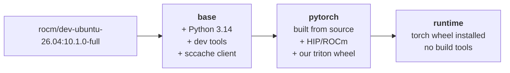

# Build Targets And Tags

Eighteen targets. Every published repository is under
`snoc-strix.fold-leaffish.ts.net:8080/rocm-pytorch/`, elided below.

Each target emits **three** tags: a versioned one, `:latest`, and an
immutable `-g<sha>` tag whenever `VCS_REF` is non-empty.

| Target | Repository | Versioned tag |
| --- | --- | --- |
| `rocm-runtime` | `rocm-runtime` | `${ROCM_VERSION}-${ARCH}` |
| `pytorch-src` | `pytorch-src` | `${PYTORCH_VERSION}` (no arch, no ROCm) |
| `pytorch-base` | `base` | `${ROCM_VERSION}-${PYTHON_VERSION}-${ARCH}` |
| `pytorch` | `pytorch` | `${PYTORCH_VERSION}-${ROCM_VERSION}-${ARCH}` |
| `pytorch-wheel` | `pytorch-wheel` | `${PYTORCH_VERSION}-${ROCM_VERSION}-${ARCH}` |
| `pytorch-run` | `runtime` | `${PYTORCH_VERSION}-${ROCM_VERSION}-${ARCH}` |
| `pytorch-test` | `pytorch` | `${PYTORCH_VERSION}-${ROCM_VERSION}-${ARCH}-test` |
| `triton-wheel` | `triton-wheel` | `${TRITON_VERSION}-${ROCM_VERSION}` |
| `aiter-wheel` | `aiter-wheel` | `${PYTORCH_VERSION}-${ROCM_VERSION}-${ARCH}` |
| `torchvision-wheel` | `torchvision-wheel` | `${TORCHVISION_REF}-${ROCM_VERSION}-${ARCH}` |
| `cupy-wheel` | `cupy-wheel` | `${CUPY_REF}-${ROCM_VERSION}-${ARCH}` |
| `nixl-wheel` | `nixl-wheel` | `${NIXL_REF}-${ROCM_VERSION}-${ARCH}` |
| `vllm` | `vllm` | `${VLLM_REF}-${ROCM_VERSION}-${ARCH}` |
| `vllm-wheel` | `vllm-wheel` | `${VLLM_REF}-${ROCM_VERSION}-${ARCH}` |
| `lmcache` | `lmcache` | `${LMCACHE_REF}-${ROCM_VERSION}-${ARCH}` |
| `lmcache-wheel` | `lmcache-wheel` | `${LMCACHE_REF}-${ROCM_VERSION}-${ARCH}` |
| `vllm-emu` | `vllm-emu` | `${VLLM_REF}-emu` (no arch, no ROCm) |
| `vllm-emu-wheel` | `vllm-emu-wheel` | `${VLLM_REF}-emu` (no arch, no ROCm) |

The last two carry no `${ARCH}` because they contain no device code:
one wheel serves every card, from a profile pack rather than a GPU.
See [Emulated Serving](../architecture/emulation.md). `pytorch-src` and
`triton-wheel` drop the arch for their own reasons — a source tree and
a compiler, respectively.

With the current defaults that resolves to:

```
rocm-runtime:10.1.0-full-gfx950
base:10.1.0-full-3.14-gfx950
pytorch-src:2.15.0
pytorch:2.15.0-10.1.0-full-gfx950
pytorch-wheel:2.15.0-10.1.0-full-gfx950
runtime:2.15.0-10.1.0-full-gfx950
triton-wheel:3.9.0-10.1.0-full
aiter-wheel:2.15.0-10.1.0-full-gfx950
torchvision-wheel:v0.29.2-10.1.0-full-gfx950
cupy-wheel:v14.2.0-10.1.0-full-gfx950
nixl-wheel:v1.5.2-10.1.0-full-gfx950
vllm:v0.33.0-10.1.0-full-gfx950
vllm-wheel:v0.33.0-10.1.0-full-gfx950
vllm-emu:v0.33.0-emu
vllm-emu-wheel:v0.33.0-emu
lmcache:v0.5.7-10.1.0-full-gfx950
lmcache-wheel:v0.5.7-10.1.0-full-gfx950
```

`make zot-tags REPO=rocm-pytorch/pytorch` lists what is actually
published.

## Three Tags That Are Not What You Would Guess

**`triton-wheel` carries no architecture and is version-prefixed.**
Triton is a compiler and publishes one noarch wheel, so the tag is
`3.9.0-10.1.0-full`. `wheelhouse.py` parses it without a gfx component.

**`pytorch-run` publishes to `runtime`, with the architecture.** It
compiles nothing and takes no `PYTORCH_ROCM_ARCH`, but it `COPY`s the
torch wheel out of `pytorch`, so what it ships is as
architecture-specific as that wheel. Without the architecture in the tag
a `gfx1201` runtime overwrote the `gfx950` one.

**`base` carries the architecture now, and did not used to.** It builds
FROM `rocm-runtime`, which holds kernel libraries for one card only, so
the apt and pip layers on top are architecture-independent while what is
underneath them is not. Without the architecture in the tag a `gfx950`
base would overwrite a `gfx1201` one exactly as `runtime` once did.

## Groups

| Group | Members |
| --- | --- |
| `default` | `rocm-runtime`, `pytorch-src`, `pytorch-base`, `pytorch`, `pytorch-wheel`, `triton-wheel`, `aiter-wheel`, `torchvision-wheel`, `cupy-wheel`, `nixl-wheel`, `vllm`, `vllm-wheel`, `lmcache`, `lmcache-wheel` |
| `wheels` | `pytorch-wheel`, `triton-wheel`, `aiter-wheel`, `nixl-wheel`, `torchvision-wheel`, `cupy-wheel`, `vllm-wheel`, `lmcache-wheel` |
| `serving` | `torchvision-wheel`, `cupy-wheel`, `nixl-wheel`, `vllm`, `vllm-wheel`, `lmcache`, `lmcache-wheel` |

There is no `all` group. `pytorch-test` and `pytorch-run` are
deliberately outside `default` —
[why](../architecture/build-graph.md#groups). `wheels` is separate
because each of its members builds `FROM` an image that must already be
published, so the group cannot run against a cold registry.
`WHEEL_REPOS` in the Makefile must match it; `check-defaults.py` fails
CI if it drifts.

## Dockerfiles

Every Dockerfile lives in `docker/`, and the build context is always the
repository root.

| File | Produces |
| --- | --- |
| `Dockerfile.base` | `pytorch-base` |
| `Dockerfile.pytorch` | `pytorch`, `pytorch-wheel`, `pytorch-test` |
| `Dockerfile.runtime` | `pytorch-run` |
| `Dockerfile.triton` | `triton-wheel` |
| `Dockerfile.aiter` | `aiter-wheel` |
| `Dockerfile.torchvision` | `torchvision-wheel` |
| `Dockerfile.cupy` | `cupy-wheel` |
| `Dockerfile.nixl` | `nixl-wheel` |
| `Dockerfile.vllm` | `vllm`, `vllm-wheel` |
| `Dockerfile.lmcache` | `lmcache`, `lmcache-wheel` |

A wheel target is the same Dockerfile built to its `wheel` stage, which
is why each `*-wheel` inherits from its image target.

## Image Lifecycle



## Cache Repositories

Each target exports its layers to a `*-cache` repository, listed in
[Caching](../architecture/caching.md#2-the-layer-cache-in-zot). `make
clean-cache` removes only four of them, locally; the registry must be
pruned separately.
